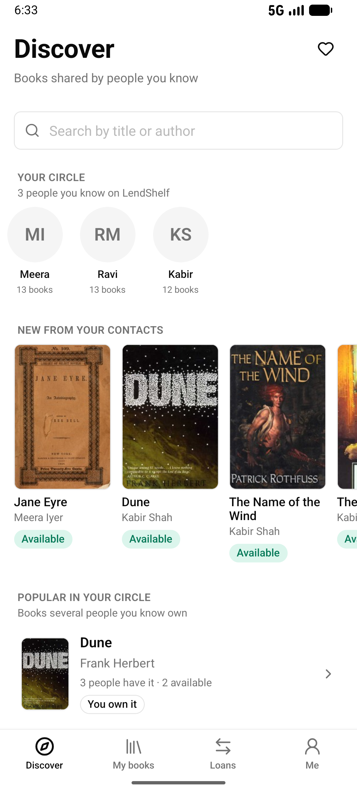

# Morning handoff — LendShelf v1

The app is built, tested and running locally on the Firebase emulators. It works on web and on the Android emulator. Nothing is deployed, and no real Firebase, Expo or Apple accounts were created or used.

## What's running right now

| Thing | Where | Notes |
|---|---|---|
| Firebase emulators | Emulator UI at http://127.0.0.1:4000 | Seeded demo data, plus changes made during QA |
| Web app (dev) | http://127.0.0.1:8081 | Sign in with 9000000001 (Asha) … 9000000005 (Zoya), then **Use code from emulator** |
| Android emulator | `Medium_Phone_API_37.0` window | The demo APK is installed and signed in as Asha |
| Demo APK | `dist-apk/lendshelf-emulator-demo.apk` | x86_64, emulator mode, JS bundled, not committed |

If anything has stopped, see README → *Run it locally*. For a clean dataset, run `npm run seed` while the emulators are up. It wipes and recreates the demo data.

## What was verified

| Area | How | Result |
|---|---|---|
| Backend: rules, 15 callables, triggers, maintenance | 169 tests (unit, rules, integration) against emulators | Pass |
| App logic | 208 Jest tests, strict TypeScript, ESLint | Pass |
| Every v1 flow, end to end | A QA agent drove the web build as 5 users (12 flows: borrow → accept → return, one-way visibility, private collections, add by search/ISBN/hand, owner actions, lend to non-app person, reviews, wishlist push, export, delete account) | All pass; 6 bugs found and fixed |
| Security and code review | An independent reviewer read the whole codebase | 1 critical, 2 high and 8 medium issues; all fixed except where noted below |
| Native Android | Debug and release builds on the API 37 emulator: sign-in, Discover, Book, Copy, My books, Loans, Me | Works |

## Not verified yet

- **iOS**: no Mac here, so nothing was built for iOS.
- **Real phone sign-in**: needs a real Firebase project (Play Integrity / reCAPTCHA, APNs).
- **Camera barcode scanning, photo upload and real push notifications** on a device. Push also needs `eas init` first; until then registration is skipped.
- **Real address-book sync** (the emulator has no contacts).
- **ARM builds** for real Android phones (only x86_64 was built).
- The Loans-tab dev-mode crash fix (src/features/loans/segmented.tsx) passed typecheck and tests but wasn't re-run in an Android debug build. Release builds never had the crash.

## What you need to do to put it on phones

See README → *Going live* for the steps. In short:

1. Create a Firebase project on the Blaze plan. Enable Phone auth, Firestore (`asia-south1`) and Storage. Add Android and iOS apps (`com.lendshelf.app`), then replace `google-services.json` and `GoogleService-Info.plist`.
2. Deploy the rules, indexes and functions.
3. Run `npx eas-cli init`, then build an APK (`eas build -p android --profile preview`) and an iOS build for TestFlight.

## Decisions I made while you slept

All of them are in [DECISIONS.md](DECISIONS.md) (37 rows). The ones you might want to revisit:

- The name **LendShelf** and the app id `com.lendshelf.app`.
- `syncContacts` is limited to 20 calls per user per day, to slow down number probing.
- Pushes about a loan the owner recorded reach the borrower only if the borrower has the owner saved.
- Borrow requests expire after 7 days. The default due date is 3 weeks; due dates can be up to 1 year out.
- Reminders are sent the day before a book is due, then on the first overdue day, then weekly.
- Offline data is not cleared on sign-out (DECISIONS row 29 explains why).

## Housekeeping

- An empty folder `D:\tmp-jdk` was left behind by the backend build. A safety rule stopped me deleting it; you can remove it.
- Building Android on Windows needs a newer CMake/ninja than the SDK default (README → *Android build*).
- A one-time scheduled task, "Resume LendShelf overnight build", was set as a safety net in case the usage limit was hit. It checks `PROGRESS.md` and exits when the status is `DONE`.
