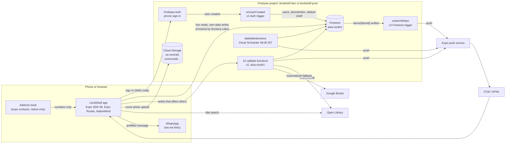
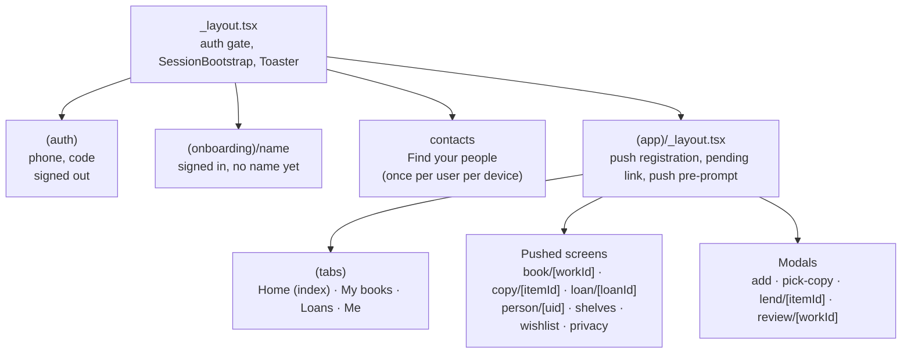
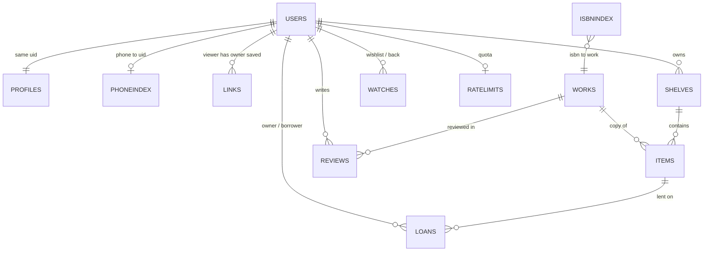
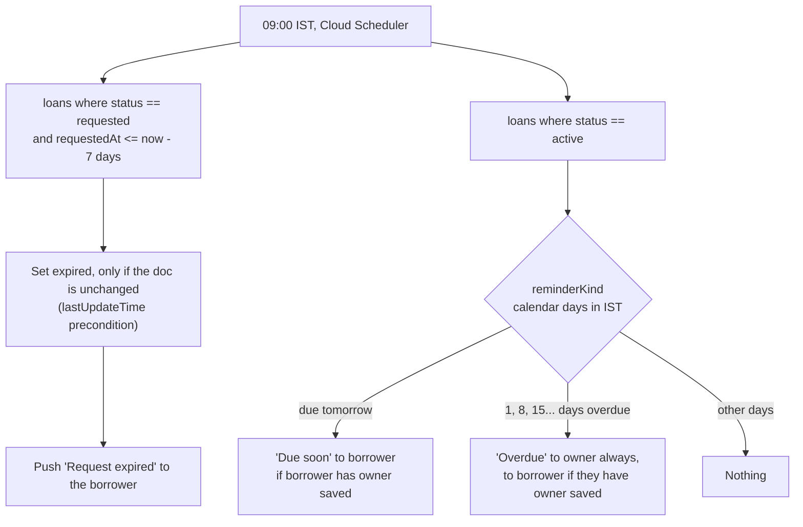
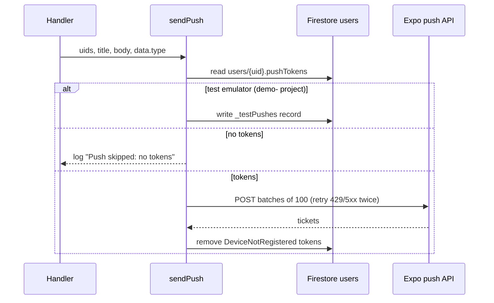
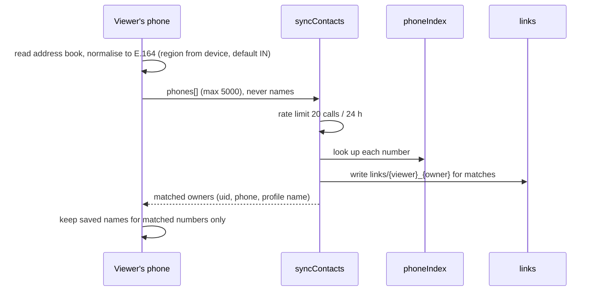

# LendShelf architecture

LendShelf is one Expo app (Android, iOS and a development-only web build) that reads Firestore directly under security rules and sends every write that touches another person through callable Cloud Functions. A Firestore trigger, a 1st-gen Auth trigger and one daily scheduled job handle the rest, and pushes go out through the Expo push service. Conversations happen in WhatsApp through `wa.me` links, and book details come from Open Library and Google Books.

Related pages: [CORE-LOGIC.md](CORE-LOGIC.md) (the rules the app follows), [DECISIONS-AND-ASSUMPTIONS.md](DECISIONS-AND-ASSUMPTIONS.md), [USER-FLOWS.md](USER-FLOWS.md), [FEATURE-MAP.md](FEATURE-MAP.md), [TEST-MAP.md](TEST-MAP.md).

Where an older document disagrees with the code, this page follows the code and says so. The list of those differences is at the end of [DECISIONS-AND-ASSUMPTIONS.md](DECISIONS-AND-ASSUMPTIONS.md#older-docs-that-disagree-with-the-code).

## 1. System diagram

| Part | What it does | Where |
|---|---|---|
| App | All screens; reads Firestore live; writes the user's own copies, shelves, reviews, watches and custom books | [src/](../../src) |
| Firebase Auth | Phone number + SMS code; the phone number is the identity | [src/lib/firebase](../../src/lib/firebase) |
| Firestore | All data; rules decide every client read and write | [firestore.rules](../../firestore.rules) |
| Callable functions | Loans, contact matching, book lookup, shelf visibility, push tokens, account deletion | [functions/src/handlers](../../functions/src/handlers) |
| `onItemWritten` | Wishlist pushes; cancels requests on a deleted copy | [triggers.ts](../../functions/src/handlers/triggers.ts) |
| `onUserCreated` | Creates `users/{uid}`, `phoneIndex/{phone}` and the default shelf | [account.ts](../../functions/src/handlers/account.ts#L26) |
| `dailyMaintenance` | Expires old requests; sends due-soon and overdue reminders | [maintenance.ts](../../functions/src/handlers/maintenance.ts) |
| Cloud Storage | Cover photos for books added by hand | [storage.rules](../../storage.rules) |
| Expo push service | One token type for Android and iOS; forwards to FCM and APNs | [functions/src/lib/push.ts](../../functions/src/lib/push.ts) |
| WhatsApp | All conversation; the app only builds `https://wa.me/<digits>?text=...` links | [src/lib/whatsapp.ts](../../src/lib/whatsapp.ts) |
| Open Library, Google Books | Book records and covers | [functions/src/lib/books.ts](../../functions/src/lib/books.ts), [src/features/discover/catalogue.ts](../../src/features/discover/catalogue.ts) |

## 2. Client structure

### 2.1 Routing tree (`src/app`)

Expo Router builds the navigation from the folder tree. The root layout is an auth gate built from `Stack.Protected` groups ([_layout.tsx](../../src/app/_layout.tsx#L64)).

| Session status | Screens allowed | Decided by |
|---|---|---|
| `loading` | Spinner (splash stays up) | [session.ts](../../src/stores/session.ts#L81) |
| `signedOut` | `(auth)/phone`, `(auth)/code` | Firebase Auth state |
| `needsProfile` | `(onboarding)/name` | Profile has no non-empty `name` |
| `ready`, contacts step not done on this device | `contacts` | [contacts store](../../src/stores/contacts.ts) `onboarded[uid]` |
| `ready` | `(app)`: tabs and detail screens | |

A push tap or `lendshelf://` link that arrives before the app is usable is kept as `pendingHref` and opened once the gate allows it ([use-pending-href.ts](../../src/hooks/use-pending-href.ts), [notification-routes.ts](../../src/lib/notification-routes.ts#L46)). `unstable_settings.anchor = '(tabs)'` puts Home under any screen opened cold.

### 2.2 Folders

| Folder | Holds | Notes |
|---|---|---|
| `src/app/` | Routes (screens) | Thin; logic lives in features |
| `src/features/<area>/` | Feature logic and feature components: add, book, contacts, copy, discover, export, first-run, home, invite, lend, library, loans, me, person, push-ask, reviews, shared, shelves, wishlist | Logic files are pure functions with unit tests in `__tests__` (see [TEST-MAP.md](TEST-MAP.md)) |
| `src/hooks/` | Firestore listeners (`use-items`, `use-loans`, `use-links`, `use-reviews`, `use-shelves`, `use-watches`, `use-work`), auth, theme, notification routing | Every list query uses equality filters only; sorting happens on the device |
| `src/stores/` | zustand stores | See 2.3 |
| `src/lib/` | Firebase wrapper, callable wrappers (`api.ts`), phone, dates, search, WhatsApp text, push, errors, export | |
| `src/components/` | Shared UI; `ui/` holds React Native Reusables (shadcn-style) components | |
| `src/types/model.ts` | Firestore document types, ids and small helpers | Mirrors [functions/src/model.ts](../../functions/src/model.ts) |

### 2.3 Stores (zustand)

| Store | Holds | Persisted on device |
|---|---|---|
| [session](../../src/stores/session.ts) | Auth user, my profile, my links, `deletingAccount`, `pendingHref` | No |
| [contacts](../../src/stores/contacts.ts) | Saved names of matched numbers (`nameByPhone`), sync status, shrink-guard count, "New on LendShelf" ids, contacts-step flags per uid, web manual contacts | Yes (AsyncStorage / localStorage) |
| [profiles](../../src/stores/profiles.ts) | Cache of other users' name and pickup note | No |
| [dismissed](../../src/stores/dismissed.ts) | Dismissed setup card and "Keep both" cards | Yes |
| [phone-auth](../../src/stores/phone-auth.ts) | The number and pending SMS confirmation between Phone and Code | No |
| [theme](../../src/stores/theme.ts) | System / light / dark | Yes |

[SessionBootstrap](../../src/components/session-bootstrap.tsx) feeds the session store: it listens to auth state, `profiles/{me}` and `links where viewerId == me`, and runs the silent daily contacts re-sync. On web, persisted stores re-read storage when another tab writes it ([storage.ts](../../src/stores/storage.ts)).

### 2.4 Native vs web Firebase SDK

App code imports only `@/lib/firebase`. Metro picks the file by platform extension:

| Platform | File | SDK |
|---|---|---|
| Android, iOS | [index.native.ts](../../src/lib/firebase/index.native.ts) | React Native Firebase v27 (`@react-native-firebase/*`), config from `google-services.json` / `GoogleService-Info.plist` |
| Web (development only) | [index.ts](../../src/lib/firebase/index.ts) | Firebase JS SDK, config from `firebase-config/<env>/web.json` passed through `extra.firebaseWeb`; invisible reCAPTCHA for phone sign-in |

Both files export the same names. [surface-check.ts](../../src/lib/firebase/surface-check.ts) makes `npm run typecheck` fail if they drift. The same `.web.ts` pattern covers contacts, push, notification routing, sharing and the barcode camera.

## 3. Data model

### 3.1 Diagram

### 3.2 Collections

"Linked" below means `links/{reader}_{owner}` exists: the reader has the owner's number saved.

| Collection (id) | Key fields | Read | Write |
|---|---|---|---|
| `users/{uid}` | `phone`, `pushTokens[]` (max 20), `createdAt` | Owner only | Created by `onUserCreated` (client create allowed only with its own token phone); client may change only `pushTokens`; tokens actually go through `registerPushToken` |
| `profiles/{uid}` | `name` (1-60), `pickupNote` (≤200) | Any signed-in user, **by id only**; listing denied | Owner, validated; the app writes through `completeProfile` |
| `phoneIndex/{e164}` | `uid` | Nobody (backend only) | Backend only |
| `links/{viewerId}_{ownerId}` | `viewerId`, `ownerId`, `ownerPhone` | The viewer only | Backend only (`syncContacts`, `deleteAccount`) |
| `works/{workId}` (`ol_…`, `gb_…`, `custom_…`) | `source`, `title`, `authors`, `description`, `coverUrl`, `isCustom`, `createdBy` | Catalogue works: any signed-in user. Custom works: creator, or linked to creator | Catalogue: backend only (`resolveBook`). Custom: creator, id must start `custom_` |
| `isbnIndex/{isbn13}` | `workId`, cached `edition` | Nobody | Backend only |
| `shelves/{shelfId}` (default `default_{uid}`) | `ownerId`, `name` (1-40), `isPublic`, `sortOrder` | Owner, or linked when `isPublic` | Owner creates and renames; `isPublic` changes and deletes only through callables |
| `items/{itemId}` | `ownerId`, `workId`, `shelfId`, `visibility`, `sharedWithContacts`, `title`, `authors`, `coverUrl`, `isbn`, `format`, `language`, `loanState`, `dueDate`, `activeLoanId` | Owner, or linked when `sharedWithContacts` | Owner, validated; `loanState`, `dueDate`, `activeLoanId` backend only; can't delete while lent |
| `loans/{loanId}` | `itemId`, `workId`, owner and borrower names and phones, `borrowerUid`, `status`, `dueDate`, `requestedAt`, `startedAt`, `returnMarkedAt`, `returnedAt`, `declineReason`, `closedReason`, `notBackYetAt`, `returnEvents[]`, `dueChangedAt`, `firstDueDate`, `borrowerLeftAt` | Owner and borrower | Backend only |
| `reviews/{workId}_{uid}` | `rating` 1-5, `text` ≤2000, `authorName` | Author, or anyone linked to the author (decided from the id, so a missing review reads as "doesn't exist") | Author; the work must exist |
| `watches/{uid}_{type}_{targetId}` | `type` `wishlist` (target = workId) or `back` (target = itemId), `workId`, `title` | Owner only | Owner; the backend also creates `back` watches |
| `rateLimits/{uid}` | Recent `syncContacts` call times | Nobody | Backend only |
| `_testPushes` | Pushes recorded in the test emulator | Nobody | Test emulator only |

Every client-written `createdAt`/`updatedAt` must equal `request.time`, `authors` is at most 20 strings of at most 300 characters, and `coverUrl` must come from an allowed host ([firestore.rules:68-81](../../firestore.rules#L68)). Full field types: [functions/src/model.ts](../../functions/src/model.ts) and [src/types/model.ts](../../src/types/model.ts).

### 3.3 Client queries and indexes

Firestore only allows a list query that the rules can prove from its own filters. The app runs these, all equality-only:

| Query | Used for | Hook |
|---|---|---|
| `items where ownerId == X and sharedWithContacts == true`, one per linked owner | Home feed, Person page, Book page copies | [use-items.ts](../../src/hooks/use-items.ts#L26) |
| `items` / `shelves where ownerId == me` | My books, collections | `use-items`, `use-shelves` |
| `shelves where ownerId == X and isPublic == true` | Person page sections | `use-shelves` |
| `loans where ownerId == me`, `loans where borrowerUid == me` | Loans, Needs you, badge | [use-loans.ts](../../src/hooks/use-loans.ts) |
| `links where viewerId == me` | The circle (one app-wide listener) | [session-bootstrap.tsx](../../src/components/session-bootstrap.tsx#L46) |
| `watches where uid == me` | Wishlist, notify-when-back | `use-watches` |
| `reviews/{workId}_{uid}` by id, for me and each linked owner | Reviews | [use-reviews.ts](../../src/hooks/use-reviews.ts#L20) |

Composite indexes in [firestore.indexes.json](../../firestore.indexes.json):

| Collection | Fields | Used by |
|---|---|---|
| `loans` | `status`, `requestedAt` | `dailyMaintenance` expiry query (needed) |
| `loans` | `ownerId`, `updatedAt` desc | No current query orders by it (the app sorts on device) |
| `loans` | `borrowerUid`, `updatedAt` desc | Same |
| `items` | `ownerId`, `sharedWithContacts`, `createdAt` desc | Same |
| `items` | `ownerId`, `createdAt` desc | Same |
| `shelves` | `ownerId`, `sortOrder` | Same |
| `shelves` | `ownerId`, `isPublic`, `sortOrder` | Same |
| `watches` | `uid`, `createdAt` desc | Same |

The unused ones cost a little on each write and nothing else; they would serve server-side ordering if it is added later.

## 4. Backend

### 4.1 Functions

All 19 functions live in one codebase, region `asia-south1`, Node 22, `maxInstances: 10` ([index.ts](../../functions/src/index.ts)). Every callable requires a signed-in user; role checks happen inside the handler. Handler errors that aren't `HttpsError` become a plain `internal` "Something went wrong" with the detail logged ([index.ts:112](../../functions/src/index.ts#L112)).

| Name | Trigger | What it does | Who may call / effect on others |
|---|---|---|---|
| `onUserCreated` | Auth user created (v1, 1st gen) | Creates `users`, `phoneIndex`, default public shelf "My books". Idempotent | Firebase Auth |
| `completeProfile` | Callable | Saves name (1-60) and optional pickup note; re-runs the bootstrap if the trigger lagged | The signed-in user, for themselves |
| `syncContacts` | Callable | Matches up to 5000 numbers against `phoneIndex`, rewrites the caller's links, shrink guard, 20 calls per 24 h | The signed-in user |
| `resolveBook` | Callable | ISBN, Open Library work key or Google Books volume id to a `works` doc; caches `isbnIndex` | Any signed-in user |
| `setShelfVisibility` | Callable | Public/private and recompute `sharedWithContacts` on up to 480 items in one transaction | Shelf owner |
| `deleteShelf` | Callable | Move items to another own shelf, recompute sharing, delete the shelf; never the last one | Shelf owner |
| `requestLoan` | Callable | Create a `requested` loan; push the owner | A borrower who has the owner saved |
| `respondToRequest` | Callable | Accept (due date, item lent, decline the other requests) or decline with a reason | Owner |
| `cancelRequest` | Callable | `requested` to `cancelled` | Borrower |
| `recordLoan` | Callable | Owner lends directly, to an app user or anyone; returns `{ loanId, onApp }` | Owner |
| `markReturned` | Callable | `active` to `returnPending`; push the owner | Borrower |
| `confirmReturn` | Callable | `returned` (or `cancelled` + `notCollected`); item available; watcher pushes | Owner |
| `markNotReturned` | Callable | `returnPending` back to `active` | Owner |
| `updateDueDate` | Callable | New due date on an active loan | Owner |
| `registerPushToken` / `unregisterPushToken` | Callable | Add the Expo token to the caller (removing it from any other account) / remove it | The signed-in user |
| `deleteAccount` | Callable | Deletes all the caller's data, closes loans, then the Auth user | The signed-in user |
| `onItemWritten` | Firestore `items/{itemId}` written (v2, Eventarc) | Copy newly shared: wishlist pushes. Copy deleted: cancel its requests | Firestore |
| `dailyMaintenance` | Schedule `0 9 * * *` Asia/Kolkata (v2) | Expire 7-day-old requests; due-soon and overdue pushes | Cloud Scheduler |

Details of each rule are in [CORE-LOGIC.md](CORE-LOGIC.md).

### 4.2 Daily maintenance job

`returnPending`, `ownerLeft` and closed loans get no reminders because only `active` loans are read ([maintenance.ts:56](../../functions/src/handlers/maintenance.ts#L56)).

### 4.3 Push sending

- Every push has `data.type` and a `loanId`, `itemId` or `workId` so a tap can open the right screen ([messages.ts](../../functions/src/lib/messages.ts), [notification-routes.ts](../../src/lib/notification-routes.ts#L20)).
- Push failures never fail the action: handlers catch and log them.
- Receipts are not polled, so FCM/APNs delivery errors that only show in receipts are not seen.
- An optional Expo access token ("enhanced push security") is bound when `USE_EXPO_ACCESS_TOKEN=true` and the `EXPO_ACCESS_TOKEN` secret exists ([index.ts:37](../../functions/src/index.ts#L37)). Neither is set today.

### 4.4 Cold-start measures

Each function instance loads the same `lib/index.js`, so start-up cost is shared by all 19.

| Measure | How | Where |
|---|---|---|
| Light imports | Top level imports only `firebase-functions/v2/options`, `/v2/https`, `/logger`, `/params` | [index.ts:19](../../functions/src/index.ts#L19) |
| One function per instance | Defines only the function named by `FUNCTION_TARGET`; with no target (deploy discovery) or an unknown one it defines all | [index.ts:93](../../functions/src/index.ts#L93) |
| Lazy handlers | Handler modules, zod and firebase-admin load on the first call; `auth` and `storage` only when used | [index.ts:56](../../functions/src/index.ts#L56), [context.ts:100](../../functions/src/lib/context.ts#L100) |
| REST Firestore | `preferRest: true` skips gRPC channel set-up | [context.ts:85](../../functions/src/lib/context.ts#L85) |
| No `minInstances` | Idle instances would be billed | PROGRESS.md workstream 12 |

PROGRESS.md records start-up going from about 2.4 s to 1.7 s on dev. New functions must be added to `FUNCTION_NAMES` and wrapped in `callable()` or `only()`.

## 5. Environments, config, build and deploy

### 5.1 Environments

| | `dev` | `prod` |
|---|---|---|
| Firebase project | `lendshelf-dev` | `lendshelf-prod` |
| Selected when | `APP_ENV=dev` or unset | Only `APP_ENV=prod` |
| App id | `com.lendshelf.app` locally; `com.lendshelf.app.dev` for EAS dev builds | `com.lendshelf.app` (enforced) |
| Test phone numbers | +91 90000 00001 to 05 (no SMS sent) | None |
| Android signing fingerprints registered | Standard React Native debug keystore | None yet, so phone sign-in on prod does not work |
| Functions code | Latest fixes deployed (PROGRESS.md workstreams 16-17) | Behind dev: the 27 Nov fixes wait for the owner |

[app.config.ts](../../app.config.ts) stops with an error for any other `APP_ENV`, for an unknown `APP_ID`, for prod with the dev id, or when the config files are missing. It exposes `extra.appEnv` and `extra.firebaseWeb` to the app.

### 5.2 Config files

| File | Committed | Purpose |
|---|---|---|
| `firebase-config/<env>/google-services.json`, `GoogleService-Info.plist`, `web.json` | No (git-ignored) | App configs; downloaded with `npm run firebase:config` ([firebase-config.mjs](../../scripts/firebase-config.mjs)), which takes the first registered app per platform |
| `firebase-config/TEST-NUMBERS.md` | No | Dev test numbers and their code |
| `GOOGLE_SERVICES_JSON`, `GOOGLE_SERVICE_INFO_PLIST`, `FIREBASE_WEB_JSON` env vars | n/a | Override paths (EAS "file" variables) |
| [.firebaserc](../../.firebaserc) | Yes | Aliases `dev` and `prod`, no default project |
| [firebase.json](../../firebase.json) | Yes | Rules, indexes, functions source and predeploy build |
| [firebase.test.json](../../firebase.test.json) | Yes | Throwaway test emulator on shifted ports, no UI |
| [functions/.env.dev](../../functions/.env.dev), [.env.prod](../../functions/.env.prod) | Yes (non-secret) | `ENFORCE_APP_CHECK=false` |
| [eas.json](../../eas.json) | Yes | Profiles `development`, `dev` (APK, dev id) and `prod` (AAB, store) |

### 5.3 Commands

| Task | Command |
|---|---|
| Web app against dev | `npm run dev:web` |
| Download app configs | `npm run firebase:config` (or `-- dev`) |
| Checks | `npm run typecheck`, `npm run lint`, `npm test`, `npm --prefix functions test` |
| Deploy everything | `npm run deploy:dev` / `npm run deploy:prod` |
| Deploy one part | `npm --prefix functions run deploy:dev:functions` (also `:firestore`, `:storage`, and `prod` variants) |
| Dry run | `npm run deploy:dev:dry-run` |
| Function logs | `npm --prefix functions run firebase -- functions:log --project dev` |

Backend tests start their own emulator with `--project demo-lendshelf`, so they can't reach a real project. They need Java 21+, which [functions/scripts/firebase.mjs](../../functions/scripts/firebase.mjs) locates.

### 5.4 Android build on Windows

The project uses Continuous Native Generation: `android/` comes from `npx expo prebuild` and is not committed. Notes from README "Android build":

- The SDK's default CMake 3.22.1 ships ninja 1.10, which fails on react-native-reanimated's long paths. Point `cmake.dir` in `android/local.properties` at Visual Studio's newer CMake after every `prebuild --clean`.
- Set `JAVA_TOOL_OPTIONS=-Djdk.net.unixdomain.tmpdir=...` to avoid "Unable to establish loopback connection" under the 8.3 temp path.
- Keep `APP_ENV` set for both prebuild and Gradle; re-run prebuild when switching environment, since it copies that environment's `google-services.json`.
- Build `-PreactNativeArchitectures=arm64-v8a` for phones. A cold build takes 30+ minutes.
- Local release APKs are signed with the debug keystore, so they sign in on dev only.

Native settings that matter: Kotlin 2.3.21 for Firebase BoM 35, iOS dynamic frameworks for React Native Firebase v27, `WRITE_CONTACTS` blocked, predictive back off ([app.config.ts:103-145](../../app.config.ts#L103)).

### 5.5 Push setup status

| Step | Status |
|---|---|
| Server sending, retries, dead-token clean-up | Done and deployed |
| App registration code, pre-prompt, Android channel | Done |
| EAS project | **Not created.** `EAS_PROJECT_ID_DEFAULT` is `''` in [app.config.ts:40](../../app.config.ts#L40), so the app logs "No EAS projectId" and registers no token |
| FCM V1 key and APNs key on EAS | Not done |
| Dev variant `com.lendshelf.app.dev` registered in `lendshelf-dev` | Not done |

Until the owner steps in README "Push notifications setup" are done, every push logs "Push skipped: no tokens". In-app state (Needs you, Loans, badge) works without push.

### 5.6 App Check

The app has no App Check provider, and both projects run with `ENFORCE_APP_CHECK=false`. Callables log "Allowing request … because enforcement is disabled" (QA-ANDROID.md). Turning it on needs the App Check SDK in the app, console registration (Play Integrity, App Attest, reCAPTCHA Enterprise for web), then `ENFORCE_APP_CHECK=true` and a functions deploy.

### 5.7 Costs

Both projects are on the Blaze plan with a budget alert recommended per project. Choices that keep the bill near zero:

| Service | Choice | Why |
|---|---|---|
| Cloud Functions / Cloud Run | No `minInstances`; `maxInstances: 10` | Free tier covers 2M requests a month; the cap limits runaway scaling |
| Cloud Scheduler | One job per project | 3 free jobs per billing account |
| Cloud Storage | Bucket in `us-central1` | The free tier covers US regions only; `asia-south1` is billed from the first byte |
| Artifact Registry | Keep images 1 day | Stays under the 0.5 GB free allowance |
| Secret Manager | Not used | Nothing secret today |
| Expo push service | Free | |
| EAS Build | Free tier, or local Gradle builds | Paid plans only add builds |

Store fees (Apple Developer Program, Play one-off fee) are outside Firebase.

## 6. Security and privacy model

### 6.1 One-way contact matching

- Only the viewer's side is written. If A has B saved, A sees B's shared books; B learns nothing about A.
- `phoneIndex` is closed to clients, so a client can test numbers only through `syncContacts`, which is rate-limited (and `recordLoan`, see [DECISIONS-AND-ASSUMPTIONS.md](DECISIONS-AND-ASSUMPTIONS.md#known-limits-and-open-items)).
- The address book is never uploaded beyond the call and never stored. The device keeps only the names of matched numbers ([sync-contacts.ts:88](../../src/lib/sync-contacts.ts#L88)).

### 6.2 What other people can see

| Who | Can read |
|---|---|
| Any signed-in user | My profile (name, pickup note) by uid; catalogue works; cover photos in Storage |
| People who have my number saved | My public collections, my copies with `sharedWithContacts` (title, cover, edition fields, `loanState`, `dueDate`), my custom books, my reviews |
| The other party on a loan | That loan: both names, both phone numbers, status, dates, note |
| Only me | `users/{me}` (phone, push tokens), my links, my watches (wishlist is private) |
| Nobody (backend only) | `phoneIndex`, `isbnIndex`, `rateLimits` |

Contacts see "Lent · back 12 Dec" but never who has the copy; only the owner and borrower can read the loan.

### 6.3 Rules highlights

- `sharedWithContacts` must equal `shelf.isPublic && visibility != 'hidden'`, checked with `getAfter` so a shelf and its first copy can be written in one batch ([firestore.rules:236](../../firestore.rules#L236)).
- Loans, links and indexes are not client-writable; every loan change is a callable.
- Shelf `isPublic` and shelf deletion are callable-only, because they must update every copy in the shelf.
- Cover URLs only from `covers.openlibrary.org`, `books.google.com`, `books.googleusercontent.com` and `firebasestorage.googleapis.com`, https only ([firestore.rules:69](../../firestore.rules#L69)).
- Storage accepts raster images up to 5 MB, written only by the owner of `covers/{uid}/` ([storage.rules](../../storage.rules)).
- Review and watch ids are split on `_`; Firebase Auth uids never contain `_`.

### 6.4 Never stored

- The address book (numbers or names) beyond the single `syncContacts` call.
- Names of contacts who are not on LendShelf.
- Messages: WhatsApp text is built on the device and never sent to the backend.
- Payment details: lending is free.

Sign-out removes the device's push token but does not clear Firestore's offline cache (DECISIONS.md row 29).
