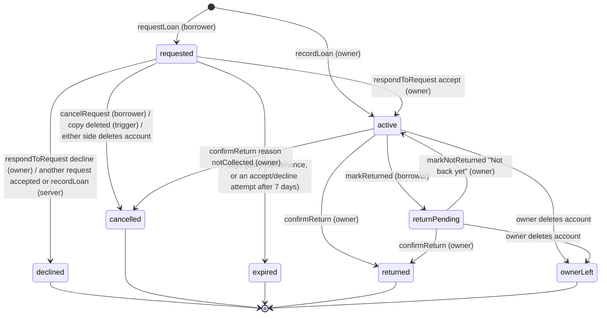
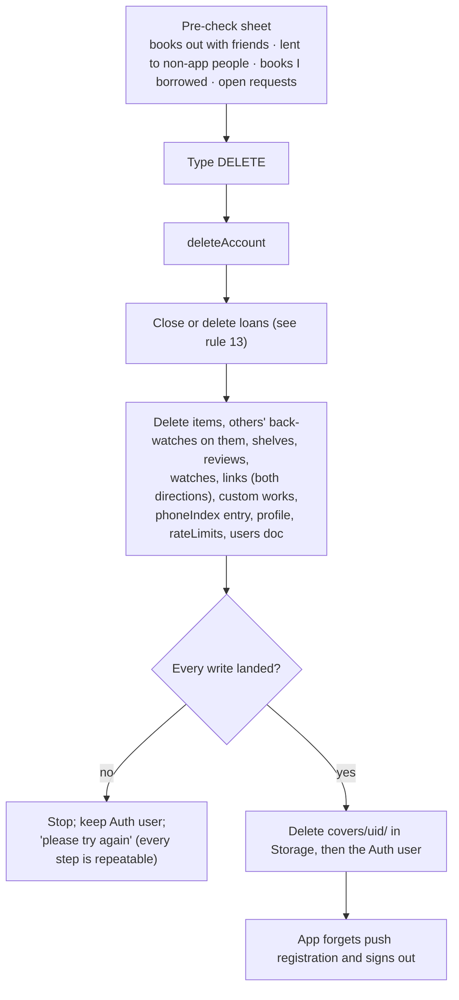

# LendShelf core logic

This page lists the rules that make LendShelf behave the way it does, each with a short explanation, a concrete example and the file and line where it lives. Server rules (in `functions/src`) are the source of truth for state; client rules (in `src/features`) decide wording, cards and which buttons appear. Line numbers are as of commit `de15c0b`.

People in the examples are labelled by role (Owner, Borrower, Watcher) rather than named. For the overall system see [ARCHITECTURE.md](ARCHITECTURE.md); for screen-by-screen journeys see [USER-FLOWS.md](USER-FLOWS.md).

## Contents

| # | Rule | Main file |
|---|---|---|
| 1 | [Contact matching and one-way visibility](#1-contact-matching-and-one-way-visibility) | [contacts.ts](../../functions/src/handlers/contacts.ts) |
| 2 | [Sharing: visibility states and public/private collections](#2-sharing-visibility-states-and-publicprivate-collections) | [sharing.ts](../../functions/src/lib/sharing.ts), [firestore.rules](../../firestore.rules) |
| 3 | [Loan state machine](#3-loan-state-machine) | [lib/loans.ts](../../functions/src/lib/loans.ts), [handlers/loans.ts](../../functions/src/handlers/loans.ts) |
| 4 | [Request expiry (7 days)](#4-request-expiry-7-days) | [maintenance.ts](../../functions/src/handlers/maintenance.ts) |
| 5 | [Competing requests and auto-decline](#5-competing-requests-and-auto-decline) | [handlers/loans.ts](../../functions/src/handlers/loans.ts#L102) |
| 6 | [Decline reasons](#6-decline-reasons) | [messages.ts](../../functions/src/lib/messages.ts) |
| 7 | [Pick-up window (48 h)](#7-pick-up-window-48-h) | [needs-you.ts](../../src/features/loans/needs-you.ts#L42) |
| 8 | [Return, not back yet, confirm](#8-return-not-back-yet-confirm) | [handlers/loans.ts](../../functions/src/handlers/loans.ts#L343) |
| 9 | [Not collected](#9-not-collected) | [handlers/loans.ts](../../functions/src/handlers/loans.ts#L373) |
| 10 | [Due dates and reminders](#10-due-dates-and-reminders) | [lib/loans.ts](../../functions/src/lib/loans.ts#L137) |
| 11 | [Needs-you cards, ordering and the Loans badge](#11-needs-you-cards-ordering-and-the-loans-badge) | [needs-you.ts](../../src/features/loans/needs-you.ts) |
| 12 | [Stale actions](#12-stale-actions) | [stale.ts](../../src/features/loans/stale.ts) |
| 13 | [Owner or borrower leaving](#13-owner-or-borrower-leaving) | [account.ts](../../functions/src/handlers/account.ts#L140) |
| 14 | [Wishlist hits and notify-when-back](#14-wishlist-hits-and-notify-when-back) | [triggers.ts](../../functions/src/handlers/triggers.ts) |
| 15 | [Reviews visibility](#15-reviews-visibility) | [use-reviews.ts](../../src/hooks/use-reviews.ts) |
| 16 | [Covers](#16-covers) | [books.ts](../../functions/src/lib/books.ts), [save.ts](../../src/features/add/save.ts) |
| 17 | [Naming](#17-naming) | [use-links.ts](../../src/hooks/use-links.ts), [people.ts](../../src/features/shared/people.ts) |
| 18 | [Account deletion](#18-account-deletion) | [account.ts](../../functions/src/handlers/account.ts#L140) |
| 19 | [Smaller rules](#19-smaller-rules) | various |

---

## 1. Contact matching and one-way visibility

**Rule.** You see someone's shared books if *you* have their number saved and they are on LendShelf. They don't need to have you saved, and they are never told that you saved them.

**How it works.**

1. The app reads the address book, normalises each number to E.164 with libphonenumber-js in the device region (default `IN`), and sends only the numbers to `syncContacts` ([sync-contacts.ts:65](../../src/lib/sync-contacts.ts#L65)). Above 5000 numbers the list is cut to the first 5000 ([sync-contacts.ts:79](../../src/lib/sync-contacts.ts#L79)).
2. The server checks the rate limit (20 calls per rolling 24 h, [rateLimit.ts:16](../../functions/src/lib/rateLimit.ts#L16)), normalises the numbers again, and looks them up in the backend-only `phoneIndex`. The caller's own number is skipped ([contacts.ts:58](../../functions/src/handlers/contacts.ts#L58)).
3. It writes `links/{viewer}_{owner}` for each match and deletes links for numbers no longer in the list, unless the **shrink guard** applies.
4. The app keeps the names you saved only for matched numbers, in the persisted contacts store.

**Shrink guard.** Without `replace: true`, a sync that would delete more than half of your existing links deletes nothing and returns `skippedRemovals` ([contacts.ts:74](../../functions/src/handlers/contacts.ts#L74)). This protects a half-restored address book on a new phone.

| Trigger | Sends `replace` | What happens when the guard fires | Where |
|---|---|---|---|
| Automatic re-sync on open or foreground (native only, at most once per 24 h, contacts granted, contacts step done) | Never | Nothing removed; Me shows "Some contacts weren't checked · Sync now" | [resync.ts:41](../../src/features/contacts/resync.ts#L41), [resync.ts:57](../../src/features/contacts/resync.ts#L57) |
| Manual Sync now | First call no | Sheet "Your contacts look incomplete" → Keep everyone, or remove them (resend with `replace: true`) | [resync.ts:57](../../src/features/contacts/resync.ts#L57) |
| Address book empty or permission denied | n/a | The app doesn't call the server at all, so links from another device stay | [sync-contacts.ts:78](../../src/lib/sync-contacts.ts#L78) |

**Example.** The viewer had 10 links. A new phone's address book has only 3 of them so far. The automatic sync adds any new matches, keeps all 10 links and returns `skippedRemovals: 7`. A manual Sync now shows the sheet; choosing to remove resends with `replace: true` and leaves 3 links.

**"New on LendShelf".** People who appear in a sync and weren't links before get a chip for 7 days. The first sync on a device marks nobody as new ([resync.ts:18](../../src/features/contacts/resync.ts#L18)).

**Consequences.**

- A friend who joins appears for you only after *your* next sync (automatic within about a day).
- Requests work one way too: `requestLoan` only checks that the borrower has the owner saved ([loans.ts:161](../../functions/src/handlers/loans.ts#L161)). The owner sees "Not in your contacts" and the borrower's number.
- Removing someone from your contacts (on a full sync) hides their books from you, but open loans with them stay readable to both sides.

---

## 2. Sharing: visibility states and public/private collections

**Rule.** A copy is shown to people who have your number saved only when its collection is public **and** the copy isn't hidden. This derived flag, `sharedWithContacts`, is stored on the copy so contacts can query it, and the rules reject any write where it doesn't match ([firestore.rules:236](../../firestore.rules#L236), [sharing.ts:4](../../functions/src/lib/sharing.ts#L4)).

| Copy `visibility` | UI label | In a public collection | In a private collection |
|---|---|---|---|
| `lendable` | Lendable | Shared; contacts can ask | Not shared |
| `visible` | Not lending | Shared; contacts see it but can't ask | Not shared |
| `hidden` | Hidden | Not shared | Not shared |

**Who changes what.**

| Change | Path | Why a callable or not |
|---|---|---|
| Copy visibility, move copy between collections | Client write, rules check the flag | Touches one document |
| Collection public/private | `setShelfVisibility` ([shelves.ts:24](../../functions/src/handlers/shelves.ts#L24)) | Recomputes the flag on up to 480 copies in one transaction |
| Delete collection | `deleteShelf` ([shelves.ts:51](../../functions/src/handlers/shelves.ts#L51)) | Moves copies and recomputes the flag; can't delete the last collection |

**Pending requests when sharing shrinks.** Hiding a copy, moving it to a private collection, making a collection private, or deleting a collection into a private one first shows a sheet naming who will be declined, then declines each request with reason `notLending`, and only then applies the change ([actions.ts:68](../../src/features/shelves/actions.ts#L68), [OwnerPanel.tsx:114](../../src/features/copy/OwnerPanel.tsx#L114), [shelves.tsx:110](<../../src/app/(app)/shelves.tsx#L110>)). Setting a copy to Not lending asks whether to decline or keep the requests, because the copy stays visible. The server's `setShelfVisibility` and `deleteShelf` don't decline anything themselves, so this ordering lives on the client.

**Example.** The owner hides a copy that has two open requests. The sheet says both requesters will be told the owner isn't lending it. On confirm, both loans become `declined` with `notLending` and get a push, then the copy's visibility changes. Neither borrower ever sees "Copy not found".

**Other rules.**

- `requestLoan` needs the copy to be shared, `lendable` and `available` ([loans.ts:162-164](../../functions/src/handlers/loans.ts#L162)).
- Lending a hidden copy by hand is allowed; the borrower keeps access through the loan.
- Contacts see a lent copy as "Lent · back 12 Dec" from the copy's `dueDate`; only owner and borrower can read the loan itself.

---

## 3. Loan state machine

**Rule.** Every loan change goes through a callable that checks the current status and the caller's role against one table ([lib/loans.ts:31](../../functions/src/lib/loans.ts#L31)). An action from the wrong status fails with `failed-precondition` and a sentence such as "Can't accept this request: this loan is already declined."

`updateDueDate` (owner, `active` only) keeps the status. Open statuses are `requested`, `active` and `returnPending` ([model.ts:51](../../functions/src/model.ts#L51)).

| Transition | Who | Copy (`items`) | Pushes | Other effects | Code |
|---|---|---|---|---|---|
| `requestLoan` → requested | Borrower with owner saved | none | Owner: "Borrow request" | Returns owner phone for WhatsApp; blocks a second open request by the same borrower for the same copy (`already-exists`) | [loans.ts:132](../../functions/src/handlers/loans.ts#L132) |
| accept → active | Owner | `lent`, `activeLoanId`, `dueDate` | Borrower: "Request accepted"; each other requester: decline push | Other requests declined `lentToSomeoneElse`, each gets a back-watch | [loans.ts:227-246](../../functions/src/handlers/loans.ts#L227) |
| decline → declined | Owner | none | Borrower: text by reason | `lentToSomeoneElse` also creates a back-watch | [loans.ts:217-224](../../functions/src/handlers/loans.ts#L217) |
| cancelRequest → cancelled | Borrower | none | none | | [loans.ts:255](../../functions/src/handlers/loans.ts#L255) |
| recordLoan → active | Owner | `lent` | Borrower "Book lent to you" only if matched by phone and has owner saved; other requesters as on accept | `requestedAt: null` (no pick-up window); returns `onApp` | [loans.ts:267](../../functions/src/handlers/loans.ts#L267) |
| markReturned → returnPending | Borrower | none | Owner: "Book returned?" | Sets `returnMarkedAt`, appends to `returnEvents`, clears `notBackYetAt` | [loans.ts:343](../../functions/src/handlers/loans.ts#L343) |
| markNotReturned → active | Owner | none | Borrower "Not back yet", if they have owner saved | Clears `returnMarkedAt`, sets `notBackYetAt`, appends to `returnEvents`; reminders resume | [loans.ts:443](../../functions/src/handlers/loans.ts#L443) |
| confirmReturn → returned | Owner | `available` (if this loan is its active one) | Back-watchers "Book is back"; borrower "How was it?" if they have owner saved | All back-watches on the copy deleted | [loans.ts:373](../../functions/src/handlers/loans.ts#L373) |
| confirmReturn `notCollected` → cancelled | Owner | `available` | Back-watchers "Available again"; no review prompt | `closedReason: notCollected` | [loans.ts:373](../../functions/src/handlers/loans.ts#L373) |
| updateDueDate | Owner | `dueDate` | Borrower "Due date changed", if they have owner saved | Records `dueChangedAt`, and `firstDueDate` on the first change | [loans.ts:469](../../functions/src/handlers/loans.ts#L469) |
| expire → expired | System | none | Borrower "Request expired" | | [maintenance.ts:35](../../functions/src/handlers/maintenance.ts#L35) |
| copy deleted → cancelled | Trigger | (deleted) | Borrower "Request cancelled · removed" | `closedReason: copyRemoved` | [triggers.ts:22](../../functions/src/handlers/triggers.ts#L22) |
| owner leaves → ownerLeft / cancelled | System | (deleted) | Borrower once, if they have owner saved | Owner phone blanked | [account.ts:151-178](../../functions/src/handlers/account.ts#L151) |

**Why pushes check "has the owner saved".** `recordLoan` accepts any phone number, so without this check anyone could send pushes with their chosen book title to any app user by "lending" to their number (DECISIONS.md row 23). The same check gates the borrower's due-soon, overdue, not-back-yet, due-changed and review pushes.

**Timeline.** The Loan screen's timeline is built from `requestedAt`, `startedAt`, `firstDueDate`/`dueChangedAt`, `returnEvents`, `returnedAt` and the closing status ([loan-view.ts:473](../../src/features/loans/loan-view.ts#L473)). `returnEvents` exists because `returnMarkedAt` and `notBackYetAt` are overwritten when a return goes back and forth.

---

## 4. Request expiry (7 days)

**Rule.** A request that nobody answers within 7 days expires. The borrower gets "Request expired".

| Where | What happens | Code |
|---|---|---|
| Daily job, 09:00 IST | `requested` loans with `requestedAt` at least 7 days ago become `expired`, only if the document hasn't changed since it was read (`lastUpdateTime` precondition), so an accept a moment earlier wins | [maintenance.ts:24-49](../../functions/src/handlers/maintenance.ts#L24) |
| Owner tries to accept or decline after 7 days | The loan is set `expired` and the call fails "This request expired (requests last 7 days)" | [loans.ts:212](../../functions/src/handlers/loans.ts#L212) |
| App, before the job runs | The Loan screen shows the request as expired and offers no Accept; Needs you drops it | [loan-view.ts:111](../../src/features/loans/loan-view.ts#L111), [needs-you.ts:139](../../src/features/loans/needs-you.ts#L139) |
| Borrower, 2 calendar days before | A "Your request expires in 2 days" card with Message | [needs-you.ts:186-195](../../src/features/loans/needs-you.ts#L186) |

**Example.** A request made on 1 Dec at 20:00 can be accepted until 8 Dec 20:00. The 9 Dec 09:00 job marks it expired. If the owner opens it on 8 Dec at 21:00, the app already shows "Request expired" and offers Message instead of Accept.

The owner gets no reminder before a request expires (UX-FLOWS backlog G36).

---

## 5. Competing requests and auto-decline

**Rule.** Several people can ask for the same copy. There is no queue: the owner picks one, and every other open request for that copy is declined in the same transaction with reason `lentToSomeoneElse`, a back-watch for that borrower and a push "<title> went to someone else. We'll tell you when it's back." ([loans.ts:102](../../functions/src/handlers/loans.ts#L102)). Lending the copy by hand with `recordLoan` does the same.

**Example.** Borrowers B and C both ask for the owner's copy. The owner sees one grouped card, "2 people want …", and taps "Lend to B". B's loan becomes `active`; C's becomes `declined` (`lentToSomeoneElse`), `watches/{C}_back_{itemId}` is created, and C is pushed. When the owner later confirms the return, C (if C has the owner saved and the copy is shared) gets "Book is back" and the watch is deleted.

**Two requests for one Book from two owners (R14).** A borrower may ask two different owners for the same Book. When one accepts, the app shows the borrower a card "Cancel your request to …?" with Cancel / Keep both ([requests.ts:110](../../src/features/loans/requests.ts#L110)). "Keep both" is remembered on the device. The Ask sheet also warns "You've already asked … for this".

The declined borrower never learns who got the book: their screens say "Lent to someone else · back around 12 Dec" ([requests.ts:30](../../src/features/loans/requests.ts#L30)).

---

## 6. Decline reasons

**Rule.** A decline may carry a reason, stored as `declineReason` on the loan. The reason picks the push text and the borrower's wording.

| Reason | Set by | Push body | Borrower sees | Extra |
|---|---|---|---|---|
| `readingIt` | Owner chip "I'm reading it" | "<owner> is reading <title> right now." | "<owner> is reading it right now" | |
| `notLending` | Owner chip "Not lending this one", or the app when hiding / making private | "<owner> isn't lending <title> at the moment." | "<owner> isn't lending it at the moment" | Owner may also tick "Also stop lending this copy" |
| `lentToSomeoneElse` | Owner chip, or the server on accept / recordLoan | "<title> went to someone else. We'll tell you when it's back." | "Lent to someone else · back around …" | Server creates a back-watch |
| none | Owner without a chip | "<owner> can't lend <title> right now." | "<owner> can't lend it right now" | |

Code: [messages.ts](../../functions/src/lib/messages.ts) (`declineBody`), [requests.ts:30](../../src/features/loans/requests.ts#L30), chips in [requests.ts:17](../../src/features/loans/requests.ts#L17).

---

## 7. Pick-up window (48 h)

**Rule.** For 48 hours after a *request* is accepted, both sides see pick-up wording instead of "With …": the borrower sees "Pick up from <owner>" and a card with Message; the owner sees "Waiting for <borrower> to pick up" with Message and "Not collected? Close this loan". It is wording only; the server has no pick-up state, and the due date still starts at accept.

| Condition | Effect | Code |
|---|---|---|
| Loan is `active`, has `requestedAt` and `startedAt`, accepted less than 48 h ago | In the window | [needs-you.ts:42](../../src/features/loans/needs-you.ts#L42) |
| Loan recorded by hand (`requestedAt: null`) | Never in the window | same |
| Any return event exists (`returnMarkedAt`, `notBackYetAt` or `returnEvents`) | Window ends early: the book was clearly collected | [needs-you.ts:48](../../src/features/loans/needs-you.ts#L48) |
| 48 h pass | Both devices switch to normal wording at the same moment, because it's computed from `startedAt` | |

While in the window the owner gets no overdue card and no Nudge ([needs-you.ts:150](../../src/features/loans/needs-you.ts#L150)). The borrower can still say "I've returned it" from the Loan screen.

**Example.** The owner accepts on Monday 10:00. Until Wednesday 10:00 the borrower's Home shows "<owner> said yes · Pick up from <owner> · pickup: <note>". If the borrower taps "I've returned it" on Tuesday (a quick read), the window ends there and the owner sees "says returned".

---

## 8. Return, not back yet, confirm

**Rule.** The borrower says it's back (`markReturned`), the owner confirms (`confirmReturn`) or disputes it (`markNotReturned`). The owner can also confirm directly without the borrower's step.

| Step | Effect | Reminders |
|---|---|---|
| Borrower: I've returned it | `returnPending`; owner gets "Book returned?" and a "says returned" card | Stop (only `active` loans get reminders) |
| Owner: Got it back | `returned`; copy available; back-watchers told; review prompt | n/a |
| Owner: Not back yet | `active` again; borrower gets "Not back yet" and a card for 3 days ([needs-you.ts:33](../../src/features/loans/needs-you.ts#L33)) | Resume, including overdue |

"Got it back" from the says-returned card is one tap; from anywhere else it opens a one-step confirm sheet that adds "<borrower> hasn't said they returned it" when that's true (UX-FLOWS §E6). There is no undo.

**Example.** The borrower marks a book returned on 10 Dec, two days before it's due. The owner can't find it and taps Not back yet. The loan is `active` again, the borrower's Home shows "<owner> hasn't got it back yet", and if 12 Dec passes the overdue reminders start on 13 Dec.

---

## 9. Not collected

**Rule.** If the borrower never picks the book up, the owner closes the loan with `confirmReturn({ reason: 'notCollected' })`. The loan becomes `cancelled` with `closedReason: 'notCollected'`, the copy is available, the borrower gets no review prompt, and back-watchers get "<title> is available again" instead of "Book is back" ([loans.ts:373-432](../../functions/src/handlers/loans.ts#L373)).

The server accepts this on any `active` loan; the app offers it only during the pick-up window, as a tertiary action ([loan-view.ts:198](../../src/features/loans/loan-view.ts#L198)). The borrower's side has "Not picking it up? Tell <owner>" (WhatsApp).

**Example.** Accepted on Monday, never collected. On Tuesday the owner taps "Not collected? Close this loan" and confirms. A watcher declined earlier as `lentToSomeoneElse` gets "Available again" and their watch is deleted.

---

## 10. Due dates and reminders

### 10.1 Due dates

| Rule | Detail | Code |
|---|---|---|
| Default | 21 days after accept or lend | [model.ts:56](../../functions/src/model.ts#L56) |
| Date-only value (`"2026-12-12"`, sent by Accept and Change due date) | Stored as **noon IST** on that day | [lib/loans.ts:137](../../functions/src/lib/loans.ts#L137) |
| Full ISO value (sent by the Lend screen) | Local noon on the chosen day | [due-date.ts:72](../../src/features/lend/due-date.ts#L72) |
| Earliest | Today in India (date-only); for a full timestamp, no more than 24 h in the past | [lib/loans.ts:144](../../functions/src/lib/loans.ts#L144) |
| Latest | 366 days from now on the server; the app's picker stops at 365 | [lib/loans.ts:147](../../functions/src/lib/loans.ts#L147), [due-dates.ts:8](../../src/features/loans/due-dates.ts#L8) |
| Chips | Accept and Lend: 1 week, 2 weeks, 3 weeks (default), 1 month, 2 months. Change: +1 week, +2 weeks, +1 month from the current due date | [due-dates.ts:18](../../src/features/loans/due-dates.ts#L18) |

Noon IST exists because date-only values used to be read as UTC midnight (05:30 IST): the 09:00 job then sent "Overdue" on the due day itself and "Due soon" two days early (QA-ANDROID.md bug D). Loans saved before that fix keep their 05:30 times.

### 10.2 Reminders

The daily job compares **calendar days in India time**, so the result doesn't depend on the hour it runs ([lib/loans.ts:171](../../functions/src/lib/loans.ts#L171)).

| Days from today to due date (IST) | Reminder | To |
|---|---|---|
| 1 (due tomorrow) | "Due soon … due back tomorrow (12 Dec)" | Borrower, only if they have the owner saved |
| -1, -8, -15, … (the day after, then weekly) | "Overdue" | Owner always; borrower only if they have the owner saved |
| Anything else | none | |

**Example.** Due 12 Dec. Due soon goes out on 11 Dec at 09:00; Overdue on 13 Dec, 20 Dec, 27 Dec, and so on until the loan leaves `active`. A loan in `returnPending` on 13 Dec gets nothing.

The app's own wording is separate: cards and rows use the device's calendar days, and a borrowed book becomes a Needs-you card 2 days before its due date ([needs-you.ts:178](../../src/features/loans/needs-you.ts#L178)). Owners get no due-soon push, only overdue.

---

## 11. Needs-you cards, ordering and the Loans badge

**Rule.** "Needs you" is every loan where the user has to act, built on the device from the two loan listeners. Home shows at most 2 cards with "See all n in Loans"; Loans shows them all first; the Loans tab badge is the number of cards (a grouped request card counts once).

| Card | When | Primary action |
|---|---|---|
| `requests` | Open, unexpired requests for one of my copies, grouped per copy | Accept (or a chooser when several) |
| `saysReturned` | My copy is `returnPending` | Got it back |
| `overdueLent` | My copy is overdue and not in the pick-up window | Nudge on WhatsApp |
| `notBackYet` | I'm the borrower and the owner said Not back yet in the last 3 days | Message |
| `dueBorrowed` | I'm the borrower and the due date is 2 or fewer calendar days away, or past | I've returned it |
| `pickup` | I'm the borrower and the loan is in its pick-up window | Message |
| `otherAccepted` | One of my requests was accepted while another of mine for the same Book is open | Cancel the other request |
| `requestExpiring` | My own request expires within 2 calendar days | Message |

**Ordering.** Oldest deadline first; ties by kind (says returned, requests, overdue lent, not back yet, due borrowed, pick-up, other accepted, request expiring), then by key ([needs-you.ts:90](../../src/features/loans/needs-you.ts#L90), [needs-you.ts:211](../../src/features/loans/needs-you.ts#L211)). A passed deadline (overdue, says returned) sorts before one still to come.

| Card | Deadline used |
|---|---|
| requests | First request's expiry (requestedAt + 7 days) |
| saysReturned | `returnMarkedAt` |
| overdueLent, dueBorrowed | `dueDate` |
| pickup | End of the 48 h window |
| notBackYet | `notBackYetAt` |
| requestExpiring, otherAccepted | The open request's expiry |

**Example.** The owner has a return to confirm (marked yesterday), a request expiring in 3 days and a book 2 days overdue. Order: the overdue book (due 2 days ago), the says-returned card (yesterday), then the request. Home shows the first two and "See all 3 in Loans"; the badge says 3.

Code: [needs-you.ts:105](../../src/features/loans/needs-you.ts#L105), [needs-you.ts:220](../../src/features/loans/needs-you.ts#L220), [home.ts:9](../../src/features/home/home.ts#L9), badge in [(tabs)/_layout.tsx](<../../src/app/(app)/(tabs)/_layout.tsx>). There is no app-icon badge. The Home setup card is hidden while any Needs-you card exists ([home.ts:91](../../src/features/home/home.ts#L91)).

---

## 12. Stale actions

**Rule.** When an action fails because the loan changed under an open sheet (the other person cancelled, it expired, it was already answered), the app re-reads the loan and says what happened in one line instead of showing an error code ([stale.ts:59](../../src/features/loans/stale.ts#L59)). Error codes treated this way: `failed-precondition`, `not-found`, `permission-denied`, `already-exists`.

| What you tried | What the loan is now | Message |
|---|---|---|
| Accept or decline | `cancelled` | "<borrower> cancelled this request" |
| Accept or decline | Still `requested` but past 7 days | "This request expired" + offer Message |
| Decline | `declined` with `lentToSomeoneElse` | "This copy went to someone else, so <borrower>'s request was declined" |
| Cancel request | `active` | "<owner> already said yes" |
| Got it back | `returned` | "This book is already back" |
| Anything | Loan unreadable or gone | "This request was withdrawn" / "This isn't there any more" |

An open sheet also watches its loan live and closes itself with the same message if the loan changes. The toast is shown once (de-duplicated for 10 s) and stays 6 s ([loan-sheets.tsx:82-84](../../src/features/loans/loan-sheets.tsx#L82)). A repeated Ask after a lost response gets `already-exists`; the app then opens the existing request and still opens WhatsApp.

**Example.** The owner has the Accept sheet open; the borrower cancels. About 2 s later the sheet closes and "<borrower> cancelled this request" appears once.

---

## 13. Owner or borrower leaving

**Rule.** Deleting an account closes loans in a way that keeps the other person's record usable.

| Loan, from the leaver's side | What happens | Other person sees |
|---|---|---|
| Owner; borrower on the app; `requested` | `cancelled`; owner phone blanked | Request closed |
| Owner; borrower on the app; `active` or `returnPending` | `ownerLeft` (terminal, no reminders); owner name kept, phone blanked; one push "<owner> left LendShelf" if the borrower has the owner saved | "<owner> left LendShelf. If you still have <title>, message them on WhatsApp if you still have their number." |
| Owner; borrower on the app; closed | Owner phone blanked | History kept |
| Owner; borrower not on the app | Loan deleted | n/a |
| Borrower; any status | `borrowerUid: null`, `borrowerLeftAt` set; name and phone kept; `requested` → `cancelled` | "<borrower> left LendShelf"; owner can still Nudge and mark it back |

Code: [account.ts:151-189](../../functions/src/handlers/account.ts#L151). Pushes are queued only for writes that landed, so retrying a failed deletion doesn't repeat them.

**Example.** The owner deletes their account while a borrower has a book (`active`). The borrower's loan becomes `ownerLeft` with the owner's name and no phone, and the borrower gets one push. The daily job ignores it from then on.

---

## 14. Wishlist hits and notify-when-back

### 14.1 Wishlist

**Rule.** A wishlist entry is `watches/{me}_wishlist_{workId}`, private to me. When a copy of that Book **becomes shared** (its `sharedWithContacts` goes from false or missing to true), the `onItemWritten` trigger pushes "On your wishlist: <owner> added <title>" to watchers who have that owner saved ([triggers.ts:58](../../functions/src/handlers/triggers.ts#L58)).

- "Becomes shared" covers a new copy in a public collection, un-hiding a copy, and making a collection public (each copy's write fires the trigger).
- It fires for Not lending copies too, since they are shared.
- The entry is not removed on a hit; it stays until the user removes it.
- In the app, Home › "From your wishlist" lists wishlist Books someone in the circle has available now, including copies filed under another catalogue record with the same normalised title and first author ([availability.ts:29](../../src/features/wishlist/availability.ts#L29), [search.ts:122](../../src/lib/search.ts#L122)).

**Example.** A user wishlists a novel. A contact (saved by the user) adds a copy to their public shelf. The user gets the push; tapping it opens the copy.

### 14.2 Notify when it's back

**Rule.** A back-watch is `watches/{me}_back_{itemId}`. The user creates one from a lent copy's page ([mutations.ts:42](../../src/features/shared/mutations.ts#L42)); the server creates one for each request it declines as `lentToSomeoneElse`.

On `confirmReturn` the server pushes watchers who are not the owner or borrower, only if the copy is shared and only to those who have the owner saved, then deletes **all** back-watches on that copy ([loans.ts:398-430](../../functions/src/handlers/loans.ts#L398)). A not-collected close sends "Available again" instead of "Book is back". First to ask wins; there is no queue.

---

## 15. Reviews visibility

**Rule.** A review belongs to the Book (`reviews/{workId}_{uid}`), one per person per Book, 1-5 stars plus optional text up to 2000 characters. You see your own review and reviews by people **you** have saved. Your review is therefore seen by people who have *you* saved.

- The app reads reviews by document id for itself and each linked owner, because rules can't filter a list query by "author is in my contacts" ([use-reviews.ts:20](../../src/hooks/use-reviews.ts#L20)).
- The rules decide a `get` from the id alone, so a missing review reads as "doesn't exist", not "permission denied" ([firestore.rules:310](../../firestore.rules#L310)).
- The average is computed on the device from the visible reviews only; nothing global is stored.
- Anyone may review, owner or not. The Book must exist (rules `exists()` check).
- After a normal return the borrower gets "How was it?" (push and inline stars on the closed Loan screen); not after Not collected or owner-left.

**Example.** Viewer V has saved R1 and R2. R1 rated a Book 4, R2 rated it 2, and a stranger rated it 5. V sees two reviews and an average of 3.0.

---

## 16. Covers

**Rule.** A copy's `coverUrl` is the edition's cover if the catalogue has one, else the Book's cover, else a photo the owner uploaded for a hand-entered book, else none.

| Source | URL | Code |
|---|---|---|
| Open Library | `https://covers.openlibrary.org/b/id/<id>-L.jpg`; lists swap in the `-M` size | [books.ts:58](../../functions/src/lib/books.ts#L58), [book-cover.tsx:35](../../src/components/book-cover.tsx#L35) |
| Google Books | Thumbnail forced to https, `&edge=curl` removed | [books.ts:120](../../functions/src/lib/books.ts#L120) |
| Uploaded (hand-entered books only) | Storage `covers/{uid}/{autoId}.{ext}`, JPEG/PNG/WebP/HEIC/HEIF, at most 5 MB | [save.ts:166](../../src/features/add/save.ts#L166), [storage.rules](../../storage.rules) |

The rules accept a cover URL only from `covers.openlibrary.org`, `books.google.com`, `books.googleusercontent.com` or `firebasestorage.googleapis.com` over https, so a user can't plant a tracking URL or SVG in other people's apps ([firestore.rules:69](../../firestore.rules#L69)). The app checks the image type before uploading and turns `image/jpg` into `image/jpeg` ([save.ts:67](../../src/features/add/save.ts#L67)). Uploaded covers are deleted with the account.

**Book lookup notes.**

- `resolveBook` tries `isbnIndex`, then Open Library, then Google Books; each request times out after 8 s ([books.ts:16](../../functions/src/lib/books.ts#L16)).
- A catalogue outage returns `unavailable` with `reason: catalogue`, so the app can say "the catalogue isn't responding" instead of "no connection" ([books.ts:328](../../functions/src/lib/books.ts#L328)).
- An ISBN sent with a work key is trusted only if the catalogue confirms it belongs to that work, so one client can't map an ISBN to the wrong Book for everyone ([books.ts:419](../../functions/src/lib/books.ts#L419)).
- If the Open Library work title isn't Latin script but the edition's is, the edition title is used ([books.ts:283](../../functions/src/lib/books.ts#L283)).

---

## 17. Naming

**Rule.** People are shown by the name *you* saved them as in your contacts, then their profile name, then their formatted number ([use-links.ts:22](../../src/hooks/use-links.ts#L22)). Outgoing WhatsApp text greets them by their *profile* first name, never by your saved nickname ([whatsapp.ts:20](../../src/lib/whatsapp.ts#L20)).

| Where | Name used | Example (saved as "Dr. Mehta", profile "Anil Mehta") |
|---|---|---|
| Lists, cards, Loan screen | Saved name → profile name → number | "Dr. Mehta" |
| Short labels ("Message …", "Waiting for … to pick up") | `shortName` of the display name | "Dr. Mehta" (kept whole: starts with a title) |
| WhatsApp greeting | Profile first name, else "Hi!" | "Hi Anil!" |
| Loan documents | Profile name copied when the loan is created; the typed name for `recordLoan` | Not updated if the profile changes later |

**Short names** ([people.ts:69](../../src/features/shared/people.ts#L69)):

- First word of the name: "Priya Sharma" becomes "Priya".
- Kept whole when it starts with a title, kinship word or initial ("Dr.", "Mrs", "Aunty", "A."), so a label never ends on "Dr.".
- Bracketed notes are dropped: "Nikhil (neighbour)" becomes "Nikhil".
- **Collision rule:** if another person in the circle (or in the same list) has a different name with the same first word, the full name is used, so two people never look like one.
- A number shown in place of a name is never shortened.

**Example.** The circle has "Test Ravi" and "Test Meera". Both would shorten to "Test", so both stay whole: "Message Test Ravi". A borrower typed by hand as "Neighbour Nikhil" is greeted "Hi!" because a typed name may be a nickname ([whatsapp.ts:107](../../src/lib/whatsapp.ts#L107)).

---

## 18. Account deletion

**Rule.** Me › Delete account shows a pre-check from loans already on the device, asks the user to type `DELETE`, then calls `deleteAccount`, which removes everything the user owns and then the Auth user.

Code: [account.ts:140](../../functions/src/handlers/account.ts#L140), [delete-precheck.ts:22](../../src/features/me/delete-precheck.ts#L22), [me/account.ts:25](../../src/features/me/account.ts#L25). While deletion runs the app sets `deletingAccount`, so the profile disappearing doesn't bounce the user to the name screen.

**Example.** A user with one book out with an app friend, one lent to a neighbour without the app and one open request deletes their account. The friend's loan becomes `ownerLeft` and they get one push; the neighbour's loan is deleted; the request is cancelled; then the data and the Auth user go.

---

## 19. Smaller rules

| Rule | Detail | Code |
|---|---|---|
| Default collection | `shelves/default_{uid}`, created public as "My books"; shown in the app as "Main shelf" | [account.ts:49](../../functions/src/handlers/account.ts#L49) |
| Can't delete a lent copy | Rules refuse delete while `loanState == 'lent'` | [firestore.rules:277](../../firestore.rules#L277) |
| Deleting a copy | Trigger cancels its open requests (`copyRemoved`) and pushes the borrowers | [triggers.ts:22](../../functions/src/handlers/triggers.ts#L22) |
| Custom books | Private to their creator and people who have the creator saved; only the creator can attach copies | [firestore.rules:165-180](../../firestore.rules#L165) |
| Adding many copies | Written 19 per batch (Firestore allows 20 document reads per batch) | [save.ts:97](../../src/features/add/save.ts#L97) |
| Push tokens | One device belongs to one account; at most 20 tokens per user; `DeviceNotRegistered` tokens removed | [devices.ts:18](../../functions/src/handlers/devices.ts#L18), [push.ts:10](../../functions/src/lib/push.ts#L10) |
| Push permission | Never asked on start; a one-line pre-prompt after the first request, accept, lend or wishlist add, once per user per device | [decision.ts:27](../../src/features/push-ask/decision.ts#L27) |
| Push tap routing | Loan pushes open `/loan/[id]`; "Book is back", "Available again" and wishlist open `/copy/[id]`; review prompt opens the loan with stars | [notification-routes.ts:20](../../src/lib/notification-routes.ts#L20) |
| Borrower can always open their copy | If the copy can't be read any more, the copy page is built from the open loan | [copy page:82](<../../src/app/(app)/copy/[itemId].tsx#L82>) |
| Invite link | `EXPO_PUBLIC_INVITE_URL`; unset, the text says "Ask me for the app link" | [invite-text.ts:12](../../src/features/invite/invite-text.ts#L12) |
| Status of a copy | Lent beats requested beats hidden beats not lending beats available | [model.ts:342](../../src/types/model.ts#L342) |
