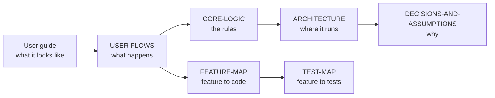

# LendShelf documentation

Start here to understand how LendShelf works and how it was built. The overview docs in this folder describe the app as the code stands on 27 Nov 2026; where an older doc disagreed with the code, the older doc was corrected or the difference is listed in [DECISIONS-AND-ASSUMPTIONS.md](DECISIONS-AND-ASSUMPTIONS.md).

## Reading order

| # | Doc | What you get from it | Length |
|---|---|---|---|
| 1 | [User guide with screenshots](../user-guide/USER-GUIDE.md) | Every flow, step by step, as it looks on a phone | Short per flow |
| 2 | [USER-FLOWS.md](USER-FLOWS.md) | Site map, then flows F1-F15: who, goal, diagrams, exact button labels, what the other person sees, edge cases, files | Long |
| 3 | [CORE-LOGIC.md](CORE-LOGIC.md) | The rules: visibility, loan states, requests, pick-up window, returns, due dates and reminders, Needs-you cards, wishlist, reviews, naming, account deletion | Long |
| 4 | [ARCHITECTURE.md](ARCHITECTURE.md) | System diagram, client structure, data model and rules, all Cloud Functions, environments, build and deploy, security and privacy | Long |
| 5 | [DECISIONS-AND-ASSUMPTIONS.md](DECISIONS-AND-ASSUMPTIONS.md) | Why things are the way they are, the assumptions (checked or not), and what's open before going live | Medium |
| 6 | [FEATURE-MAP.md](FEATURE-MAP.md) | Every feature with its screens, code, backend and status; spec items not built | Medium |
| 7 | [TEST-MAP.md](TEST-MAP.md) | How testing works, what each test covers, manual phone scenarios, and gaps | Medium |

## How the pieces fit

All overview docs and the user guide use the same flow IDs:

| ID | Flow | ID | Flow |
|---|---|---|---|
| F1 | Sign in and set up | F9 | Manage my library |
| F2 | Find a book | F10 | Reviews |
| F3 | Ask to borrow | F11 | Wishlist and notify when back |
| F4 | Answer a request | F12 | Notifications |
| F5 | Pick up, return and confirm | F13 | Profile, contacts and pickup note |
| F6 | Overdue and nudges | F14 | Export |
| F7 | Lend in person | F15 | Sign out and delete account |
| F8 | Add books | | |

## Older and source documents

| Doc | Role now |
|---|---|
| [README.md](../../README.md) | Setup, environments, build, deploy, push setup steps |
| [SPEC.md](../../SPEC.md) | The original v1 spec; data model and API tables kept current |
| [docs/ux/UX-FLOWS.md](../ux/UX-FLOWS.md) | The v1.1 UX spec the app was built from (personas, IA, flow specs, cross-cutting rules, decision log) |
| [docs/ux/UX-REVIEW.md](../ux/UX-REVIEW.md) | The review that shaped v1.1 |
| [DECISIONS.md](../../DECISIONS.md) | The original decision log |
| [HANDOFF.md](../../HANDOFF.md) | Session handoff notes |
| [PROGRESS.md](../../PROGRESS.md) | Build status log by workstream |
| [functions/README.md](../../functions/README.md) | Backend reference: function contracts, deploy, IAM, cold starts |
| [docs/ux/QA-ANDROID.md](../ux/QA-ANDROID.md), [QA-V1.1.md](../ux/QA-V1.1.md), [MULTI-DEVICE-TESTS.md](../ux/MULTI-DEVICE-TESTS.md) | Test runs and results |
