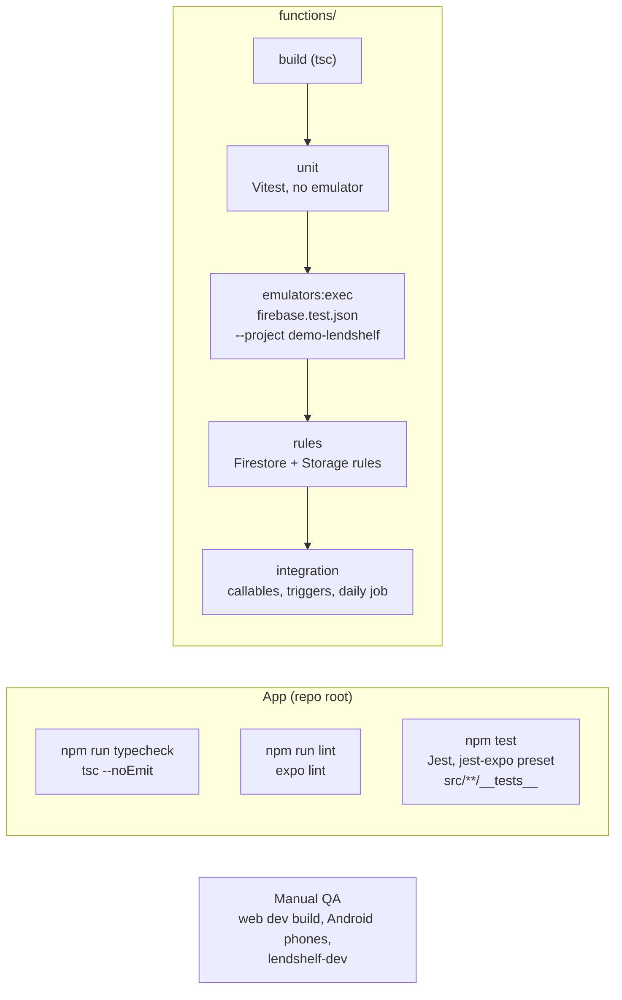

# Test map

LendShelf has four automated layers: Jest unit tests for the app's pure logic, Vitest unit tests for the backend, Vitest rules tests and Vitest integration tests that run against a private, throwaway Firebase emulator. Everything that needs a screen, a phone or a real Firebase project was tested by hand, recorded in [docs/ux/QA-V1.1.md](../ux/QA-V1.1.md), [docs/ux/QA-ANDROID.md](../ux/QA-ANDROID.md) and the two-phone scenarios in [docs/ux/MULTI-DEVICE-TESTS.md](../ux/MULTI-DEVICE-TESTS.md). This page says how to run the tests, maps each flow (F1 to F15, see [USER-FLOWS.md](USER-FLOWS.md)) to the tests that cover it, and lists what has never been tested.

Related: [FEATURE-MAP.md](FEATURE-MAP.md) (one row per feature), [ARCHITECTURE.md](ARCHITECTURE.md), [CORE-LOGIC.md](CORE-LOGIC.md).

## How testing works

| Command | What it runs | Needs | Touches dev or prod? |
|---|---|---|---|
| `npm run typecheck` | `tsc --noEmit` over the app | Node 22 | No |
| `npm run lint` | `expo lint` (ESLint) | Node 22 | No |
| `npm test` | Jest with the `jest-expo` preset, roots `src/`; pure-logic tests in `src/**/__tests__` | Node 22 | No |
| `npm --prefix functions test` | Builds the functions, runs the unit tests, then starts the emulator and runs the rules tests and the integration tests | Node 22, Java 21+ | No |
| `npm --prefix functions run test:unit` | Backend unit tests only ([vitest.unit.config.mts](../../functions/vitest.unit.config.mts)) | Node 22 | No |
| `npm --prefix functions run test:rules` | Rules tests only, emulator with Firestore and Storage | Java 21+ | No |
| `npm --prefix functions run test:integration` | Build, then integration tests, emulator with Auth, Firestore, Functions and Storage | Java 21+ | No |

**The test emulator.** [firebase.test.json](../../firebase.test.json) starts a private Firebase emulator under the project id `demo-lendshelf`, on shifted ports (hub 14400, Auth 19099, Firestore 18080, Functions 15001, Storage 19199) with no UI, so it can't collide with anything else. A `demo-` project never reaches real Google services. The app itself has no emulator mode: it always talks to `lendshelf-dev` or `lendshelf-prod`. [functions/scripts/firebase.mjs](../../functions/scripts/firebase.mjs) finds a Java 21+ runtime (`JAVA_HOME`, `PATH`, Android Studio's JBR, common JDK folders or `LENDSHELF_JAVA_HOME`).

**How each layer works**

- **App unit tests** cover pure modules only: view models such as [loan-view.ts](../../src/features/loans/loan-view.ts) and [needs-you.ts](../../src/features/loans/needs-you.ts), copy builders, date and phone helpers, stores. No component is rendered and Firebase is not loaded.
- **Backend unit tests** cover pure helpers in [functions/src/lib](../../functions/src/lib) with fixture catalogue responses in [functions/test/fixtures](../../functions/test/fixtures) (no network).
- **Rules tests** use `@firebase/rules-unit-testing` against [firestore.rules](../../firestore.rules) and [storage.rules](../../storage.rules), including the exact list queries the app runs.
- **Integration tests** sign in test users through the Auth emulator and call the real callables with the Firebase JS SDK (`httpsCallable`), so triggers run too. Pushes are not sent: in a `demo-` project `sendPush` writes each one to the `_testPushes` collection, which the tests read ([helpers.ts](../../functions/test/integration/helpers.ts)). The daily job is called directly as `runDailyMaintenance`. Files run one at a time (`fileParallelism: false`).
- **There is no CI.** The repository has no `.github` workflow; the checks are run by hand.

### Latest results

Run on 2026-11-27 for this document, on a clean working tree at `de15c0b`.

| Check | Result | Earlier reported (QA-V1.1, after fixes) |
|---|---|---|
| `npm run typecheck` | exit 0 | exit 0 |
| `npm run lint` | exit 0 | exit 0 |
| `npm test` | 44 suites, 424 tests passed | 40 suites, 387 tests |
| Backend unit | 5 files, 96 tests passed | 92 |
| Backend rules | 2 files, 46 tests passed | 46 |
| Backend integration | 6 files, 45 tests passed | 44 |

Re-run on 2026-11-28 after the reading feature (F16): `npm test` 45 suites, 439 tests; backend unit 99, rules 53, integration 45; typecheck and lint exit 0. The per-file tables below are from 27 Nov apart from the reading rows.

## Test inventory

Counts are tests per file as reported by the runners (Jest and Vitest JSON output), so `it.each` rows are counted individually.

### App (Jest), 424 tests

| File | Tests | Covers | Flows |
|---|---|---|---|
| [pressable-label.test.ts](../../src/components/ui/__tests__/pressable-label.test.ts) | 10 | Button labels pass touches through (Android dead-zone bug) | F3, F4, F8, F9 |
| [catalogue.test.ts](../../src/features/__tests__/catalogue.test.ts) | 5 | Catalogue search URL, parsing, search | F2 |
| [circle-copies.test.ts](../../src/features/__tests__/circle-copies.test.ts) | 5 | Ranking copies on the Book page, borrowed by me | F2 |
| [copy-actions.test.ts](../../src/features/__tests__/copy-actions.test.ts) | 11 | Copy page state for owner, viewer, borrower; loan fallback | F2, F3, F9 |
| [feed-and-book.test.ts](../../src/features/__tests__/feed-and-book.test.ts) | 11 | New this week, Available, Popular, merged editions, wishlist matches, Main shelf, "Is it one of these?" | F2, F8, F9, F11 |
| [short-names.test.ts](../../src/features/__tests__/short-names.test.ts) | 7 | Short names never collide | F2 to F7, F13 |
| [small-helpers.test.ts](../../src/features/__tests__/small-helpers.test.ts) | 15 | Edition, descriptions, Popular, group by collection, review logic, people, wishlist availability | F2, F10, F11 |
| [add-helpers.test.ts](../../src/features/add/__tests__/add-helpers.test.ts) | 8 | Open Library search parsing, candidates, manual entry | F8 |
| [isbn.test.ts](../../src/features/add/__tests__/isbn.test.ts) | 8 | ISBN validation, barcode reading, formatting | F8 |
| [leave.test.ts](../../src/features/add/__tests__/leave.test.ts) | 5 | Back in Add books (discard confirm) | F8 |
| [save.test.ts](../../src/features/add/__tests__/save.test.ts) | 6 | 19-copy batches, cover content types | F8 |
| [scan-queue.test.ts](../../src/features/add/__tests__/scan-queue.test.ts) | 7 | Scan queue reducer and summary | F8 |
| [resync.test.ts](../../src/features/contacts/__tests__/resync.test.ts) | 9 | Automatic re-sync rules, skipped removals | F13 |
| [assemble.test.ts](../../src/features/export/__tests__/assemble.test.ts) | 7 | Export assembly | F14 |
| [first-run.test.ts](../../src/features/first-run/__tests__/first-run.test.ts) | 15 | The three new-user cases, result copy, setup card, empty states, Me contacts row | F1 |
| [home.test.ts](../../src/features/home/__tests__/home.test.ts) | 8 | Home Needs-you slice, status strip, setup card | F1, F5, F6 |
| [invite-text.test.ts](../../src/features/invite/__tests__/invite-text.test.ts) | 5 | Invite message | F1, F13 |
| [lend.test.ts](../../src/features/lend/__tests__/lend.test.ts) | 12 | Lend due presets, calendar, borrower options, lent message | F7 |
| [filter.test.ts](../../src/features/library/__tests__/filter.test.ts) | 6 | My books filters, counts, owner status | F9 |
| [buckets.test.ts](../../src/features/loans/__tests__/buckets.test.ts) | 16 | Loans ledger, history filter, row lines, expiry labels | F3 to F7 |
| [due-dates.test.ts](../../src/features/loans/__tests__/due-dates.test.ts) | 15 | Accept and extend chips, clamping, hints | F4, F5 |
| [loan-view.test.ts](../../src/features/loans/__tests__/loan-view.test.ts) | 29 | Loan phases, owner and borrower banners and actions, timeline, QA fixes | F3 to F7, F15 |
| [messages.test.ts](../../src/features/loans/__tests__/messages.test.ts) | 4 | WhatsApp loan texts, copy picker | F4 to F7 |
| [needs-you.test.ts](../../src/features/loans/__tests__/needs-you.test.ts) | 15 | Pick-up window, Needs-you cards, order, expiry | F4 to F6 |
| [requests.test.ts](../../src/features/loans/__tests__/requests.test.ts) | 19 | Decline reasons, back around, competing requests, R14, retries | F3, F4, F7 |
| [stale.test.ts](../../src/features/loans/__tests__/stale.test.ts) | 6 | Stale actions | F4, F5 |
| [delete-confirmation.test.ts](../../src/features/me/__tests__/delete-confirmation.test.ts) | 1 | Type DELETE | F15 |
| [delete-precheck.test.ts](../../src/features/me/__tests__/delete-precheck.test.ts) | 2 | Delete pre-check | F15 |
| [decision.test.ts](../../src/features/push-ask/__tests__/decision.test.ts) | 6 | Notification pre-prompt decision | F12 |
| [logic.test.ts](../../src/features/shelves/__tests__/logic.test.ts) | 6 | Collection order and names | F9 |
| [pending-requests.test.ts](../../src/features/shelves/__tests__/pending-requests.test.ts) | 10 | Pending requests on hide, private, Not lending; sheet text | F9 |
| [a11y.test.ts](../../src/lib/__tests__/a11y.test.ts) | 8 | Screen-reader labels | all |
| [dates.test.ts](../../src/lib/__tests__/dates.test.ts) | 14 | Date formatting, due state, labels | F5, F6 |
| [errors.test.ts](../../src/lib/__tests__/errors.test.ts) | 5 | Plain-word errors, catalogue outage | F1, F3 to F8 |
| [export.test.ts](../../src/lib/__tests__/export.test.ts) | 17 | CSV and JSON export | F14 |
| [model.test.ts](../../src/lib/__tests__/model.test.ts) | 11 | Model helpers, push routing, defensive reads | F2, F12 |
| [phone.test.ts](../../src/lib/__tests__/phone.test.ts) | 25 | Phone normalisation | F1, F7, F13 |
| [push-permission.test.ts](../../src/lib/__tests__/push-permission.test.ts) | 6 | Android 13+ permission mapping | F12 |
| [search-books.test.ts](../../src/lib/__tests__/search-books.test.ts) | 10 | Book grouping, catalogue ranking, likely matches | F2, F8 |
| [search.test.ts](../../src/lib/__tests__/search.test.ts) | 11 | Text normalising, circle search | F2 |
| [status-text.test.ts](../../src/lib/__tests__/status-text.test.ts) | 3 | Status badge text | F2, F9 |
| [whatsapp.test.ts](../../src/lib/__tests__/whatsapp.test.ts) | 9 | wa.me links, greetings | F3 to F7 |
| [contacts.test.ts](../../src/stores/__tests__/contacts.test.ts) | 8 | Contacts onboarding flag, state merge | F1, F13 |
| [reading.test.ts](../../src/features/reading/__tests__/reading.test.ts) | 11 | Reading now and Read list order, the 5-book cap, re-reads, Stop reading, unconfirmed server dates, labels, the share flag, what the circle is reading | F16 |
| [session.test.ts](../../src/stores/__tests__/session.test.ts) | 8 | Session during deletion, pending deep link, guard redirect | F1, F12, F15 |

### Backend unit (Vitest), 96 tests

| File | Tests | Covers | Flows |
|---|---|---|---|
| [books.test.ts](../../functions/test/unit/books.test.ts) | 32 | Catalogue parsers, Open Library and Google Books fetchers, `resolveBook`, ISBN belongs to the work, timeouts | F8 |
| [helpers.test.ts](../../functions/test/unit/helpers.test.ts) | 24 | Phone normalising, ISBN, `sharedWithContacts`, document ids | F1, F8, F9 |
| [infra.test.ts](../../functions/test/unit/infra.test.ts) | 5 | Rolling quota window, tracked bulk writer | F13, F15 |
| [loans.test.ts](../../functions/test/unit/loans.test.ts) | 18 | Loan state machine, actors, due dates, expiry, reminder days, push texts | F3 to F6 |
| [push.test.ts](../../functions/test/unit/push.test.ts) | 17 | Push building, sender, Expo transport, texts, token list | F12 |

### Backend rules (Vitest + emulator), 46 tests

| File | Tests | Covers | Flows |
|---|---|---|---|
| [firestore.rules.test.ts](../../functions/test/rules/firestore.rules.test.ts) | 43 | The app's list queries; `users`, `profiles`, backend-only collections, `works`, `shelves`, `items` (validation, batch sizes, cover URLs, authors), timestamps, `rateLimits`, `reviews`, `readings` (who can see, the share switch, validation, finish and re-read), `watches` | F2, F3 to F7 (loans backend-only), F8, F9, F10, F11, F12, F13 |
| [storage.rules.test.ts](../../functions/test/rules/storage.rules.test.ts) | 3 | `covers/{uid}`: read, owner-only upload up to 5 MB images, delete | F8 |

### Backend integration (Vitest + emulator), 45 tests

| File | Tests | Covers | Flows |
|---|---|---|---|
| [account.test.ts](../../functions/test/integration/account.test.ts) | 5 | `onUserCreated` bootstrap, `completeProfile` create, update and fallback, input checks, sign-in required | F1, F13 |
| [contacts-books-shelves.test.ts](../../functions/test/integration/contacts-books-shelves.test.ts) | 10 | `syncContacts` (matching, removal, shrink guard, input), `resolveBook` via the ISBN index, `setShelfVisibility`, `deleteShelf` | F1, F8, F9, F13 |
| [delete-account.test.ts](../../functions/test/integration/delete-account.test.ts) | 1 | Full `deleteAccount`: `ownerLeft`, `borrowerLeftAt`, one push, everything removed | F15 |
| [devices-quota.test.ts](../../functions/test/integration/devices-quota.test.ts) | 5 | Push token register, move between accounts, 20 newest, unregister; `syncContacts` 20-per-day quota | F12, F13 |
| [loans.test.ts](../../functions/test/integration/loans.test.ts) | 19 | Request → accept → returned → confirm; decline, cancel, expiry on accept; `requestLoan` guards; `recordLoan`; pushes only to people who saved the owner; decline reasons and back-watches; not collected; not back yet and `returnEvents`; due-date push | F3 to F7, F11 |
| [triggers-maintenance.test.ts](../../functions/test/integration/triggers-maintenance.test.ts) | 5 | Wishlist push on share (and not for hidden or private copies), `dailyMaintenance` expiry and reminders, requests cancelled when a copy is deleted, late delete trigger | F3, F6, F9, F11 |

## Flow to test map

Manual scenario IDs: **S0 to S19** are the two-phone scenarios in [MULTI-DEVICE-TESTS.md](../ux/MULTI-DEVICE-TESTS.md), results in [QA-ANDROID.md](../ux/QA-ANDROID.md) "Two-phone scenarios (2026-11-27)". **V-C1 to V-C14** are the web acceptance checks and **V-B1 to V-B25** the web bugs in [QA-V1.1.md](../ux/QA-V1.1.md) (21 Nov, emulator, since removed). **A-** refers to [QA-ANDROID.md](../ux/QA-ANDROID.md) sections: the first phone run (21 Nov), the Pixel re-test, and the time-based run on dev (27 Nov).

| Flow | App unit tests | Backend unit | Integration | Rules | Manual scenarios |
|---|---|---|---|---|---|
| F1 Sign in and set up | first-run (15), session (8), contacts store (8), phone (25), errors (5), home (8), invite-text (5) | helpers (phone) | account (5), contacts-books-shelves (syncContacts part) | users, profiles | S0, S15; V-C10; A- coverage "E1 sign-up", "E2 / E2a", "Contacts denied" (Pixel), sign-in speed |
| F2 Find a book | feed-and-book (11), circle-copies (5), catalogue (5), search (11), search-books (10), copy-actions (11), small-helpers (15), status-text (3), short-names (7) | none | none | client list queries, items, shelves, works | S0, S8, S14; V-C8, V-C9, V-C13; A- "E3 search / who has it", Pixel fix 6 (hidden copy) |
| F3 Ask to borrow | requests (19), copy-actions (11), whatsapp (9), messages (4), buckets (16), errors (5) | loans (state machine, actors) | loans (happy path, guards, cancel) | loans backend-only | S1, S4, S18; V-B4 (receipt); A- "E4 ask → accept", "Cancel request" (Pixel fix 2) |
| F4 Answer a request | requests (19), needs-you (15), stale (6), due-dates (15), loan-view (29), pressable-label (10) | loans (push texts) | loans (decline reasons, competing requests, expiry on accept) | loans backend-only, watches | S1, S2, S3, S4; V-C2, V-C4, V-B3, V-B7, V-B15; A- "E5 accept", "E5 decline", Pixel fix 5 (keyboard) |
| F5 Pick up, return and confirm | loan-view (29), needs-you (15), buckets (16), due-dates (15), dates (14) | loans (transitions, due dates) | loans (happy path, not collected, not back yet, due-date push) | loans backend-only | S1, S5, S6, S7, S14; V-C5, V-B1, V-B9, V-B10, V-B11; A- "E6", "Not collected", "Due-date change", Pixel fixes 7 and 8, time-based "End of the 48 h pick-up window" |
| F6 Overdue and nudges | needs-you (15), home (8), dates (14), whatsapp (9), messages (4) | loans (expiry and reminders, due-soon wording) | triggers-maintenance (daily job), loans (reminders resume after Not back yet) | none | S17; A- time-based run (expiry, due tomorrow, overdue, weekly, Nudge) |
| F7 Lend in person | lend (12), messages (4), requests (lend warning), phone (25) | helpers (phone) | loans (recordLoan to non-app and app users, privacy of pushes) | loans backend-only | S10, S12; A- "E7", re-check F (onApp) |
| F8 Add books | add-helpers (8), isbn (8), leave (5), save (6), scan-queue (7), search-books (10), feed-and-book (manual match) | books (32), helpers (ISBN) | contacts-books-shelves (resolveBook) | items create and batch sizes, cover URLs, custom works, storage covers | V-C13, V-B17; A- "E8 add", "E8 scanner", "Cover upload", Pixel fix 3 (Back), Pixel "Camera → live scanner" |
| F9 Manage my library | filter (6), shelves logic (6), pending-requests (10), copy-actions (11), feed-and-book (Main shelf) | helpers (sharedWithContacts) | contacts-books-shelves (shelves), triggers-maintenance (copy deleted) | shelves, items (sharedWithContacts, delete while lent) | S8, S9 (and re-check E); V-C1, V-C12; A- "E9 shelves, private collection, hide with request" |
| F10 Reviews | small-helpers (review logic) | none | loans (review prompt push only) | reviews | S13; V-B8; A- "E10 reviews" |
| F11 Wishlist and notify when back | small-helpers (wishlist availability), feed-and-book (wishlistAvailableNow) | none | triggers-maintenance (wishlist push), loans (back-watches, itemBack, availableAgain) | watches | S3, S11, S12; A- "E11 wishlist" |
| F12 Notifications | decision (6), push-permission (6), model (routing), session (pending deep link) | push (17), loans (push texts) | devices-quota (tokens), every integration test that reads `_testPushes` | users (pushTokens only) | S18, S19; V-C3 (deep links), V-C11 (not testable on web); A- "E12" (fail, then Pixel fix 1), "Deep links" |
| F13 Profile, contacts and pickup note | resync (9), contacts store (8), invite-text (5), short-names (7), phone (25) | infra (quota), helpers (phone) | account (completeProfile), contacts-books-shelves (syncContacts, shrink guard), devices-quota (quota) | profiles, links read-only | S0 (guard), S15; V-C10; A- "B1 guard", sync feedback re-check |
| F14 Export | assemble (7), export (17) | none | none | none | A- "E14 export" |
| F15 Sign out and delete account | delete-precheck (2), delete-confirmation (1), session (8), loan-view (owner left) | infra (bulk writer) | delete-account (1) | none | S15, S16; V-C6, V-B13, V-B21; A- "E15 delete account" |

## Gaps

### No automated test at all

| Area | Why it matters |
|---|---|
| Every screen and component (`src/app/**`, `src/features/**/*.tsx`) | No render tests and no component-testing library; screens were checked only by hand. A wrong prop or a broken button wiring is caught by typecheck at best. |
| Data hooks and Firestore adapters ([src/hooks](../../src/hooks), [src/lib/firebase](../../src/lib/firebase), [api.ts](../../src/lib/api.ts)) | The live listeners and the web/native Firebase split are untested; query shapes are covered only indirectly by the rules tests. |
| Navigation and the auth gate as a whole ([_layout.tsx](../../src/app/_layout.tsx)) | Only `appGuardRedirect` and the pending-link store are unit-tested. |
| Client-side multi-step sequences: declining pending requests before hiding or making private, deleting a collection into a private one | Logic for who gets declined is tested; the sequence of calls and what happens if it stops half-way are not. |
| Add books end to end (camera → queue → batches → Firestore) | Pieces are tested; partial batch failure is not handled or tested. |
| Export file sharing ([share.ts](../../src/features/export/share.ts)) | Only the file contents are tested. |
| Real Open Library / Google Books responses | Backend tests use fixtures; the client's catalogue search is tested with stubs. |
| End-to-end on a device | No Detox, Maestro or Playwright suite. |
| CI | No workflow runs any of the checks automatically. |

### Tested only by hand

| Area | Where | Last result |
|---|---|---|
| Two-person loan flows live on two phones (S1 to S7, S10 to S17) | QA-ANDROID two-phone run | Pass (S9 and S14 partly; S9's bug E fixed and re-checked) |
| One-way visibility and switching accounts on one phone | S0, S15 | Pass |
| Deep links to loans and unknown ids | S18, QA-ANDROID deep links | Pass |
| Notification pre-prompt and the OS dialog | S19, Pixel fix 1 | Pass |
| Camera permission and the live viewfinder | Pixel re-test | Pass, but no real barcode was scanned and recorded |
| Cover photo upload to Storage | QA-ANDROID first run | Pass |
| Contacts denied → Settings → sync on return | Pixel re-test | Pass |
| Time-based flows (expiry, due tomorrow, overdue, weekly, end of the pick-up window) | QA-ANDROID time-based run, with backdated data on dev | Pass after bug D and the overdue timing fix |
| WhatsApp hand-offs | Web (URLs captured), phone A with WhatsApp | Texts checked; nothing sent. Phone B had no WhatsApp. |
| Android Back, keyboard over dialogs, Android 16 and 17 insets | QA-ANDROID | Pass, with fixes |
| Fixes from QA-V1.1 that were never clicked: B15 Decline all, B17 discard confirm (since re-checked on Pixel), Add confirm layout, B21 | QA-V1.1 "Left open" | Checked by typecheck and lint only (B17 later passed on the Pixel) |

### Never tested

| Area | Why |
|---|---|
| Push delivery and tapping a real push | No EAS project, so no push token is ever registered; every push logs "Push skipped: no tokens". Routing was tested only through deep links. |
| iOS (build, sign-in, contacts, camera, push, VoiceOver) | No iOS build has been made. |
| TalkBack, VoiceOver and 200 % system font | Planned as UX-FLOWS C14; never run on a device. The web accessibility tree was looked at once (QA-V1.1 C14). |
| Real SMS sign-in | Only the dev test numbers (+91 90000 00001 to 05) were used; prod has no signing-key fingerprints. |
| Anything on `lendshelf-prod` | Not run (README "Going live"). |
| App Check | The app has no App Check provider and enforcement is off. |
| Automatic contact re-sync after 24 h and the "New on LendShelf" chip on a device | Needs a day to pass; covered by unit tests only. |
| Android 12 and older (the one-time notification note) | No such device used. |
| No-network behaviour on a phone | No app-only way to go offline was available; buttons are not disabled offline anyway (QA-V1.1 B6). |
| Pull to refresh | Not implemented; lists update live. |
| Owner deleting their account while a book is out, on two phones | Covered by the integration test and the web run (V-C6); S16 tested the borrower leaving, not the owner. |
| Large libraries | The sizing assumption is about 10 users × 200 books; collections over 480 copies are refused by the shelf functions; no load test. |
| Request expiry racing an accept at 09:00 | The daily job uses a precondition write; there is no test for the race. |
