# User flows

This document walks through every LendShelf flow, F1 to F15, as the app behaves today: who it is for, where it starts, the screens and button labels, what the other person sees, and the files that implement it. Labels are copied from the code (apostrophes are shown straight here; the app uses curly ones). Where the code and the older docs ([SPEC.md](../../SPEC.md), [docs/ux/UX-FLOWS.md](../ux/UX-FLOWS.md)) disagree, the code wins and the difference is noted.

Related documents in this folder: [ARCHITECTURE.md](ARCHITECTURE.md) (how the parts fit), [CORE-LOGIC.md](CORE-LOGIC.md) (loan state machine, matching, reminders), [DECISIONS-AND-ASSUMPTIONS.md](DECISIONS-AND-ASSUMPTIONS.md), [FEATURE-MAP.md](FEATURE-MAP.md) and [TEST-MAP.md](TEST-MAP.md).

**Conventions.** `<name>` stands for a person's display name: the name you saved them under in your contacts, else their profile name, shortened to the first word unless it starts with a title such as "Dr." ([people.ts](../../src/features/shared/people.ts)). `<title>` is the book title. "Push" means an Expo push notification sent by a Cloud Function; no push has yet been delivered to a real phone (see F12).

## Contents

| ID | Flow | Main people |
|---|---|---|
| [F1](#f1-sign-in-and-set-up) | Sign in and set up | New or returning user |
| [F2](#f2-find-a-book) | Find a book | Borrower |
| [F3](#f3-ask-to-borrow) | Ask to borrow | Borrower, owner |
| [F4](#f4-answer-a-request) | Answer a request | Owner, borrower(s) |
| [F5](#f5-pick-up-return-and-confirm) | Pick up, return and confirm | Owner, borrower |
| [F6](#f6-overdue-and-nudges) | Overdue and nudges | Owner, borrower |
| [F7](#f7-lend-in-person) | Lend in person | Owner, borrower (app or not) |
| [F8](#f8-add-books) | Add books | Owner |
| [F9](#f9-manage-my-library) | Manage my library | Owner, requesters |
| [F10](#f10-reviews) | Reviews | Anyone |
| [F11](#f11-wishlist-and-notify-when-back) | Wishlist and notify when back | Borrower |
| [F12](#f12-notifications) | Notifications | Everyone |
| [F13](#f13-profile-contacts-and-pickup-note) | Profile, contacts and pickup note | Everyone |
| [F14](#f14-export) | Export | Everyone |
| [F15](#f15-sign-out-and-delete-account) | Sign out and delete account | Everyone |
| [F16](#f16-currently-reading-and-read-list) | Currently reading and Read list | Anyone |

## Site map

The app has four tabs. Every other screen is pushed on the root stack above the tabs, so the tab bar is hidden there and each screen has a header Back button. Add books, Lend a book (copy picker), Lend and Review open as modals.

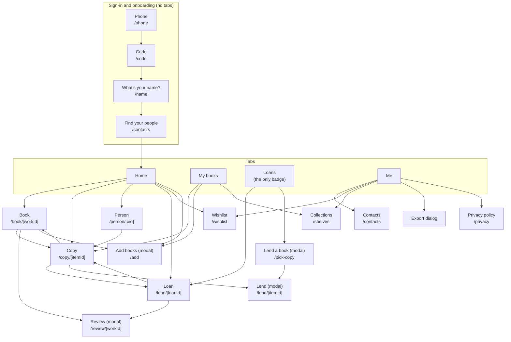

| Route | Screen title in the app | File |
|---|---|---|
| `/phone` | Welcome to LendShelf | [`(auth)/phone.tsx`](<../../src/app/(auth)/phone.tsx>) |
| `/code` | Enter the code | [`(auth)/code.tsx`](<../../src/app/(auth)/code.tsx>) |
| `/name` | What's your name? | [`(onboarding)/name.tsx`](<../../src/app/(onboarding)/name.tsx>) |
| `/contacts` | Find your people (onboarding) / Contacts (later) | [`contacts.tsx`](../../src/app/contacts.tsx) |
| `/` (tab) | Home | [`(tabs)/index.tsx`](<../../src/app/(app)/(tabs)/index.tsx>) |
| `/my-books` (tab) | My books | [`(tabs)/my-books.tsx`](<../../src/app/(app)/(tabs)/my-books.tsx>) |
| `/loans` (tab) | Loans | [`(tabs)/loans.tsx`](<../../src/app/(app)/(tabs)/loans.tsx>) |
| `/me` (tab) | Me | [`(tabs)/me.tsx`](<../../src/app/(app)/(tabs)/me.tsx>) |
| `/book/[workId]` | The book's title | [`book/[workId].tsx`](<../../src/app/(app)/book/[workId].tsx>) |
| `/copy/[itemId]` | Your copy / `<name>`'s copy | [`copy/[itemId].tsx`](<../../src/app/(app)/copy/[itemId].tsx>) |
| `/loan/[loanId]` | Loan | [`loan/[loanId].tsx`](<../../src/app/(app)/loan/[loanId].tsx>) |
| `/person/[uid]` | The person's name | [`person/[uid].tsx`](<../../src/app/(app)/person/[uid].tsx>) |
| `/add` | Add books / Add a copy / Add n books | [`add.tsx`](<../../src/app/(app)/add.tsx>) |
| `/pick-copy` | Lend a book · Which copy? | [`pick-copy.tsx`](<../../src/app/(app)/pick-copy.tsx>) |
| `/lend/[itemId]` | Lend, then Lent | [`lend/[itemId].tsx`](<../../src/app/(app)/lend/[itemId].tsx>) |
| `/review/[workId]` | Write a review / Edit your review | [`review/[workId].tsx`](<../../src/app/(app)/review/[workId].tsx>) |
| `/shelves` | Collections | [`shelves.tsx`](<../../src/app/(app)/shelves.tsx>) |
| `/wishlist` | Wishlist | [`wishlist.tsx`](<../../src/app/(app)/wishlist.tsx>) |
| `/privacy` | Privacy policy | [`privacy.tsx`](<../../src/app/(app)/privacy.tsx>) |

The auth gate in [`_layout.tsx`](../../src/app/_layout.tsx) decides which group is reachable; the tab bar and its badge are in [`(tabs)/_layout.tsx`](<../../src/app/(app)/(tabs)/_layout.tsx>).

### Loan states in one picture

F3 to F7 all move one `loans` document through these states. Only Cloud Functions write loans; the full rules are in [CORE-LOGIC.md](CORE-LOGIC.md) and [functions/src/lib/loans.ts](../../functions/src/lib/loans.ts).

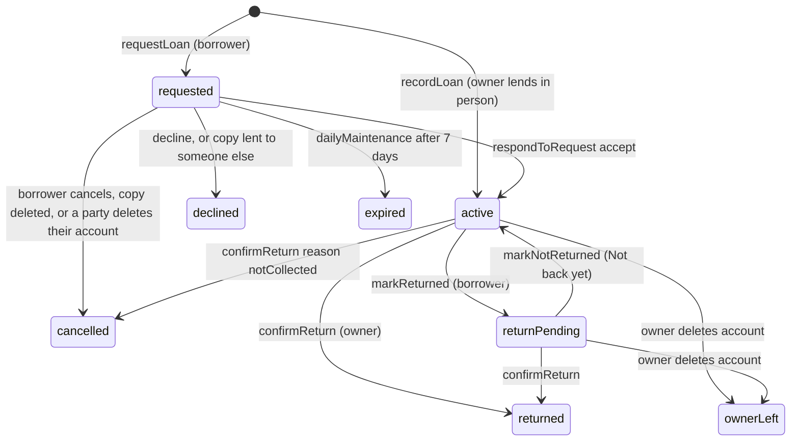

The "pick-up window" is not a state. It is wording shown for 48 hours after `startedAt` on loans that came from a request, and it ends early once anyone records a return event ([needs-you.ts](../../src/features/loans/needs-you.ts) `inPickupWindow`).

---

## F1 Sign in and set up

**Who and goal.** Someone opening LendShelf for the first time, or signing in on a new phone. The goal is to sign in with a phone number, give a name, find people from contacts and reach Home with a clear next step.

**Entry points**

- First launch, or any launch while signed out (the gate sends you to `/phone`).
- "Use a different number" on the name screen (signs out).
- A push tap or `lendshelf://` link while signed out: the target is kept and opened after onboarding ([use-pending-href.ts](../../src/hooks/use-pending-href.ts)).

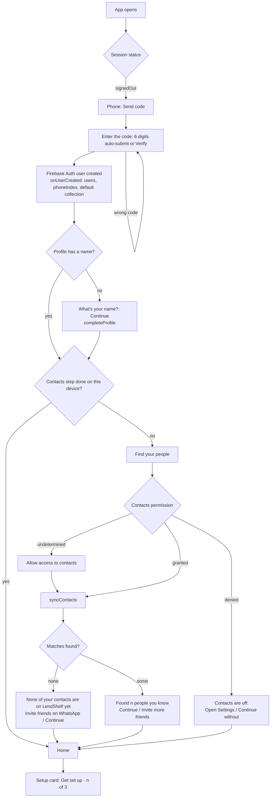

**Steps**

| # | Screen | What the user does | Labels and notes |
|---|---|---|---|
| 1 | Welcome to LendShelf (step 1 of 4) | Enters a mobile number (country picker defaults to India) and taps **Send code**. | Button shows "Sending code…", then "Checking this phone…" after 4 s. Footer: "People who have your number saved will be able to see the books you share." |
| 2 | Enter the code (step 2 of 4) | Types the 6-digit SMS code; it submits on the sixth digit, or taps **Verify**. | **Resend code in Ns**, then **Resend code** after 30 s (toast "New code sent"). Back clears the pending code and returns to Phone. |
| 3 | What's your name? (step 3 of 4) | Enters a name (max 60 characters) and taps **Continue**. | Calls `completeProfile`. Help text: "People see this on your requests until they save your number. Friends who have your number see the name they saved." **Use a different number** signs out. |
| 4 | Find your people (step 4 of 4) | Taps **Allow access to contacts** (or **Check my contacts** if already allowed). | Three privacy points ("Only numbers are checked", "Owners don't see who saved them", "Names you know"). **Skip for now** leaves without syncing. |
| 4a | Result, nobody found | **Invite friends on WhatsApp** (primary) or **Continue**. | Title "None of your contacts are on LendShelf yet". |
| 4b | Result, people found | **Continue** (primary); **Invite more friends** while 2 or fewer were found. | Title "Found n people you know", up to 3 names, "You'll see the books they share: n so far." |
| 4c | Contacts are off | **Open Settings** or **Continue without**. | Coming back from Settings with access granted syncs at once. |
| 5 | Home | Sees the setup card "Get set up · n of 3" (or the empty-circle copy), with rows **Find your people**, **Add your books**, **Set your pickup spot**. | The card's single button is the first unfinished row: "Invite friends" / "Turn on contacts" / "Try again", "Scan your shelf" (web: "Search for a book"), or "Set your pickup spot". Hidden while Needs-you cards exist. Dismissable (×) once two rows are done. |

On web there is no address book: the Contacts screen shows "Your contacts" with Name and Phone number fields and **Add contact**, and those numbers are what gets synced.

**What the other person sees.** Nothing directly. People who have the new user's number saved only see their books after their own next contact sync, which happens automatically on app foreground at most once a day (F13).

**Edge cases and errors**

| Case | What happens |
|---|---|
| Invalid number | "Enter a valid mobile number." |
| Wrong or expired code | "That code isn't right. Check the SMS and try again." / "That code has expired. Request a new one." |
| Too many attempts | "Too many attempts. Please wait a bit and try again." or "Too many SMS requests right now. Please try again later." |
| No connection | "No connection. Check your internet and try again." |
| Name save fails | "Couldn't save your name. Please try again." |
| Sync fails | Inline amber box with the error and **Retry**; the setup card later shows "Try again" instead of Invite. |
| Sync quota (20 per 24 h) | "You've synced a lot today. Try again tomorrow." |
| Address book has no numbers | "Your address book has no phone numbers to check." |
| iOS limited contacts | "You've shared only some contacts with LendShelf." + **Choose more contacts**. |
| Returning user, same phone | Goes straight to Home (the contacts step is remembered per user per device). |
| Returning user, new phone | Gets the normal Find your people screen. The spec's "Welcome back" copy (UX-FLOWS E1) was not built. |
| Auth trigger slow | `completeProfile` also creates `users`, `phoneIndex` and the default collection if missing. |

**Files.** [`(auth)/phone.tsx`](<../../src/app/(auth)/phone.tsx>), [`(auth)/code.tsx`](<../../src/app/(auth)/code.tsx>), [`(onboarding)/name.tsx`](<../../src/app/(onboarding)/name.tsx>), [`contacts.tsx`](../../src/app/contacts.tsx), [`_layout.tsx`](../../src/app/_layout.tsx) (auth gate), [session.ts](../../src/stores/session.ts), [contacts store](../../src/stores/contacts.ts), [first-run.ts](../../src/features/first-run/first-run.ts), [setup-card.tsx](../../src/features/home/setup-card.tsx), [use-manual-sync.tsx](../../src/features/contacts/use-manual-sync.tsx), [sync-contacts.ts](../../src/lib/sync-contacts.ts); backend [account.ts](../../functions/src/handlers/account.ts) (`onUserCreated`, `completeProfile`), [contacts.ts](../../functions/src/handlers/contacts.ts) (`syncContacts`).

---

## F2 Find a book

**Who and goal.** A reader who wants something to borrow, or wants to know "does anyone I know have X?" before buying it.

**Entry points**

- Home tab (the landing tab): feed sections and the search box "Does anyone have…?".
- A person's avatar in "Your circle" on Home, which opens their Person page.
- Loans empty state **Find a book** (jumps to Home and focuses search).
- Wishlist **Find books** (empty wishlist), and wishlist / "book is back" pushes (open the Copy page).

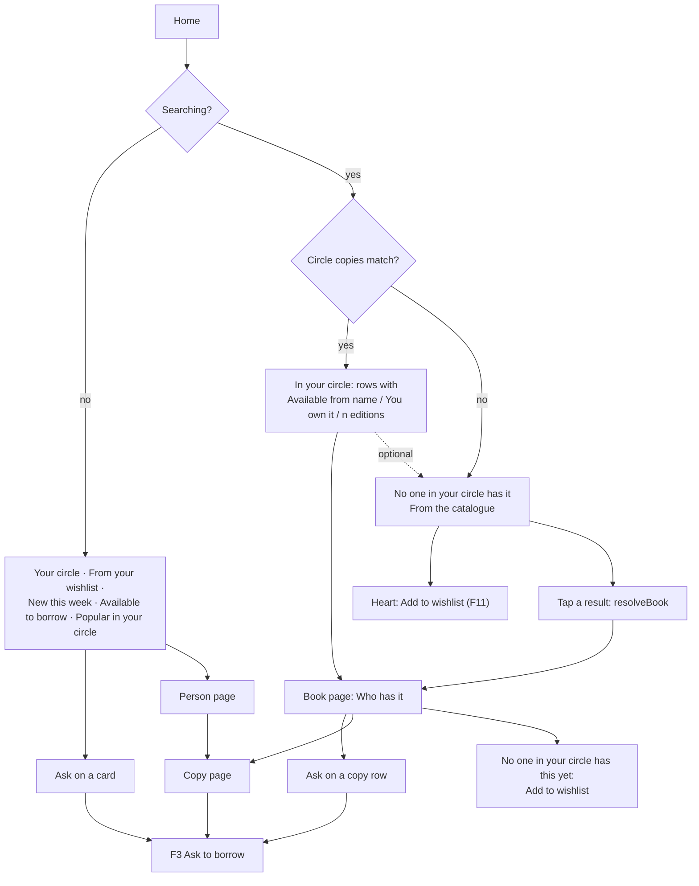

**Steps**

| # | Screen | Labels and behaviour |
|---|---|---|
| 1 | Home, not searching | Sections, each hidden when empty: **Your circle** (avatars with book counts, a "+ Invite" avatar, a "New on LendShelf: `<names>`" chip after a sync finds someone new); **From your wishlist** (available wishlist books with **Ask**); **New this week** (one card per person, "`<name>` added n books", tap to expand; last 7 days); **Available to borrow** ("Ready now from your circle", **Ask** on each card; excludes books in New, books I asked for, books I borrow and books I own); **Popular in your circle** (network copies only, books I own excluded, hidden below 3 entries). |
| 2 | Home, searching | Matches my circle's copies (and mine) by title or author on the device. Rows are grouped by book, and copies filed under different catalogue records with the same title and first author show as one row with an "n editions" badge. Each row shows an availability line ("Available from `<names>`", "With you · borrowed from `<name>`", "No one in your circle has it yet") or a "You own it" badge. |
| 3 | Home, no circle match | Card "No one in your circle has it", then **From the catalogue** (Open Library) once 2 or more characters are typed. Each result has a heart to add to the wishlist. With circle matches, a **Search the catalogue for "`<q>`"** button shows the catalogue too. |
| 4 | Book page | Compact header (cover, title, authors, "First published", average rating from reviews you can see). **Who has it** comes first: your copy first, then contacts' copies ranked by availability, "n of m available to borrow", **Ask** on available rows, and "Other edition" on copies filed under another catalogue record. Then **Wishlist** / **On wishlist** (hidden when you own a copy) and **I own this** / **Add another copy**, the reading panel (see F16), **About** (description, **Read more**) and **Reviews**. |
| 5 | Person page | Title is their name. "Pickup: …", counts, **Message on WhatsApp** (greets them by their profile first name), a search box when they share more than 8 books, filter **All** / **Available to borrow**, copies grouped by collection. |
| 6 | Copy page (viewer) | Status card: "Available to borrow" (**Ask to borrow**), "Lent" (**Notify me when it's back**), "Not lending" ("`<name>` has it but isn't lending it right now"), "Request sent" (**Message `<name>` again**, **Open request**, **Cancel request**), or "With you" (**Open loan**). Owner row with "Pickup: …"; Edition card (format, language and ISBN); Reviews. |

**What the other person sees.** Nothing. Browsing and searching are invisible to owners.

**Edge cases and errors**

| Case | What happens |
|---|---|
| Copy becomes hidden or private while open | The Copy page switches to "This copy isn't shared any more" with **See other copies of this book** and **Go back**. |
| Copy gets lent while open | Live update to "Lent"; Ask becomes **Notify me when it's back**. |
| Person not in my contacts | "Not in your contacts" + **Sync contacts**. |
| Person shares nothing | "No shared books yet · `<name>` hasn't shared any books with contacts yet." The spec's "Nudge `<name>`" button (UX-FLOWS E2) was not built. |
| Circle data fails to load | "Couldn't search your circle" / "Couldn't load your circle's books" with retry. |
| Catalogue outage | "The book catalogue isn't responding right now. Try again in a moment, or add the book by hand." |
| Circle empty | Home shows the setup card or the empty-circle copy instead of a feed; search still reaches the catalogue. |
| Subtitle variants | "Sapiens" and "Sapiens: A Brief History…" are not merged (open product question in QA-V1.1). |

**Files.** [`(tabs)/index.tsx`](<../../src/app/(app)/(tabs)/index.tsx>), [DiscoverHome.tsx](../../src/features/discover/DiscoverHome.tsx), [highlights.ts](../../src/features/discover/highlights.ts), [CatalogueResults.tsx](../../src/features/discover/CatalogueResults.tsx), [catalogue.ts](../../src/features/discover/catalogue.ts), [search.ts](../../src/lib/search.ts), [`book/[workId].tsx`](<../../src/app/(app)/book/[workId].tsx>), [CircleCopiesList.tsx](../../src/features/book/CircleCopiesList.tsx), [circle-copies.ts](../../src/features/book/circle-copies.ts), [`person/[uid].tsx`](<../../src/app/(app)/person/[uid].tsx>), [`copy/[itemId].tsx`](<../../src/app/(app)/copy/[itemId].tsx>), [ViewerPanel.tsx](../../src/features/copy/ViewerPanel.tsx), [copy-actions.ts](../../src/features/copy/copy-actions.ts), [use-items.ts](../../src/hooks/use-items.ts), [use-links.ts](../../src/hooks/use-links.ts); backend [books.ts](../../functions/src/handlers/books.ts) (`resolveBook`).

---

## F3 Ask to borrow

**Who and goal.** A borrower asks an owner (whose number they have saved) for an available, lendable copy. The request is the record; WhatsApp is where they actually talk.

**Entry points**

- **Ask** on a Home card (Available to borrow, From your wishlist).
- **Ask** on a Book page "Who has it" row.
- **Ask to borrow** on a Copy page.
- **Ask again** on a Loan screen after an expired request or a "lent to someone else" copy that is back.

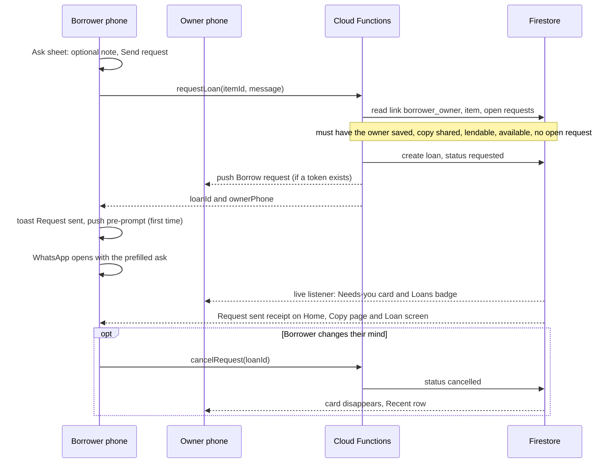

**Steps**

| # | Where | Labels and behaviour |
|---|---|---|
| 1 | Ask sheet | Title **Ask to borrow**: "`<owner>` gets a request in LendShelf. We'll then open WhatsApp so you can say hi." Book row with "from `<owner>`" and "Pickup: …" if the owner set one. Optional note (500 characters, placeholder "Add a note (optional), e.g. when you could pick it up"). **Cancel** / **Send request** ("Sending…"). |
| 2 | Ask sheet warning | If I already asked someone else for the same book: "You've already asked `<name>` for this. If `<name>` says yes too, you can cancel one." If I'm borrowing it: "You already have this book from `<name>`." Sending is still allowed. |
| 3 | After sending | Toast "Request sent · `<owner>` can accept it in LendShelf." The first time, the notification pre-prompt (F12). WhatsApp opens with a prefilled ask that greets the owner by profile first name. |
| 4 | Back in the app | Home shows a receipt card "Request sent · `<title>`", "`<owner>` can answer in LendShelf", **Message `<owner>` again**, **Open request** and × to hide it. The Copy page and Loan screen show "Request sent" with **Message `<owner>` again** and **Cancel request**. Loans lists it under **Your requests** ("expires in n days"). |
| 5 | Cancel | **Cancel request** → "Cancel your request? · `<owner>` won't see your request for `<title>` any more." **Keep it** / **Cancel request** → toast "Request cancelled". |
| 6 | Expiring | Two days before the 7-day expiry, a Needs-you card "Your request to `<owner>` expires in n days" with **Message `<owner>`**. |

**What the other person sees**

| When | Owner sees | Push to owner |
|---|---|---|
| Request created | Needs-you card "`<borrower>` wants `<title>`" (or "n people want `<title>`") on Home and Loans; Loans badge +1; Copy page "`<borrower>` wants to borrow it"; Loan screen "`<borrower>` wants to borrow it". "Not in your contacts · `<number>`" when the owner hasn't saved the borrower. | "Borrow request: `<borrower>` would like to borrow `<title>`." |
| Borrower cancels | Card disappears; Recent "`<borrower>` cancelled the request". | None. |
| 7 days pass | Recent "You didn't answer `<borrower>`'s request"; Loan "Request expired" with **Message `<borrower>`**. | Borrower only: "Request expired". |

**Edge cases and errors** (server messages from [loans.ts](../../functions/src/handlers/loans.ts))

| Case | Message or behaviour |
|---|---|
| Owner not saved | "You can only borrow from people whose number you have saved." |
| Copy lent meanwhile | "This copy is lent out right now." |
| Owner set Not lending | "The owner isn't lending this copy." |
| Copy hidden or gone | "Book not found." |
| Own copy | "You can't borrow your own book." |
| Already asked (retry after a lost response) | Server says `already-exists`; the app opens the existing request and still opens WhatsApp. |
| Owner deletes the copy | Request becomes `cancelled` with `closedReason: copyRemoved`; borrower push "Request cancelled: `<owner>` removed `<title>`."; Recent "`<owner>` removed the book". |
| Owner hides it or makes it private | The owner's app declines the request first (reason `notLending`, F9), so the borrower sees a normal decline. |
| Offline | Toast "You're offline…" or "Can't reach LendShelf…". Buttons are not disabled while offline (QA-V1.1 B6, still open). |

**Files.** [AskDialog.tsx](../../src/features/copy/AskDialog.tsx), [ViewerPanel.tsx](../../src/features/copy/ViewerPanel.tsx), [DiscoverHome.tsx](../../src/features/discover/DiscoverHome.tsx) (receipts), [CircleCopiesList.tsx](../../src/features/book/CircleCopiesList.tsx), [requests.ts](../../src/features/loans/requests.ts) (`askConflict`, `existingRequestFor`), [loans messages](../../src/features/loans/messages.ts), [whatsapp.ts](../../src/lib/whatsapp.ts), [api.ts](../../src/lib/api.ts); backend `requestLoan` and `cancelRequest` in [loans.ts](../../functions/src/handlers/loans.ts), push text in [messages.ts](../../functions/src/lib/messages.ts).

---

## F4 Answer a request

**Who and goal.** The owner says yes (with a due date and pickup note) or no (with an optional reason), and starts the WhatsApp conversation. When several people asked for one copy, the owner picks one.

**Entry points**

- Needs-you card on Home (at most 2 cards) or Loans (all cards).
- Push "Borrow request" (opens the Loan screen).
- Owner's Copy page "`<name>` wants to borrow it" / "n people want it · Review requests".
- Loan screen in the requested state.

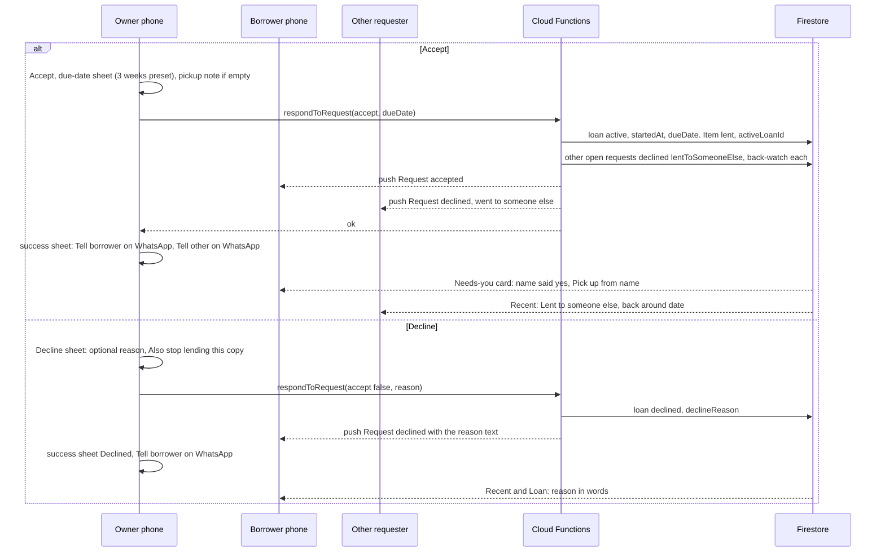

**Steps: accept**

| # | Where | Labels and behaviour |
|---|---|---|
| 1 | Card | One request: "`<borrower>` wants `<title>`", the note, "expires in n days", optional "Not in your contacts · `<number>`". **Accept** (primary), **Decline**, and a WhatsApp icon "Message `<borrower>` on WhatsApp". |
| 2 | Due-date sheet | Title "Lend to `<borrower>`", "When should `<title>` come back?". Chips **1 week**, **2 weeks**, **3 weeks** (preselected), **1 month**, **2 months**, plus a date stepper. If other people asked: "`<name>`'s request will be declined. They'll be told it went to someone else, and we'll tell them when it's back." While my pickup note is empty: "Where can they pick it up?" with **Don't ask again** (a typed note is saved to my profile). **Cancel** / **Lend to `<borrower>`** ("Lending…"). |
| 3 | Success sheet | "Lent to `<borrower>` · due `<date>`", "`<borrower>` can see it in LendShelf. Agree the pick-up on WhatsApp." (or "The other request was declined."). **Tell `<borrower>` on WhatsApp** (primary, prefilled "Yes, you can borrow…" with pickup and due date), **Tell `<other>` on WhatsApp** for each declined requester, **Done**. First accept also shows the notification pre-prompt. |
| 4 | Afterwards | The card is gone. Loans › **Out with friends** shows "Waiting for `<borrower>` to pick up" for 48 hours. |

**Steps: several requests for one copy**

| # | Where | Labels and behaviour |
|---|---|---|
| 1 | Grouped card | "n people want `<title>`", "`<names>` · first asked `<time>`". With exactly 2 requesters: **Lend to `<name A>`** and **Lend to `<name B>`** (both outline). With 3 or more: **Choose who**. The card counts once for the badge. |
| 2 | Chooser | "Who gets `<title>`?" "The others are told it went to someone else, and we'll tell them when it's back." One row per requester (name, "Not in your contacts" cue, note, "Asked …", expiry) with **Lend to `<name>`** and **Decline**; **Decline all** at the bottom. |
| 3 | Then | The due-date sheet and success sheet as above. |

**Steps: decline**

| # | Where | Labels and behaviour |
|---|---|---|
| 1 | Decline sheet | "Decline `<name>`'s request?" (or "Decline all n requests?"), "`<name>` is told in LendShelf that you can't lend `<title>`. Add a reason if you like." Reason chips **I'm reading it**, **Not lending this one**, **Lent to someone else** (optional, tap again to clear). With Not lending: switch **Also stop lending this copy** (sets the copy to Not lending). **Cancel** / **Decline** ("Declining…"). |
| 2 | Success sheet | Title "Declined", **Tell `<name>` on WhatsApp** with the reason prefilled, **Done**. |

**What the other person sees**

| Outcome | Borrower sees | Push |
|---|---|---|
| Accepted | Needs-you card "`<owner>` said yes to `<title>`", "Pick up from `<owner>` · pickup: …", **Message `<owner>`**; Loan banner "Pick up from `<owner>`"; With you row "Pick up from `<owner>`". | "Request accepted: `<owner>` is lending you `<title>`. Due back `<date>`." |
| Declined, I'm reading it | Recent and Loan "Request declined · `<owner>` is reading it right now." with **Add to wishlist**. | "`<owner>` is reading `<title>` right now." |
| Declined, Not lending | "`<owner>` isn't lending it at the moment." | "`<owner>` isn't lending `<title>` at the moment." |
| Declined, no reason | "`<owner>` can't lend it right now." | "`<owner>` can't lend `<title>` right now." |
| Lent to someone else (chosen, or automatic when another request is accepted or the copy is lent by hand) | "Lent to someone else · back around `<date>`", "We'll tell you when it's back." with **Turn off "Notify me"**. The server created a back-watch. When the copy is back: "It's back on `<owner>`'s shelf" with **Ask again**. | "`<title>` went to someone else. We'll tell you when it's back." |
| Borrower had another open request for the same book | R14 card "`<owner>` said yes to `<title>`. Cancel your request to `<other>`?" with **Cancel the other request** / **Keep both**. | None. |

**Edge cases and errors**

| Case | What happens |
|---|---|
| Borrower cancelled while the sheet is open | The sheet closes by itself; toast "`<name>` cancelled this request" (shown once, 6 s). |
| Request older than 7 days | The card disappears; the Loan screen says "Request expired" with **Message `<name>`**; the server answers "This request expired (requests last 7 days)." and marks it expired. |
| Copy already lent (e.g. lent by hand) | "You already lent it to …" from [stale.ts](../../src/features/loans/stale.ts); server text "This copy is already lent out. Confirm its return first." |
| Retry after a lost response | If accept fails as "already lent" by this same loan, the success sheet is shown instead of an error. |
| Network error | Toast with **Retry**; the sheet stays open. |
| Requester deleted their account | `deleteAccount` already cancelled the request; the card disappears. |

**Files.** [needs-you-card.tsx](../../src/features/loans/needs-you-card.tsx), [needs-you.ts](../../src/features/loans/needs-you.ts), [loan-sheets.tsx](../../src/features/loans/loan-sheets.tsx), [due-date-dialog.tsx](../../src/features/loans/due-date-dialog.tsx), [due-dates.ts](../../src/features/loans/due-dates.ts), [requests.ts](../../src/features/loans/requests.ts), [stale.ts](../../src/features/loans/stale.ts), [loans messages](../../src/features/loans/messages.ts), [OwnerPanel.tsx](../../src/features/copy/OwnerPanel.tsx), [`loan/[loanId].tsx`](<../../src/app/(app)/loan/[loanId].tsx>), [loan-view.ts](../../src/features/loans/loan-view.ts); backend `respondToRequest` in [loans.ts](../../functions/src/handlers/loans.ts).

---

## F5 Pick up, return and confirm

**Who and goal.** After a yes, the borrower collects the book, reads it and gives it back; the owner confirms it is back. The owner can also say "Not back yet", close a loan that was never collected, or change the due date.

**Entry points**

- Needs-you cards: pick-up (borrower), due soon (borrower), "says they returned" (owner), "hasn't got it back yet" (borrower).
- Loans rows: **Out with friends** (owner, **Got it back** on each row) and **With you** (borrower).
- Loan screen; Copy page (**Got it back**, **Open loan**); pushes.

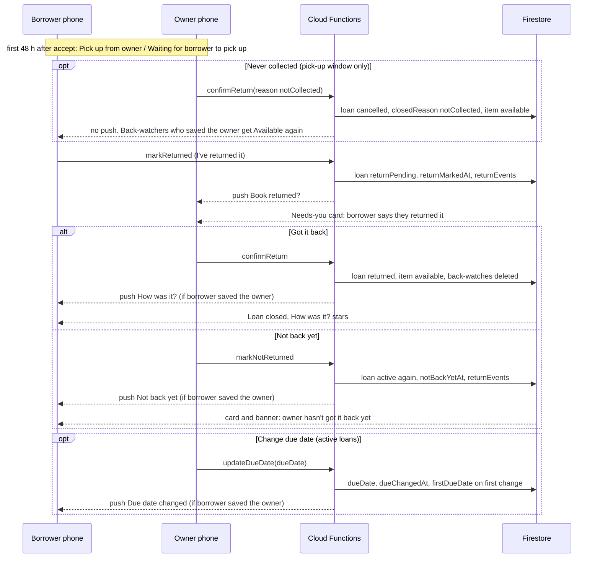

**Steps**

| # | Who | Where and labels |
|---|---|---|
| 1 | Borrower | Pick-up window: card "`<owner>` said yes to `<title>`", **Message `<owner>`**; Loan banner "Pick up from `<owner>`" with **Message `<owner>`**, and quieter **Not picking it up? Tell `<owner>`** and **I've returned it**. |
| 2 | Owner | Pick-up window: Loan banner "Waiting for `<borrower>` to pick up", "You said yes · due …", **Message `<borrower>`**, and **Not collected? Close this loan** → "Close this loan as not collected? · Use this if `<borrower>` never picked up `<title>`. It's available again, and `<borrower>` isn't asked for a review." **Close loan** → toast "Closed as not collected". |
| 3 | Borrower | Reading: Loan banner "With you · From `<owner>` · due `<date>`", **I've returned it**, **Ask for more time** (WhatsApp). Within 2 days of the due date a Needs-you card with the same two actions. |
| 4 | Borrower | **I've returned it** → "Did you give `<title>` back to `<owner>`? · `<owner>` will be asked to confirm they have it." **Not yet** / **Yes, I've returned it** → toast "Thanks! `<owner>` will confirm". Banner becomes "Waiting for `<owner>` to confirm" with **Message `<owner>`**. |
| 5 | Owner | Card "`<borrower>` says they returned `<title>`", "Confirm when you have it": **Got it back** (one tap, no confirm, because both sides agree) and **Not back yet**. From any other place (Out with friends row, Copy page, Loan screen, overdue card) **Got it back** opens "Got `<title>` back from `<borrower>`?" with **Yes, it's back** / **Cancel**; it adds "`<borrower>` hasn't said they returned it." when that is true for an app borrower. Toast "Back on your shelf". |
| 6 | Owner | **Not back yet** → "Tell `<borrower>` you haven't got `<title>` back? · The loan stays open and due-date reminders start again." → success sheet "Marked as not back yet", "The loan is open again. `<borrower>` can see it in LendShelf.", **Message `<borrower>` on WhatsApp**. |
| 7 | Borrower | After Not back yet: card and banner "`<owner>` hasn't got it back yet" (card for 3 days), **Message `<owner>`** (prefilled reply), **I've returned it**, **Ask for more time**. |
| 8 | Owner | **Change** on the Loan screen's due row (or the calendar icon on an overdue card) → sheet "Change due date", chips **+1 week**, **+2 weeks**, **+1 month** counted from the current due date, **Save due date** → success sheet "Due date moved to `<date>`" with **Tell `<borrower>` on WhatsApp** (text adapts when the date moves earlier). |
| 9 | Borrower | After confirm: Loan "Returned to `<owner>` · Confirmed `<date>`" and **How was it?** stars (F10). Recent row "Returned to `<owner>`". |

**What the other person sees.** Every change is live on the other phone through Firestore listeners (4 to 9 s in the two-phone run). The Loan screen timeline lists "You asked / `<name>` asked", "Accepted (due …)" or "Lent to `<name>`", "Due date moved to …", every "said it's back" and "not back yet", and how it ended ("Confirmed back", "Closed: not collected").

| Event | Push (only if a token exists) |
|---|---|
| markReturned | Owner: "Book returned? `<borrower>` says they've returned `<title>`. Confirm when you have it." |
| confirmReturn | Borrower (if they saved the owner): "How was it? Thanks for returning `<title>`. Leave a quick review?"; back-watchers who saved the owner and could see the copy: "Book is back". |
| Not collected | Back-watchers: "Available again". No review prompt. |
| markNotReturned | Borrower (if they saved the owner): "Not back yet: `<owner>` hasn't got `<title>` back yet." |
| updateDueDate | Borrower (if they saved the owner): "Due date changed: `<owner>` changed the due date for `<title>` to `<date>`." |

**Edge cases and errors**

| Case | What happens |
|---|---|
| Due date in the past or over a year | "The due date can't be in the past." / "The due date must be within a year." (date-only values mean noon IST, [functions/src/lib/loans.ts](../../functions/src/lib/loans.ts) `resolveDueDate`). |
| Action on a loan that already moved | Server: "Can't `<action>`: this loan is `<state>`." The app rewrites it in plain words and closes the sheet ([stale.ts](../../src/features/loans/stale.ts), [errors.ts](../../src/lib/errors.ts)). |
| Wrong person | "Only the owner can …" / "Only the borrower can …" / "This isn't your loan." |
| Borrower not on LendShelf | No WhatsApp button without a number; **Got it back** becomes the primary. |
| Borrower deleted their account | Owner banner "`<name>` left LendShelf · You can still mark it back or message them on WhatsApp." |
| Due date passes while returnPending | No reminders until the owner taps Not back yet. |

**Files.** [loan-view.ts](../../src/features/loans/loan-view.ts), [`loan/[loanId].tsx`](<../../src/app/(app)/loan/[loanId].tsx>), [loan-sheets.tsx](../../src/features/loans/loan-sheets.tsx), [needs-you.ts](../../src/features/loans/needs-you.ts), [needs-you-card.tsx](../../src/features/loans/needs-you-card.tsx), [buckets.ts](../../src/features/loans/buckets.ts), [`(tabs)/loans.tsx`](<../../src/app/(app)/(tabs)/loans.tsx>), [OwnerPanel.tsx](../../src/features/copy/OwnerPanel.tsx), [ViewerPanel.tsx](../../src/features/copy/ViewerPanel.tsx), [due-dates.ts](../../src/features/loans/due-dates.ts); backend `markReturned`, `confirmReturn`, `markNotReturned`, `updateDueDate` in [loans.ts](../../functions/src/handlers/loans.ts).

---

## F6 Overdue and nudges

**Who and goal.** Keep books coming back without awkwardness: the app reminds both sides, and the owner can nudge on WhatsApp in one tap. The borrower can ask for more time.

**Entry points**

- Daily job `dailyMaintenance` at 09:00 India time.
- Needs-you cards: overdue (owner), due within 2 days or overdue (borrower).
- Home status strip ("n out with friends · n with you, due …", "1 overdue").
- Loan screen.

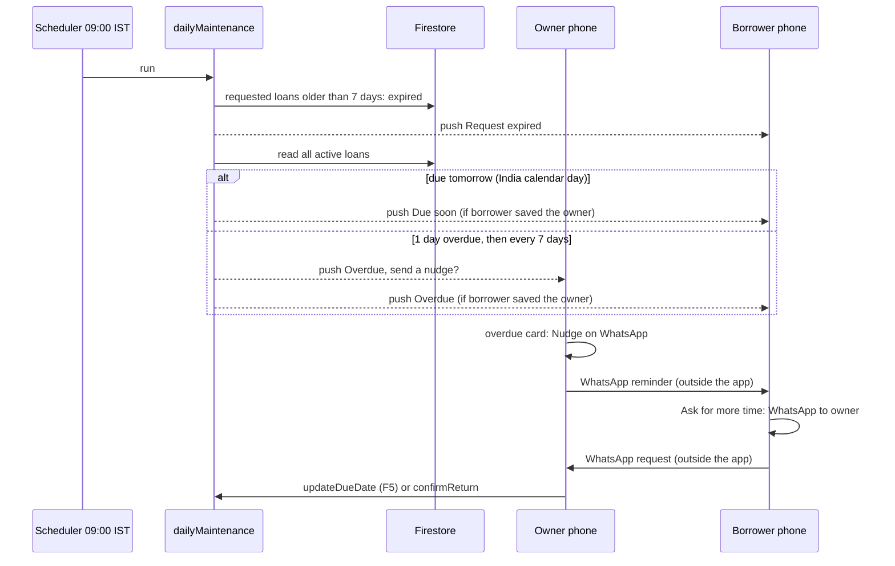

**Steps**

| # | Who | Labels and behaviour |
|---|---|---|
| 1 | Owner | Overdue card "`<title>` with `<borrower>`", "n days overdue" in red and in words. **Nudge on WhatsApp** (primary; prefilled "Hi `<name>`! Just a reminder that `<title>` was due back on `<date>`…"), **Got it back** (confirm sheet), calendar icon **Change due date**. Without a number: **Got it back** is the primary. |
| 2 | Owner | Loan banner "n days overdue · With `<borrower>` · was due `<date>`", same actions. On a loan that isn't overdue, the Loan screen offers **Got it back** and **Nudge `<name>`** as secondary actions. |
| 3 | Borrower | Card "`<title>` from `<owner>`" with "due tomorrow" / "n days overdue", **I've returned it**, **Ask for more time** (WhatsApp "Could I keep `<title>` a little longer? Maybe till `<date + 1 week>`?"). |
| 4 | Both | Loans tab badge counts the cards; the status strip says "1 overdue". |

**What the other person sees.** A nudge and a request for more time are WhatsApp messages only; nothing changes in the app until the owner changes the due date (F5) or confirms the return.

**Reminder rules (code)**

| Reminder | When | To |
|---|---|---|
| Due soon | The India calendar day before the due date, once | Borrower, only if they saved the owner |
| Overdue | The day after the due date, then every 7 days | Owner always; borrower only if they saved the owner |
| Request expired | First run after 7 days | Borrower |
| Owner reminders for expiring requests or long returnPending | Not built (UX-FLOWS backlog G36) | n/a |

**Edge cases.** Loans to people not on the app still get owner reminders. Loans in `returnPending` get no reminders. In-app due wording ("due today", "1 day overdue") is computed on the device and can differ slightly from push timing, which follows India time.

**Discrepancy.** [SPEC.md](../../SPEC.md) §5 and the header comment in [maintenance.ts](../../functions/src/handlers/maintenance.ts) say "due in 2 days"; the code (`reminderKind` in [functions/src/lib/loans.ts](../../functions/src/lib/loans.ts)) sends "Due soon" the day before. The in-app borrower card appears 2 days ahead.

**Files.** [maintenance.ts](../../functions/src/handlers/maintenance.ts), [functions/src/lib/loans.ts](../../functions/src/lib/loans.ts), [messages.ts](../../functions/src/lib/messages.ts), [needs-you.ts](../../src/features/loans/needs-you.ts), [needs-you-card.tsx](../../src/features/loans/needs-you-card.tsx), [status-strip.tsx](../../src/features/home/status-strip.tsx), [home.ts](../../src/features/home/home.ts), [loans messages](../../src/features/loans/messages.ts), [whatsapp.ts](../../src/lib/whatsapp.ts).

---

## F7 Lend in person

**Who and goal.** The owner records a book handed over face to face, to an app user or to someone not on the app, so the app remembers who has it and reminds them.

**Entry points**

- Loans header **Lend a book** → copy picker.
- Owner's Copy page **Lend this copy**.
- Loans empty state **Lend a book** (when I have books but no circle).

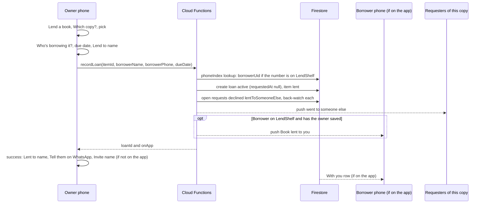

**Steps**

| # | Screen | Labels and behaviour |
|---|---|---|
| 1 | Lend a book · Which copy? | Search my copies that are on my shelf now (lendable, Not lending or Hidden; books already out are not listed). Empty: "Nothing to lend" + **Add books**. |
| 2 | Lend | Book row. **Who's borrowing it?**: an "On LendShelf" section (my linked contacts), then "Your contacts" (phone address book; web: "Saved numbers"), then **Someone else** ("Type a name and, if you like, their number") with Name and Phone fields and **Use this person**. If someone asked for this copy: "`<name>` asked for this. Their request will be declined." |
| 3 | Lend | **When should it come back?**: chips 1 week / 2 weeks / 3 weeks / 1 month and **Pick a date** (calendar). Button **Lend to `<name>`** ("Lending…"; "Choose who's borrowing it" until someone is picked). |
| 4 | Lent | "Lent to `<name>`", "`<title>` is due back `<date>` (in n weeks)." plus "They'll see it in their Loans tab." when the number belongs to an app user. If not on the app: "`<name>` isn't on LendShelf. Invite them?" with **Invite `<name>`**. **Tell them on WhatsApp** (only with a number) and **Done**. |

**What the other person sees**

| Borrower | Sees | Push |
|---|---|---|
| On LendShelf, has the owner saved | Loans › With you "From `<owner>` · due …" (no pick-up window, because `requestedAt` is null); Loan banner "With you". | "Book lent to you: `<owner>` lent you `<title>`. Due back `<date>`." |
| On LendShelf, has not saved the owner | The loan is linked and readable, but no push, no due-soon or overdue push and no review prompt. | None (privacy rule, DECISIONS #23). |
| Not on LendShelf | Only the WhatsApp message, if the owner sends it. | None. |

**Edge cases and errors**

| Case | What happens |
|---|---|
| Copy already lent | "Already lent out · `<title>` is out right now (…). Mark it returned first." with **Close**. The spec's inline **Got it back** (UX-FLOWS G13) was not built. |
| Not the owner | "Can't lend this book · Only the owner of a copy can lend it." |
| Bad number | "That number doesn't look right. Include the country code if it's not local." / server "`<number>` isn't a valid phone number." |
| Own number | "You can't lend a book to yourself." |
| Lending a Hidden copy | Allowed; the copy stays hidden to others. |
| Typo in a recorded borrower | Not editable (UX-FLOWS H12 open). |

**Files.** [`pick-copy.tsx`](<../../src/app/(app)/pick-copy.tsx>), [`lend/[itemId].tsx`](<../../src/app/(app)/lend/[itemId].tsx>), [borrower-picker.tsx](../../src/features/lend/components/borrower-picker.tsx), [borrowers.ts](../../src/features/lend/borrowers.ts), [due-date-picker.tsx](../../src/features/lend/components/due-date-picker.tsx), [due-date.ts](../../src/features/lend/due-date.ts), [pick-copy.ts](../../src/features/lend/pick-copy.ts), [use-device-contacts.ts](../../src/features/lend/use-device-contacts.ts), [share-invite.ts](../../src/features/invite/share-invite.ts); backend `recordLoan` in [loans.ts](../../functions/src/handlers/loans.ts).

---

## F8 Add books

**Who and goal.** An owner gets physical books into LendShelf quickly and onto the right catalogue record, so "who has X" works across friends.

**Entry points**

- **+** ("Add a book") in the My books header.
- Home setup card **Scan your shelf** / **Search for a book**.
- My books welcome screen **Scan books** (web: **Search for a book**), **Search**, **Type it in**.
- Book page **I own this** / **Add another copy** (skips straight to the confirm step).
- "Nothing shared yet" on Home: **Add a book**; Lend picker empty state **Add books**.

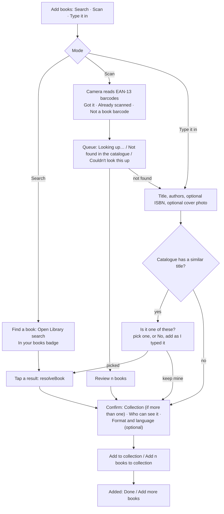

**Steps**

| # | Screen | Labels and behaviour |
|---|---|---|
| 1 | Add books | Mode switch **Search**, **Scan**, **Type it in** (Scan is the default on phones, Search on web). |
| 2a | Search | "Find a book" with a title/author box; results show "In your books" when I already own it; an ISBN typed here offers **Look up this ISBN**; **Not here? Add it yourself** / **Add "`<q>`" yourself**. |
| 2b | Scan | Continuous scanning with a torch button; each barcode shows a toast "Got it", "Already scanned" or "Not a book barcode". An "Or type an ISBN" box with **Add**. Queue rows show "Looking up…", the resolved title, "Not found in the catalogue" (**Type it in**) or "Couldn't look this up" (**Retry**). **Review n books** goes to confirm; **Clear** empties the queue. |
| 2c | Type it in | Title, authors, ISBN (optional), cover photo from camera or library (JPEG/PNG/WebP/HEIC, under 5 MB, uploaded to Storage `covers/{uid}/…`). **Continue** ("Checking the catalogue…") runs a catalogue check: "Is it one of these?" with matches, **No, add "`<title>`" as I typed it** and **Back to edit**. |
| 3 | Confirm | Header "Add a copy" or "Add n books". Duplicate warning "You already have a copy of this book. Adding it again creates a second copy." **Collection** (only with more than one), **Who can see it** (Lendable / Not lending / Hidden with the privacy help text), **Format and language (optional)** (Paperback / Hardcover / Other; language chips). Button **Add to `<collection>`** or **Add n books to `<collection>`** ("Adding…"). |
| 4 | Added | "`<title>` is on your shelf" (or n books), **Done** / **Add more books**. |

**What the other person sees.** People who have my number saved see the new copies on Home (New this week, Available to borrow) once the collection is public and the copy is not Hidden. Anyone with a wishlist entry for the book who has me saved gets "On your wishlist: `<owner>` added `<title>`." (`onItemWritten` trigger).

**Edge cases and errors**

| Case | What happens |
|---|---|
| Leaving with a scan queue or typed text | Header Back and Android Back ask "Discard n scanned books?" (**Keep scanning** / **Discard**) or "Discard this book?" (**Keep editing** / **Discard**). From the confirm step Back returns to the previous step. |
| Camera denied | "Camera access is turned off for LendShelf. Turn it on in Settings to scan barcodes." with **Open Settings** (or **Allow camera** if it can still ask). |
| ISBN not in any catalogue | Toast "That ISBN isn't in the catalogues. Add the details yourself." and the manual form prefilled. |
| Catalogue down | "The book catalogue isn't responding right now…"; manual add still works. |
| Photo too big or wrong type | "That photo is too large. Pick one under 5 MB." / unsupported type message. |
| Save fails | Toast "Couldn't add the book. Please try again." Copies are written in batches of up to 19, so a failure part-way can leave earlier batches saved; the spec's "4 of 6 added. Retry the other 2" (UX-FLOWS E8) was not built. |
| Remembered settings | Collection and visibility are remembered for the next add while the app runs (a module variable), not across app restarts; UX-FLOWS E8 says "between sessions". |
| Adding a book that is on my wishlist | The spec's "Remove from your wishlist?" prompt (UX-FLOWS E11) was not built. |

**Files.** [`add.tsx`](<../../src/app/(app)/add.tsx>), [scan-panel.tsx](../../src/features/add/components/scan-panel.tsx), [barcode-camera.tsx](../../src/features/add/components/barcode-camera.tsx), [search-panel.tsx](../../src/features/add/components/search-panel.tsx), [manual-panel.tsx](../../src/features/add/components/manual-panel.tsx), [confirm-step.tsx](../../src/features/add/components/confirm-step.tsx), [added-step.tsx](../../src/features/add/components/added-step.tsx), [save.ts](../../src/features/add/save.ts), [scan-queue.ts](../../src/features/add/scan-queue.ts), [isbn.ts](../../src/features/add/isbn.ts), [open-library.ts](../../src/features/add/open-library.ts), [leave.ts](../../src/features/add/leave.ts), [library-empty.tsx](../../src/features/library/components/library-empty.tsx); backend `resolveBook` in [books.ts](../../functions/src/handlers/books.ts) and [functions/src/lib/books.ts](../../functions/src/lib/books.ts); `onItemWritten` in [triggers.ts](../../functions/src/handlers/triggers.ts); rules in [firestore.rules](../../firestore.rules) and [storage.rules](../../storage.rules).

---

## F9 Manage my library

**Who and goal.** The owner controls what others see and can borrow, organises copies into collections and deletes copies, without leaving anyone with a dead request.

**Entry points**

- My books tab: grid or list of copies, search, collection chips (**All**, each collection, **Manage**) and status chips **All**, **Out**, **Not lending**, **Hidden**; header icons **Collections** and **+**.
- Copy page (owner): **Sharing** and **Collection**.
- Collections screen (`/shelves`) from My books or Me › Collections.

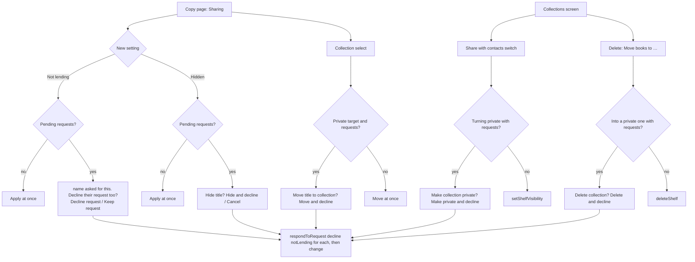

**Steps**

| # | Where | Labels and behaviour |
|---|---|---|
| 1 | Copy page status card | "On your shelf" (or "(not lending)", "(private)") with **Lend this copy**; "`<name>` wants to borrow it" / "n people want it · Review requests"; when out, "Waiting for `<name>` to pick up" or "With `<name>`" with **Open loan** and **Got it back**. |
| 2 | Sharing | Segmented **Lendable** / **Not lending** / **Hidden** with help text: "People who have your number saved can see it and ask to borrow it." / "…can see you have it, but can't ask." / "Only you can see it." |
| 3 | Collection | Select of my collections (private ones marked); toast "Moved to `<collection>`". |
| 4 | Edition | **Edit** → format, language → **Save** (toast "Edition details saved"). |
| 5 | Delete | **Delete this copy** (disabled while out: "Mark it returned before deleting this copy.") → "Delete this copy?" → **Delete** → toast "Copy deleted". Open requests are cancelled by the server trigger. |
| 6 | Collections screen | Each row: "n books · Shared/Private", **Move up/down**, **Share with contacts** switch, **Rename**, **Delete** (disabled for the last one). **New collection** → "New collection" dialog with name and **Share with contacts** ("People who have your number saved can see these books." / "Private: only you can see these books.") → **Create**. |
| 7 | Delete collection | "Its n books move to the collection you pick. No books are deleted." **Move books to** → **Delete collection** → toast "Deleted `<collection>`. n books moved to …". |

The default collection is stored as "My books" but shown as **Main shelf** everywhere ([filter.ts](../../src/features/library/filter.ts) `MAIN_SHELF_NAME`).

**What the other person sees.** Copies that become Hidden or private disappear from their Home and Person pages within seconds; a copy page they have open switches to "This copy isn't shared any more". Declined requesters see "`<owner>` isn't lending it at the moment" and get the decline push. Not lending copies show "Not lending · `<owner>` has it but isn't lending it right now".

**Edge cases.** The declines run on the client, one `respondToRequest` per request, before the visibility change; if the app closes in between, the requests are declined and the copy still visible (safe; the owner retries). A server trigger to do this (UX-FLOWS G34) is not built, and `deleteShelf` itself never declines. Collections with more than 480 copies can't be made private or deleted in one step ("This collection has more than 480 books; split it first."). Hiding a copy that is out is allowed; the borrower keeps access through the loan.

**Files.** [`(tabs)/my-books.tsx`](<../../src/app/(app)/(tabs)/my-books.tsx>), [library-toolbar.tsx](../../src/features/library/components/library-toolbar.tsx), [copy-card.tsx](../../src/features/library/components/copy-card.tsx), [filter.ts](../../src/features/library/filter.ts), [OwnerPanel.tsx](../../src/features/copy/OwnerPanel.tsx), [visibility-copy.ts](../../src/features/copy/visibility-copy.ts), [EditEditionDialog.tsx](../../src/features/copy/EditEditionDialog.tsx), [`shelves.tsx`](<../../src/app/(app)/shelves.tsx>), [shelf-dialogs.tsx](../../src/features/shelves/components/shelf-dialogs.tsx), [pending-requests.ts](../../src/features/shelves/pending-requests.ts), [pending-requests-sheet.tsx](../../src/features/shelves/components/pending-requests-sheet.tsx), [actions.ts](../../src/features/shelves/actions.ts), [mutations.ts](../../src/features/shared/mutations.ts); backend `setShelfVisibility`, `deleteShelf` in [shelves.ts](../../functions/src/handlers/shelves.ts), `onItemWritten` in [triggers.ts](../../functions/src/handlers/triggers.ts); rules in [firestore.rules](../../firestore.rules).

---

## F10 Reviews

**Who and goal.** Anyone can rate a book (1 to 5 stars, optional text), so friends can decide what to borrow. Reviews belong to the book, not the copy; you see your own review and reviews by people whose number you saved.

**Entry points**

- Loan screen after a confirmed return: **How was it?** stars (borrower).
- Push "How was it?" (opens the closed loan with the review section).
- Book page **Reviews** → **Write a review** / **Edit your review** / **Write the first review**.
- Copy page reviews section.

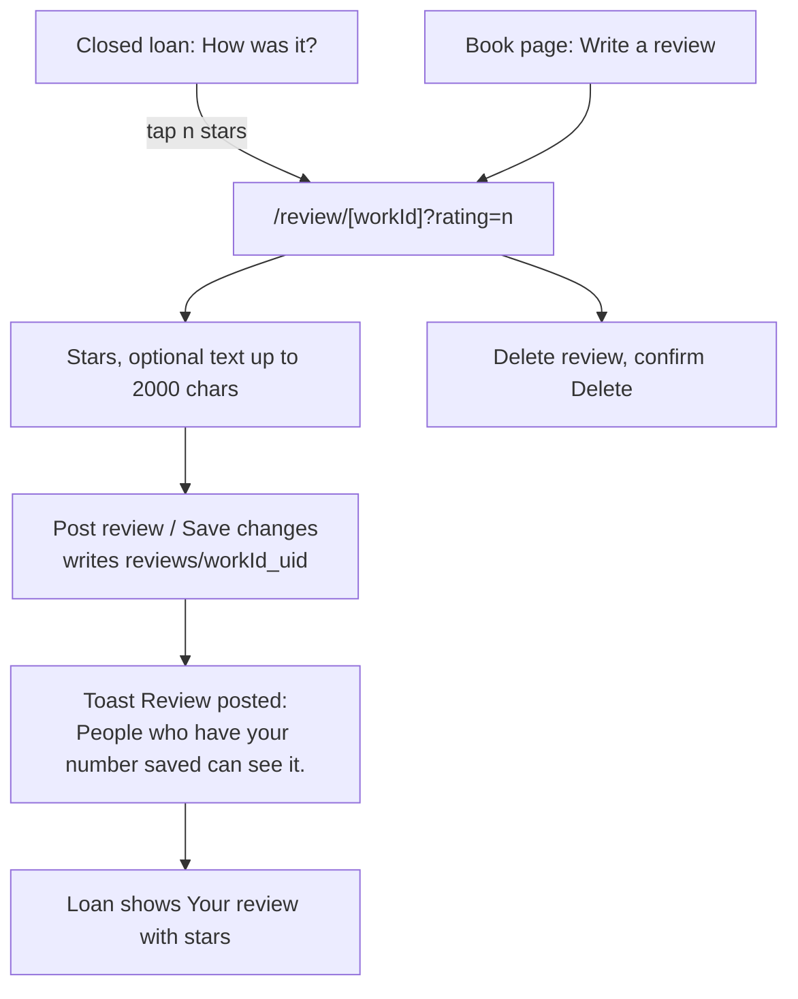

**Steps.** The review modal is titled "Write a review" or "Edit your review", shows the book, a star row with a word for each rating ("Tap a star to rate" before), a text box, **Post review** / **Save changes** ("Saving…"), and **Delete review** with a **Cancel** / **Delete** confirm. After saving, the Loan screen shows "Your review" and "Thanks. `<name>` and others can see it. Tap a star to change it."

**What the other person sees.** People who have the reviewer's number saved see the review on the Book page and Copy page, and it counts toward the average shown there (computed on each device). People who have not saved the reviewer never see it. No push is sent for a new review.

**Edge cases.** Reviews are written directly to Firestore by the client; rules require the id `${workId}_${uid}`, a rating of 1 to 5, text up to 2000 characters and an existing book. A custom (hand-entered) book's reviews are visible only to people who can read that custom book. Deleting an account deletes its reviews. The review prompt is not sent after "Not collected" or to a borrower who hasn't saved the owner.

**Files.** [`review/[workId].tsx`](<../../src/app/(app)/review/[workId].tsx>), [ReviewList.tsx](../../src/features/reviews/ReviewList.tsx), [Stars.tsx](../../src/features/reviews/Stars.tsx), [review-logic.ts](../../src/features/reviews/review-logic.ts), [use-reviews.ts](../../src/hooks/use-reviews.ts), [mutations.ts](../../src/features/shared/mutations.ts), [`loan/[loanId].tsx`](<../../src/app/(app)/loan/[loanId].tsx>); rules in [firestore.rules](../../firestore.rules).

---

## F11 Wishlist and notify when back

**Who and goal.** A reader says "I want this" and gets told when someone they know adds it, or when a lent copy comes back.

**Entry points**

- Book page **Wishlist** toggle, or **Add to wishlist** when nobody has it.
- Heart on Home catalogue results.
- Copy page **Notify me when it's back** on a lent copy.
- Server-made back-watch when a request is declined as "lent to someone else" (F4).
- Wishlist screen: heart icon on Home, or Me › Wishlist.

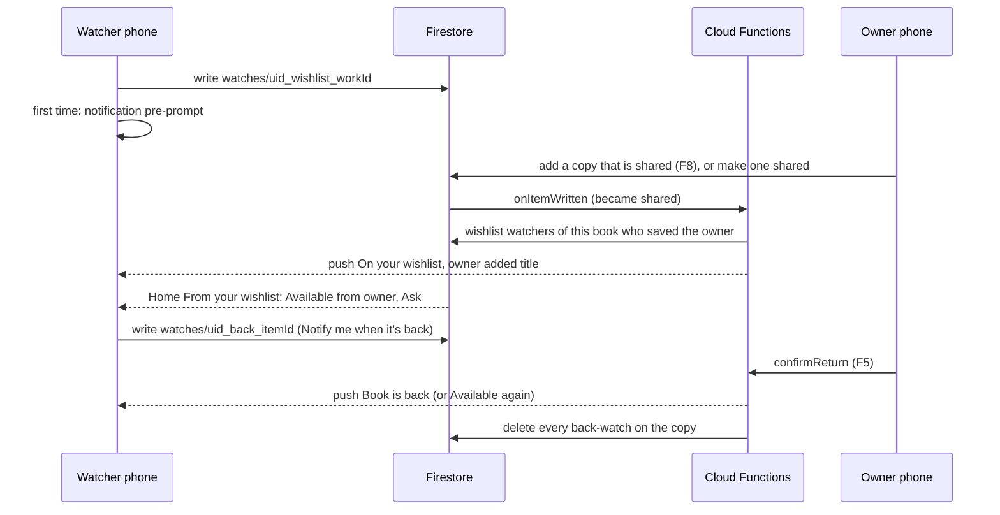

**Steps**

| # | Where | Labels and behaviour |
|---|---|---|
| 1 | Book page | **Wishlist** / **On wishlist** (hidden when I own a copy) → toast "Added to your wishlist · We'll let you know when someone you know adds it." / "Removed from your wishlist". |
| 2 | Copy page (lent) | **Notify me when it's back** / **Stop notifying me** → "We'll let you know when it's back" / "You won't be notified". |
| 3 | Wishlist screen | Title "Wishlist", "We'll tell you when someone in your circle has one". **Books you want** (each with its availability line, × to remove) and **Waiting for it to come back** (back-watches, × "Stop waiting for `<title>`"; "No longer shared with you" when the copy disappeared). Empty: "Your wishlist is empty" + **Find books**. |
| 4 | Home | **From your wishlist** section with "Available from `<names>`" and **Ask**. |
| 5 | Loan screen (lent to someone else) | "We'll tell you when it's back" with **Turn off "Notify me"**, or "Notify me is off." with **Notify me when it's back**. |

**What the other person sees.** Owners never see wishlists or watches; they are private to their creator (rules).

**Edge cases.** Wishlist entries stay after they fire (they are not deleted), so a second friend adding the same book notifies again. Back-watches are all deleted on any return or not-collected close, notified or not. A watcher who has not saved the owner, or who could not see the copy (private or hidden), gets no push. The push pre-prompt is also triggered by the first wishlist add.

**Files.** [`wishlist.tsx`](<../../src/app/(app)/wishlist.tsx>), [availability.ts](../../src/features/wishlist/availability.ts), [AvailabilityLine.tsx](../../src/features/wishlist/AvailabilityLine.tsx), [mutations.ts](../../src/features/shared/mutations.ts), [use-watches.ts](../../src/hooks/use-watches.ts), [`book/[workId].tsx`](<../../src/app/(app)/book/[workId].tsx>), [ViewerPanel.tsx](../../src/features/copy/ViewerPanel.tsx), [DiscoverHome.tsx](../../src/features/discover/DiscoverHome.tsx); backend `onItemWritten` in [triggers.ts](../../functions/src/handlers/triggers.ts), `confirmReturn` and `respondToRequest` in [loans.ts](../../functions/src/handlers/loans.ts).

---

## F12 Notifications

**Who and goal.** Tell people about things that need them, without asking for permission before they have seen any value. Every notifying change also offers a WhatsApp button, because the app can't know whether the other person has push on.

**Entry points**

- The pre-prompt after the first request, accept, recorded loan or wishlist add (once per user per device).
- Me › **Push notifications** row.
- A tap on a delivered push.

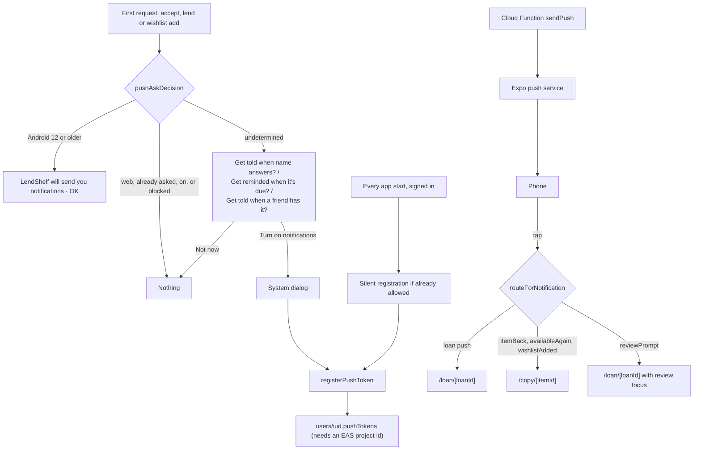

**What gets pushed** (texts from [messages.ts](../../functions/src/lib/messages.ts))

| Type | Title | To | Condition | Tap opens |
|---|---|---|---|---|
| loanRequested | Borrow request | Owner | Always | Loan |
| requestAccepted | Request accepted | Borrower | Always | Loan |
| requestDeclined | Request declined (body by reason) | Borrower | Always | Loan |
| lentToYou | Book lent to you | Borrower | Borrower on the app and has the owner saved | Loan |
| markedReturned | Book returned? | Owner | Always | Loan |
| reviewPrompt | How was it? | Borrower | Has the owner saved; not after Not collected | Loan, review focused |
| itemBack | Book is back | Back-watchers | Copy shared and watcher has the owner saved | Copy |
| availableAgain | Available again | Back-watchers | Same, after Not collected | Copy |
| wishlistAdded | On your wishlist | Wishlist watchers | Copy became shared and watcher has the owner saved | Copy |
| requestExpired | Request expired | Borrower | Daily job | Loan |
| dueSoon | Due soon | Borrower | Day before due; has the owner saved | Loan |
| overdue | Overdue | Owner, and borrower if they saved the owner | Day after due, then weekly | Loan |
| itemRemoved | Request cancelled | Borrower | Owner deleted the copy | Loan |
| notBackYet | Not back yet | Borrower | Has the owner saved | Loan |
| dueChanged | Due date changed | Borrower | Has the owner saved | Loan |
| ownerLeft | `<owner>` left LendShelf | Borrower | Owner deleted their account while the book was out; has the owner saved | Loan |

**Me › Push notifications.** Detail text by state: "Requests, returns and due-date reminders" (on, with an "On" badge), "Off · turn on to get told about requests and due dates" (asks the OS), "Notifications off. You'll only see updates when you open the app. Tap to turn them on in Settings." (opens Settings), "Not available on this device" (web).

**Edge cases.** Tokens are only registered when the build has an EAS project id; today none does, so the app logs "No EAS projectId … skipping push registration" and the backend logs "Push skipped: no tokens". A token moves to the last account that registered it, each account keeps its 20 newest tokens, and tokens Expo reports as `DeviceNotRegistered` are removed. Sign-out unregisters the device token. In the backend tests' `demo-` project pushes are written to `_testPushes` instead of being sent. Foreground pushes are shown as normal system banners (the spec's custom in-app banner, UX-FLOWS E12, was not built). There is no app-icon badge; the Loans tab badge is the only one.

**Files.** [ask.ts](../../src/features/push-ask/ask.ts), [decision.ts](../../src/features/push-ask/decision.ts), [push-ask-dialog.tsx](../../src/features/push-ask/push-ask-dialog.tsx), [store.ts](../../src/features/push-ask/store.ts), [push.ts](../../src/lib/push.ts), [push-permission.ts](../../src/lib/push-permission.ts), [use-push-registration.ts](../../src/features/me/use-push-registration.ts), [notifications-section.tsx](../../src/features/me/notifications-section.tsx), [notification-routes.ts](../../src/lib/notification-routes.ts), [use-notification-routing.ts](../../src/hooks/use-notification-routing.ts), [use-pending-href.ts](../../src/hooks/use-pending-href.ts); backend [functions/src/lib/push.ts](../../functions/src/lib/push.ts), [messages.ts](../../functions/src/lib/messages.ts), [devices.ts](../../functions/src/handlers/devices.ts).

---

## F13 Profile, contacts and pickup note

**Who and goal.** Keep my name, my pickup spot and my circle up to date. My circle is everyone whose number I have saved and who is on LendShelf (one-way).

**Entry points**

- Me profile card **Edit**; Home setup card **Set your pickup spot**; accept sheet "Where can they pick it up?" (F4).
- Me › **Contacts** (opens `/contacts`), **Sync now**, **Invite friends**.
- Automatic re-sync when the app comes to the foreground.

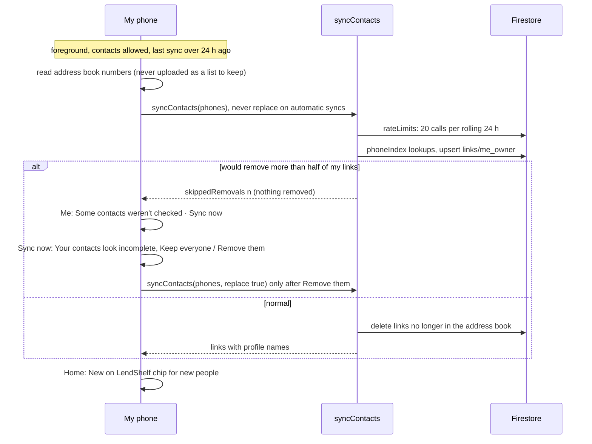

**Steps**

| # | Where | Labels and behaviour |
|---|---|---|
| 1 | Me profile card | Initials avatar, name, number, pickup note; **Edit** → dialog with Name (max 60) and Pickup note (max 200) → **Save** (toast "Profile updated"; uses `completeProfile`). |
| 2 | Setup card | **Set your pickup spot** opens the same dialog. |
| 3 | Accept sheet | While the note is empty: "Where can they pick it up?" and **Don't ask again**; a typed note is saved to the profile and put in the WhatsApp text. |
| 4 | Me › Contacts | Detail such as "n people on LendShelf · checked …", "Some contacts weren't checked · Sync now", or "Off · Turn on". **Sync now** ("Syncing…") → toast "Contacts synced · n people on LendShelf" and a line naming new people or "No one new". |
| 5 | Contacts screen | "Contacts" with the privacy points, "n people on LendShelf" badge, "Checked …", **Sync now**, **Invite friends**. |
| 6 | Invite | The share sheet (WhatsApp first) with "I'm putting my books on LendShelf so friends can borrow instead of buying. … Save my number (`<my number>`) so you can see my shelf." Until `EXPO_PUBLIC_INVITE_URL` is set, the link line reads "Ask me for the app link". Toast "Invite shared". |

**What the other person sees.** My name and pickup note appear on my requests, loans and Person page; people who saved me see their own saved name for me instead of my profile name. Removing someone from my contacts hides their copies from me after the next full sync; open loans stay readable for both.

**Edge cases.** Sync quota: "You've synced a lot today. Try again tomorrow." The shrink guard protects a half-restored address book on a new phone. The spec's "Welcome back" copy and the reverse "someone who saved me joined" notice are not built (UX-FLOWS H6 says not now).

**Files.** [`(tabs)/me.tsx`](<../../src/app/(app)/(tabs)/me.tsx>), [edit-profile-dialog.tsx](../../src/features/me/edit-profile-dialog.tsx), [rows.tsx](../../src/features/me/rows.tsx), [`contacts.tsx`](../../src/app/contacts.tsx), [use-auto-resync.ts](../../src/features/contacts/use-auto-resync.ts), [resync.ts](../../src/features/contacts/resync.ts), [use-manual-sync.tsx](../../src/features/contacts/use-manual-sync.tsx), [sync-contacts.ts](../../src/lib/sync-contacts.ts), [contacts.ts](../../src/lib/contacts.ts), [contacts store](../../src/stores/contacts.ts), [profiles store](../../src/stores/profiles.ts), [invite-text.ts](../../src/features/invite/invite-text.ts), [use-invite.ts](../../src/features/invite/use-invite.ts), [session-bootstrap.tsx](../../src/components/session-bootstrap.tsx); backend [contacts.ts](../../functions/src/handlers/contacts.ts), [rateLimit.ts](../../functions/src/lib/rateLimit.ts), `completeProfile` in [account.ts](../../functions/src/handlers/account.ts).

---

## F14 Export

**Who and goal.** Anyone can take their data out as a file, generated on the device. There is no import.

**Entry points.** Me › **Export** ("Share a CSV or JSON file"; web: "Download CSV or JSON"); the delete-account pre-check **Export your books and loan history first**.

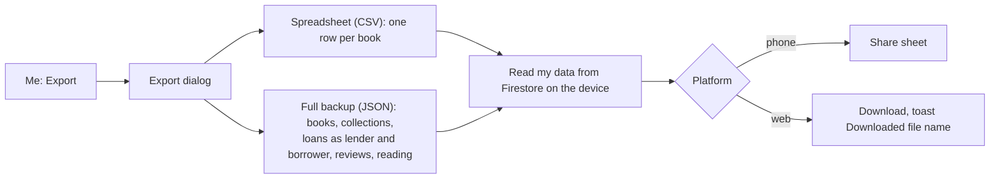

**Steps.** The dialog says "The file is created on your phone and opens the share sheet. Nothing is uploaded." (web: "…created on this device and downloaded."). Options: **Spreadsheet (CSV)** "One row per book: title, authors, ISBN, collection, status. Opens in Excel or Sheets." and **Full backup (JSON)** "Books, collections, loan history as lender and borrower, your reviews and your reading." Success toast "Export ready" with a summary; failure "Couldn't create the export. Please try again."

**What the other person sees.** Nothing.

**Files.** [export-dialog.tsx](../../src/features/export/export-dialog.tsx), [assemble.ts](../../src/features/export/assemble.ts), [fetch.ts](../../src/features/export/fetch.ts), [share.ts](../../src/features/export/share.ts), [share.web.ts](../../src/features/export/share.web.ts), [export.ts](../../src/lib/export.ts).

---

## F15 Sign out and delete account

**Who and goal.** Leave this device (sign out), or leave LendShelf for good (delete everything), with fair warning for people who have my books or whose books I have.

**Entry points.** Me › **Sign out**; Me › **Delete account**; "Use a different number" on the name screen (signs out).

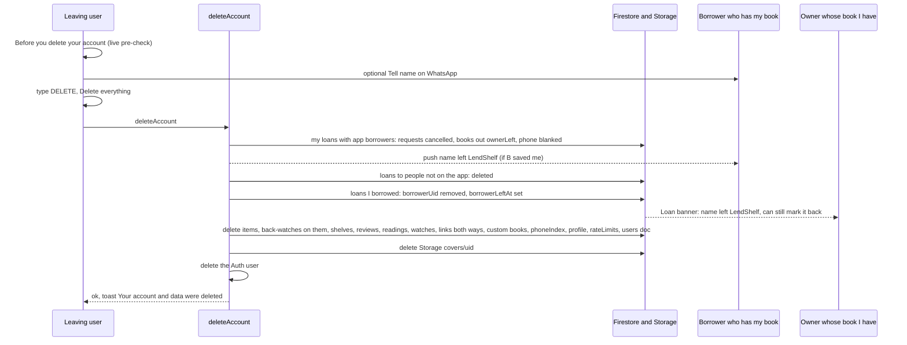

**Steps: sign out.** **Sign out** → "Sign out? · Your books and loans stay safe. Sign in again with the same number to get back to them." → **Sign out** ("Signing out…"). The device's push token is unregistered first (4 s limit). The app returns to the Phone screen.

**Steps: delete account**

| # | Dialog | Labels and behaviour |
|---|---|---|
| 1 | Before you delete your account | Built from live data: "n books are out with friends. They'll see that you left LendShelf, without your number. Tell them first?" with a row per book and **Tell `<name>`** (WhatsApp); "You have `<title>` from `<name>`…" per borrowed book; a line about loans to people not on LendShelf being deleted with **Export your books and loan history first**; "Your n open requests will be cancelled." **Cancel** / **Continue**. |
| 2 | Delete your account? | Type `DELETE` to confirm; **Cancel** / **Delete everything** ("Deleting…"). |
| 3 | Done | Toast "Your account and data were deleted"; back to the Phone screen. |

**What the other person sees**

| Person | Sees |
|---|---|
| Borrower of my book (on the app) | Loan banner "`<owner>` left LendShelf · If you still have `<title>`, message them on WhatsApp if you still have their number." Loans row and push say the same. |
| Owner of a book I borrowed | Loan banner "`<borrower>` left LendShelf · You can still mark it back or message them on WhatsApp."; borrower row "Left LendShelf". |
| Someone I requested from, or who requested from me | The request is cancelled and disappears. |
| People who saved me | My copies, reviews and reading disappear. |

**Edge cases.** If any write fails, the server keeps the Auth user and answers "Some of your data couldn't be deleted. Please try deleting your account again."; every step is safe to repeat and owner-left pushes are only sent for writes that landed. Offline data on the device is not cleared on sign-out (DECISIONS row 29), but the two-phone run (S15) found no data from the previous account on screen.

**Files.** [`(tabs)/me.tsx`](<../../src/app/(app)/(tabs)/me.tsx>), [account.ts (client)](../../src/features/me/account.ts), [delete-account-dialog.tsx](../../src/features/me/delete-account-dialog.tsx), [delete-precheck.ts](../../src/features/me/delete-precheck.ts), [delete-confirmation.ts](../../src/features/me/delete-confirmation.ts), [session.ts](../../src/stores/session.ts); backend `deleteAccount` in [account.ts](../../functions/src/handlers/account.ts), [bulk.ts](../../functions/src/lib/bulk.ts).

---

## F16 Currently reading and Read list

**Who and goal.** Anyone can mark the books they are reading now, keep a list of the books they have finished, and see what friends are reading. Added 28 Nov 2026; not in the original spec.

**Entry points.**
- Book page: the reading panel under the Wishlist and I own this buttons. Any book that opens a Book page counts, including catalogue results with no copy in the circle.
- Me › **Reading** (detail "2 now · 14 read").
- Person page **Reading now** and **Read**; Home **Your circle is reading**.

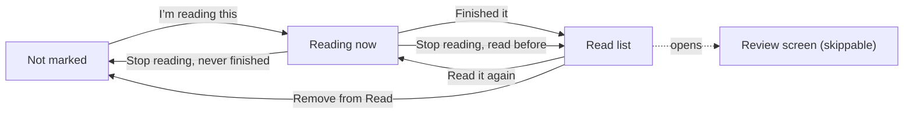

**Steps.**

| # | Where | Labels and behaviour |
|---|---|---|
| 1 | Book page, not marked | **I’m reading this** (outline). Toast "Added to Reading now". With 5 books already in Reading now: toast "You’re reading 5 books. Finish or stop one first." |
| 2 | Book page, reading | Card "You’re reading this · Reading since 3 Nov" (plus "read before, finished 3 May" on a re-read), **Finished it** and **Stop reading**. |
| 3 | Finished it | Toast "Added to your Read list", then the review screen opens (pre-filled when you reviewed it before). |
| 4 | Book page, finished | Card "You’ve read this · Finished 28 Nov", **Read it again** and **Remove from Read**. |
| 5 | Me › Reading | **Reading now** ("2 of 5") with "Reading since" dates, **Read** ("14 books") with finish dates, newest first. Empty state "Nothing here yet" with **Find a book**. A card at the bottom: **Show my reading to contacts** switch (on by default). |
| 6 | Friends | Person page shows **Reading now** and **Read** (3 shown, **Show all n**). Home shows **Your circle is reading** (up to 4 books, "Asha and Ravi are reading it"). The Book page says "Asha is reading this". |

**Edge cases.**
- One record per person per book (`readings/{workId}_{uid}`). A re-read keeps the last finish date, so the book stays in the Read list while it is being read again; finishing again moves the date.
- Turning the switch off hides both lists from everyone else at once: the rules read the profile's `shareReading` on every check, so nothing has to be rewritten. The visibility of your copies doesn't affect reading.
- The 5-book cap is checked on the device only (rules can't count).
- Deleting an account deletes its reading; Export (JSON) includes it.

**Files.** [ReadingPanel.tsx](../../src/features/reading/ReadingPanel.tsx), [reading.tsx](<../../src/app/(app)/reading.tsx>), [PersonReading.tsx](../../src/features/reading/PersonReading.tsx), [CircleReading.tsx](../../src/features/reading/CircleReading.tsx), [reading.ts](../../src/features/reading/reading.ts), [mutations.ts](../../src/features/reading/mutations.ts), [use-readings.ts](../../src/hooks/use-readings.ts); rules in [firestore.rules](../../firestore.rules).
