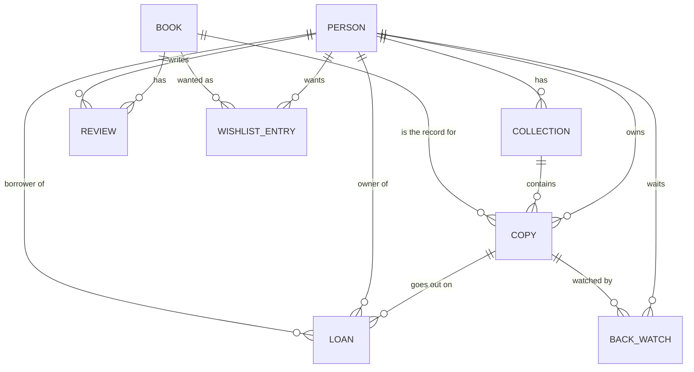
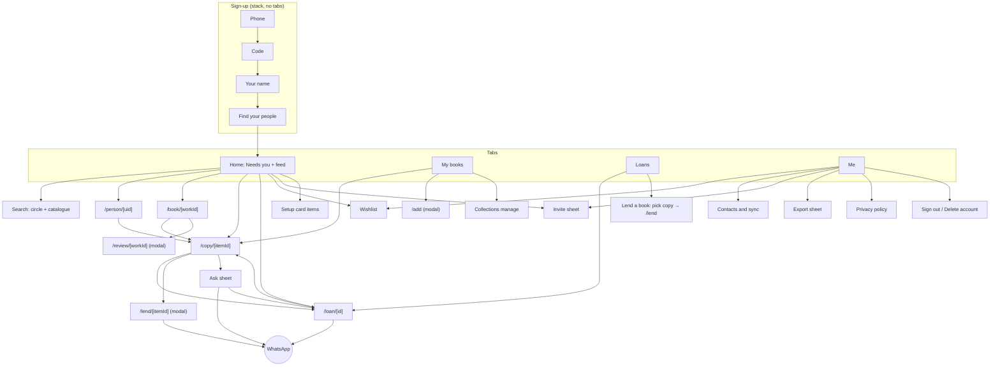
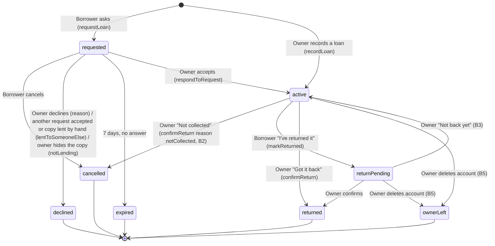

# LendShelf: UX audit and flow redesign

Status: final spec for UX v1.1 (after independent review and the lead's rulings). Nothing under `src/` or `functions/` was changed. Screenshots of the current web build (375 × 812) are in [screens/](screens/).

**The short version.** The app is organised around screens and data types (a Discover feed, a library, a loans ledger split by role, settings). People open it for three reasons: "someone needs something from me", "I want something to read", and "where are my books". Only the second has a front door. The first is a red dot on the third tab, and the third is split across two tabs and a segmented control. The fix is mostly structural. This is the final spec, after an independent review (`docs/ux/UX-REVIEW.md`) and the lead's rulings; the Decision log below records what changed and why. The first release (§G, "UX v1.1 cut") is a small backend bundle followed by client work, about 5–6 developer-weeks plus a device test pass:

1. **Home stays the discovery feed** (today's Discover), with a **Needs you** stack pinned above it: at most 2 cards, collapsing to nothing when empty.
2. **Loans becomes a ledger sorted by who has to act**, and its tab carries the app's only badge.
3. A **Loan** screen, so the loan has its own page, timeline and actions, and every loan push opens it.
4. **Real loan states set by the server instead of client guesses**: "not collected", "not back yet", "lent to someone else" and "owner left".
5. **WhatsApp at the right moments**: it opens automatically after Ask; it's a one-tap button after Accept, Decline, Lend and a due-date change.
6. An **invite** path plus **safe automatic contact re-sync**, so a friend who joins actually shows up.
7. **One vocabulary** for visibility and collections, keeping the names people already know (My books, Wishlist).

Tabs: **Home · My books · Loans · Me**.

---

## Decision log

How this spec handles each finding in `docs/ux/UX-REVIEW.md`. **Taken** = applied as the reviewer suggested; **Changed** = applied differently (the lead's ruling or a narrower fix); **Rejected** = not applied. B# and C# refer to the build plan in §G.

| ID | Finding | Decision | Why |
|---|---|---|---|
| R1 | The invite loop needs auto re-sync, which sat in the backlog | Taken | Auto re-sync on open is in the cut (C10), made safe by the sync shrink guard (B1). The download URL is a dated prerequisite (H1). |
| R2 | "Friends can see it" overstates who can see a copy | Changed | Help text is "People who have your number saved can see it" (the lead's wording), in visibility help and the Add confirm step. "Friends" stays for social copy only (F6). |
| R3 | Device-only pick-up flags; closing an uncollected loan sends "Thanks for returning" | Changed | `confirmReturn` gets `reason: 'notCollected'` (B2), which skips the review prompt and watcher pushes. The pick-up window is time-based wording only, with no buttons or flags (E4). |
| R4 | No way back when the borrower says "returned" but the owner doesn't have it | Taken | Owner action "Not back yet", returnPending → active (B3). Reminders resume because the loan is active again, so the reviewer's extra "show as overdue after 3 days" rule isn't needed. |
| R5 | The owner's overdue card lacks "Got it back" | Taken | Owner overdue and due cards and Out-with-friends rows have S "Got it back" (D4, E6). |
| R6 | A silent re-sync on a half-restored phone can wipe the circle | Changed | The guard is on the server (B1), not a client contact-count heuristic: `syncContacts` won't delete more than half the existing links without `replace: true`. |
| R7 | The app-icon badge isn't possible without backend | Taken | Dropped. Only the Loans tab has a badge (F5). |
| R8 | Undo made by delaying the call is unreliable and too short | Taken | No undo in v1.1. "Got it back" opens a one-step confirm sheet (F3). |
| R9 | "Lent to someone else" was guessed on the client; the push contradicted it | Taken | The server sets `declineReason: 'lentToSomeoneElse'`, creates the borrower's back-watch and sends a matching push (B4). |
| R10 | The owner-left guess misses returnPending and suggests an impossible action | Taken | Server status `ownerLeft` for active and returnPending loans, keeping the display name. The phone stays blanked, so the copy tells the borrower to use WhatsApp if they still have the number (B5, E4). |
| R11 | "Keep request" on hide reopens the "Copy not found" problem | Changed | Hiding a copy or making its collection private auto-declines pending requests after a confirm sheet that names who is declined; no Keep option. "Not lending" keeps the choice, because the copy stays visible and can still be lent (E9). |
| R12 | A due-date change is never told to the borrower | Taken | `updateDueDate` pushes the borrower (B6); the owner gets a WhatsApp sheet after changing it (C5). |
| R13 | Home has competing primaries and pushes discovery below the fold | Taken | One filled primary per card, at most 2 cards + "See all n in Loans", setup card hidden while Needs you has cards; discovery starts above the fold at 375 × 812 (D4, C7). |
| R14 | A borrower can end up with two accepted copies of one book | Taken | Client card "Cancel your other request?" when an accept lands while another request for the same Book is open; the Ask sheet warns (C4). |
| R15 | Grouping alternate catalogue records only fixes search rows | Taken | The Book page "Who has it" merges copies filed under alternate work ids (C9). A backend merge stays later. |
| R16 | No accessibility rules | Taken | New §F8; C14 is an accessibility pass with TalkBack and 200 % font. |
| R17 | "Got it" vs "Got it back" | Taken (moot) | The borrower's "Got it" button no longer exists (R3). |
| R18 | Keep "Wishlist" | Taken | "Want to read" dropped; pushes already say "wishlist". |
| R19 | Keep the "My books" tab; rename only the default collection | Taken | Tab stays "My books"; the default collection is shown as "Main shelf". |
| R20 | "Due soon" goes only to the borrower | Taken | E4 table corrected; owners get no due-soon push. |
| R21 | WhatsApp text greets people by saved nicknames ("Hi Dr.!") | Taken | Outgoing text uses the profile first name, else "Hi!" (C1). |
| R22 | Under-costed | Taken | Re-estimated at 5–6 developer-weeks plus device testing; the Loan screen and owner-left work are separate items (C3, C6). |
| R23 | Does the badge count cards or loans? | Taken | Cards (F5). |
| R24 | E6 and F3 disagreed on confirming "Got it back" | Taken | Resolved by R8: always a confirm sheet. |
| R25 | The review screen has no `rating` param | Taken | Added in C3. |
| R26 | Keeping a pending deep-link target wasn't in any item | Taken | In C3. |
| R27 | Duplicate WhatsApp action on the Loan screen; owner's primary in the pick-up window unspecified | Taken | The row's WhatsApp button is hidden when the banner's primary is a WhatsApp action; the owner's primary in the window is "Message Asha" (D4). |
| Missing flows | Returning user, number change, new phone, nicknames, lost/damaged, lent onward, many books with one person, households, low literacy, push off, flaky network, pickup note, early return, owner away | Partly taken | In the cut: flaky-network retries (C4), the Android ≤ 12 notification line (C11), the pickup-note rules (E13), the "push off on the other side" rule (F7) and the new-phone guard (B1). The rest are in E16 as later; households and lost/damaged are open questions (H). |

---

## A. Principles used

| Principle | What it says | How it is applied here | Source |
|---|---|---|---|
| Nielsen #1 Visibility of system status | Keep users informed about what is going on, in reasonable time | Pending requests, returns to confirm and overdue books must be visible on launch, not behind a tab and segment | [NN/g 10 heuristics](https://www.nngroup.com/articles/ten-usability-heuristics/) |
| Nielsen #2 Match the real world | Use the user's concepts and order of events | A loan is "asked → agreed → handed over → back". The app jumps from "agreed" to "lent" | same |
| Nielsen #3 User control and freedom | Clear exits; undo | Clear exits everywhere; one-step confirm sheets for loan-changing actions instead of timed undo (F3) | same |
| Nielsen #4 Consistency and standards | Same word for same thing | One state currently has four names | same |
| Nielsen #6 Recognition rather than recall | Make options visible | Wishlist, collections and history should not live behind icons the user has to remember | same |
| Nielsen #8 Aesthetic and minimalist design | Every extra unit of information competes | Discover shows the same books twice and "popular" books you already own | same |
| Hick's law | Decision time grows with the number of choices | Fewer equal-weight buttons per card; one primary action per state | [lawsofux.com/hicks-law](https://lawsofux.com/hicks-law/) |
| Fitts's law | Far or small targets are slower | Primary loan actions on Home cards, in thumb reach; no "…" menus for frequent actions | [lawsofux.com/fittss-law](https://lawsofux.com/fittss-law/) |
| Jakob's law | Users expect your app to work like the apps they already use | Home-first feed, a back button on every detail screen, keeping the names testers already know ("My books", "Wishlist"), WhatsApp share sheet for invites | [lawsofux.com/jakobs-law](https://lawsofux.com/jakobs-law/) |
| Miller's law / chunking | Group information into meaningful chunks | "New from Kabir: 12 books" as one chunk, not 12 separate covers | [lawsofux.com/chunking](https://lawsofux.com/chunking/) |
| Tesler's law | Some complexity cannot be removed; the system should absorb it | The app, not the user, keeps track of due dates, reminders and who-said-what | [lawsofux.com/teslers-law](https://lawsofux.com/teslers-law/) |
| Goal-gradient effect | Motivation rises as the goal gets closer | A 3-step setup card on Home for new users | [lawsofux.com/goal-gradient-effect](https://lawsofux.com/goal-gradient-effect/) |
| Peak-end rule | Experiences are judged by their peak and their end | The "yes, you can borrow it" moment and the return are the peaks; today both end in a toast | [lawsofux.com/peak-end-rule](https://lawsofux.com/peak-end-rule/) |
| Zeigarnik effect | Unfinished tasks are remembered | Show open loops ("Asha says she returned it, confirm?") until closed | [lawsofux.com/zeigarnik-effect](https://lawsofux.com/zeigarnik-effect/) |
| Material 3 navigation bar | 3–5 top-level destinations of equal importance; FAB = the most important action on a screen | 4 tabs; Add stays the "+" in the My books header (no FAB, less churn) | [Android layout and nav patterns](https://developer.android.com/design/ui/mobile/guides/layout-and-content/layout-and-nav-patterns) |
| Apple HIG tab bars | Tabs switch sections and **preserve each section's navigation state**; tabs are for navigation, not actions | Per-tab stacks were considered for detail screens and deferred for cost (§F1) | [HIG: Tab bars](https://developer.apple.com/design/human-interface-guidelines/tab-bars) |
| NN/g onboarding | Skip it when possible; make the UI learnable instead | Keep sign-up to 4 steps; teach in context with empty states and a checklist | [NN/g: Mobile app onboarding](https://www.nngroup.com/articles/mobile-app-onboarding/), [Mobile tutorials study](https://www.nngroup.com/articles/mobile-tutorials/) |
| NN/g empty states | Communicate status, give learning cues, give a direct path to fill it | Every empty state names why it is empty and has one primary button | [NN/g: Empty states in complex apps](https://www.nngroup.com/articles/empty-state-interface-design/) |
| NN/g push notifications | Don't ask for permission at first launch; explain what will be sent | Ask for push right after the first request or lend, with a reason | [NN/g: Push notifications](https://www.nngroup.com/articles/push-notification/) |
| Progressive disclosure | Show the common path; reveal advanced options on demand | Collections, edition details and history appear only when relevant | [NN/g: Progressive disclosure](https://www.nngroup.com/articles/progressive-disclosure/) |
| Jobs-to-be-done | Design for the progress the person is trying to make in a situation | Objectives in §B are written as situations, not features | [Christensen Institute: JTBD](https://www.christenseninstitute.org/theory/jobs-to-be-done/) |
| Object-oriented UX (ORCA) | Identify objects, relationships, CTAs and attributes before flows; every core object gets a home | The Loan has no screen today; §D gives each object one owner screen | [A List Apart: OOUX](https://alistapart.com/article/ooux-a-foundation-for-interaction-design/) |
| Service blueprint | Map both actors and the backstage at each step | §E4 shows borrower view, owner view and notifications for every loan state | [NN/g: Service blueprints](https://www.nngroup.com/articles/service-blueprints-definition/) |
| WCAG 2.2 / platform accessibility | Resizable text, 48 dp / 44 pt targets, no colour-only meaning, adjustable timing | §F8 and build item C14 | [WCAG 2.2](https://www.w3.org/TR/WCAG22/) |

Comparable apps looked at: **Splitwise** keeps an activity feed plus per-friend balances, and lets you record things with friends before they join ([App Store listing](https://apps.apple.com/us/app/splitwise/id458023433)). LendShelf's "who has what between friends" is the same job. **Olio** puts "Lend" behind a single global "+" and agrees loan terms by message ([Olio help: lending and borrowing](https://help.olioapp.com/en/articles/12240533-how-does-lending-and-borrowing-work-on-olio)). **Peerby** and newer apps such as Lently lead with a borrow manager that has due-date reminders and a "Mark as returned" flow. **Goodreads/Libib** keep a wishlist next to the owned library. The comparisons are by pattern only; I didn't benchmark those apps hands-on.

---

## B. Personas and objectives

### Personas

| Persona | Who | What they want from LendShelf | What worries them |
|---|---|---|---|
| **Asha, the Curator** (lender-first) | Owns 150–300 books, organised, lends often. Seeds the circle. | Say yes to friends quickly, know where every book is, get books back. | Losing books, chasing people, the effort of cataloguing. |
| **Ravi, the Reader** (borrower-first; also lends) | Reads a lot, buys a lot, owns fewer. | Something to read this weekend; not buying a book a friend already has; not looking bad about returns. | Asking feels awkward; forgetting due dates. |
| **Zoya, the Invited** (casual) | Joined because Asha sent a WhatsApp link. Has 0–10 books listed, may deny contacts. One-way: has Asha saved, Asha doesn't have her. | Borrow the one book Asha mentioned with minimal setup. | Being asked to catalogue everything; privacy. |
| (Secondary actor) **Nikhil, not on the app** | Neighbour who borrows by hand | Nothing; he never sees the app | n/a, but the owner still needs the record and a WhatsApp message to him |

Most real users are both lender and borrower. The personas are roles, and every screen has to serve both at once.

### Objectives ranked

Frequency × importance. P0 = the app is useless without it, or done weekly. P1 = core but less frequent. P2 = supporting. P3 = rare or admin. Taps are counted from app open on the current build. Typing is not counted as a tap.

| ID | Objective (job) | Persona | Frequency | Pri | Current path, taps, friction | Target |
|---|---|---|---|---|---|---|
| O1 | "Someone asked for my book; answer and set up the handover" | Asha | Weekly per active lender; time-sensitive (7-day expiry) | **P0** | Loans (1) → Accept (2) → Accept in dialog (3). The card then vanishes and the user lands on an empty Requests view. Messaging them means Lent out (4) → "…" (5) → Message on WhatsApp (6). **6 taps, dead end.** | Home card → Accept (1) → due-date sheet Accept (2) → "Tell Asha on WhatsApp" (3). **3 taps, no dead end.** |
| O2 | "Find something to read this weekend and ask for it" | Ravi, Zoya | Weekly | **P0** | Discover → cover (1) → Ask to borrow (2) → Send (3) → WhatsApp opens. Via a person: 4. Reasonable. | Same, plus "Ask" directly on available cards (2). |
| O3 | "Before I buy X, does anyone I know have it?" (the product's founding job) | Ravi | Weekly-ish, often in a shop | **P0** | Discover search, type → inline result shows "Available from Asha and Kabir". 0–1 taps. **Good.** Catalogue fallback is there. | Keep. Add a one-tap Wishlist on catalogue results and a search box that also answers "you own this". |
| O4 | "What do I have, and when is it due? Return it." | Ravi, Zoya | Weekly glance; return monthly | **P0** | Loans (1) → Borrowed segment (2; the initial segment is Requests or Lent out if either has items) → I've returned it (3) → confirm (4). | Due soon or overdue: in Home's Needs-you stack (0 taps), return in 2. Otherwise Loans › With you (1 tap). |
| O5 | "Who has my books right now? Anything overdue? Nudge. Got it back." | Asha | Weekly glance; return monthly | **P0** | Loans (1) → Lent out (2 if requests exist) → Nudge / Mark returned → confirm (4). "Says returned" is not counted in the tab badge. | Home status strip at 0 taps ("3 out · next due 7 Dec"); overdue and "says returned" in Needs you; details in Loans (1). "Got it back" in 2 (one-step confirm sheet). |
| O6 | "Find my people / get my friends on" | All, mostly first week | Once, then whenever the circle is thin | **P0** | Onboarding contacts sync. If 0 are found: a toast, then an empty Discover with "Sync contacts". **No invite anywhere in the app.** | Invite via WhatsApp from onboarding, Home, lend-to-non-app success and Me (E2a). |
| O7 | "Put my existing books in" (bulk, first week) | Asha | Once per user, 30–200 books | **P0** | My books (1) → + (2) → scan × N → Review (3) → Add (4) → Done (5). Mechanically fine; nothing on first run points here except an empty tab. | Same flow, started from the Home setup card. |
| O8 | "I lent a book in person (maybe to someone not on the app)" | Asha | Monthly | **P1** | My books (1) → find copy (scroll/search) (2) → copy (3) → Lend this copy (4) → Someone else (5) → type → Lend (6) → Tell them on WhatsApp (7). | Also from Loans "Lend a book": pick book → pick person → Lend → WhatsApp (4). |
| O9 | "I just bought a book (or 6), add them" | Asha, Ravi | Monthly | **P1** | My books → + → scan → Review → Add → Done (5 + scans). OK. | My books "+" → same (4 + scans). |
| O10 | "Stop lending a book for now (I'm reading it) / hide it" | Asha | Monthly | **P1** | My books → copy → Visible / Hidden toggle (3). Four names for "visible" (see C10). | Same depth; one vocabulary; one tap from the copy page in My books (3). |
| O11 | "Tell me when someone has / gets back a book I want" | Ravi | Monthly | **P1** | Book page Wishlist (search → result → Wishlist, 2). The wishlist list is behind a heart icon on Discover or in Me. Matches are never surfaced on the home feed. | Wishlist (heart on Home, row in Me); "From your wishlist: now available" section on Home. |
| O12 | "Follow up on or cancel my request" | Ravi | Monthly | **P1** | Loans → Requests → card. | Loans › Your requests; Needs you when it expires in ≤ 2 days. |
| O13 | "Extend / change a due date" | Asha (asked by borrower) | Monthly | **P1** | Loans → Lent out → "…" → Change due date (4). | Loan screen → Change due date (2). |
| O14 | "Read reviews before borrowing / write one after" | Ravi | Monthly | **P2** | Book page sections; write via Book page or reviewPrompt push only. | Inline "How was it?" on the closed Loan screen (peak-end). |
| O15 | "Browse one friend's shelf" | Ravi | Occasional | **P2** | Discover avatar → Person page. Fine. | Same. |
| O16 | "Organise my books in collections, private shelf" | Asha | Rare after setup | **P2** | 3 entry points (header icon, "Manage" chip, Me). | One entry point; collections hidden until the user makes a second one. |
| O17 | "Fix edition / format / language" | Asha | Rare | **P2** | Copy → Edition › Edit. Fine. | Same. |
| O18 | "My friend just joined, find them" (contacts re-sync) | All | Occasional | **P2** | Me → Sync now. | Same, plus automatic re-sync on app open (rate-limit permitting) and a "New on LendShelf" chip on Home. |
| O19 | "Set where people pick up books" | Asha | Once | **P2** | Me → Edit. Not asked anywhere in flows. | Setup card item on Home; asked inline on the first accept if empty. |
| O20 | Export, theme, privacy, sign out, delete account | All | Rare | **P3** | Me. Fine. | Me (unchanged), minus library items. |

---

## C. Current-state audit

Severity: **blocker** = an objective fails or dead-ends; **major** = it works but users will get it wrong or give up; **minor** = friction or polish. Anything marked "observed" was reproduced on the web build with seeded data (screenshots in `screens/`).

### C1. O1 "Answer a borrow request" (P0)

Current path: push (if enabled) → `/loans` · or open app → lands on Discover → notice red "1" on Loans → Loans → Requests → Accept → due-date dialog → Accept → card disappears.

| # | Problem | Principle violated | Where | Sev |
|---|---|---|---|---|
| C1.1 | The app opens on a browse feed. A pending request, which expires in 7 days, appears only as a badge on the third tab. Observed: Ravi signed in with Asha's request waiting, and Discover showed nothing about it ([06](screens/06-ravi-discover-pending-request-only-badge.jpg)). | #1 Visibility of status; Zeigarnik | `src/app/(app)/(tabs)/index.tsx` (no loan awareness); `src/app/(app)/(tabs)/_layout.tsx:40` (Discover is the first tab) | **blocker** |
| C1.2 | The tab badge counts only incoming requests. "Says returned" (waiting for my confirmation), overdue books and my own accepted requests are not counted. | #1 | `src/app/(app)/(tabs)/_layout.tsx:28,47` | major |
| C1.3 | After Accept, the toast says "Arrange the handover on WhatsApp" but offers no button. The card disappears and the user is left on an empty "No requests" view ([09](screens/09-ravi-after-accept-empty-dead-end.jpg)). Observed: the accept call took about 6 s in the emulator, so the 3.5 s toast was close to gone by the time the dialog closed. To message the borrower: Lent out → "…" → Message on WhatsApp. | Peak-end; #3 control; Tesler | `src/app/(app)/(tabs)/loans.tsx:130-134`; `src/app/_layout.tsx:37` (toast duration) | **blocker** |
| C1.4 | Push tap routes to the generic `/loans` with no segment and no loan. The segment param exists but isn't used. | #1; Fitts (extra hunting) | `src/lib/notification-routes.ts:28`; `loans.tsx:80-87` | major |
| C1.5 | A requester who is not in my contacts (one-way: Zoya has Asha saved, Asha doesn't have Zoya) is shown with their profile name and no cue that they aren't a saved contact. That is a trust decision made blind. | #2; safety | `loans.tsx:94-97` (falls back to `l.borrowerName`) | major |
| C1.6 | Several requests for the same copy appear as separate cards. The accept dialog warns that the others are declined, but you can't compare requesters side by side. | Chunking | `src/features/loans/buckets.ts:51-53` | minor |
| C1.7 | "N people want to borrow it" on my copy page goes to the Loans list, not to those requests. | #6 | `src/features/copy/OwnerPanel.tsx:178-186` | minor |
| C1.8 | Decline has no way to say why ("I'm reading it"). The borrower gets "can't lend it right now", which reads as a personal no. | #2; social cost | `loan-cards.tsx:212-222`; `functions/src/lib/messages.ts:16-20` | minor |

### C2. O2 / O3 "Find something to borrow / who has X" (P0)

Current path: Discover feed (Your circle → New from your contacts → Popular in your circle → Ready to borrow), or search → circle results → catalogue fallback.

| # | Problem | Principle | Where | Sev |
|---|---|---|---|---|
| C2.1 | "Ready to borrow" repeats the same books, in the same order, as "New from your contacts". Observed for Asha: the 9 "Ready" items are the first 9 "New" items. | #8 Minimalist | `src/features/discover/DiscoverHome.tsx:82-95` | major |
| C2.2 | "Popular in your circle" includes my own copies, so it recommends books I own. Observed for Asha: all 6 entries were badged "You own it". | #8; JTBD (I want something I *don't* have) | `DiscoverHome.tsx:83` (`popularInCircle(items…)` with `items` = mine + network) | major |
| C2.3 | One bulk-adder floods "New". Observed: 11 of 12 "New from your contacts" were Kabir's. | Chunking | `DiscoverHome.tsx:82` | minor (seed-shaped, but real after any scan session) |
| C2.4 | Wishlist matches ("a book you want is available now") never appear on the feed. The wishlist is behind an unlabeled heart icon. | #6 Recognition | `index.tsx:84-93`; `src/features/wishlist/availability.ts` exists but is used only in search results and the Wishlist screen | major |
| C2.5 | Book page hierarchy: a large cover, then Wishlist + "Add another copy" buttons, then *Copies in your circle* with Ask. On a 375 px screen the copies list starts around 70 % down ([17](screens/17-ravi-book-page.jpg)). For a borrower, the decision content (who has it, Ask) is below the fold. Wishlist is offered even when I own the book. | Hierarchy; Fitts | `src/app/(app)/book/[workId].tsx:127-217` | major |
| C2.6 | The borrower's copy page gives the Edition card (format, language, **ISBN**) the same weight as Owner and Reviews. | #8 | `src/app/(app)/copy/[itemId].tsx:187` | minor |
| C2.7 | Search is good: "Available from Asha R. Rao and Kabir Shah" answers O3 inline ([16](screens/16-ravi-discover-search-who-has.jpg)). Keep it. | (positive) | `index.tsx:123-188` | n/a |

### C3. O4 / O5 "Status, return, overdue" (P0)

| # | Problem | Principle | Where | Sev |
|---|---|---|---|---|
| C3.1 | Loans are split by role into three segments (Requests / Lent out / Borrowed), each with its own History. Urgency cuts across them, so a "Says returned" card in Lent out is invisible while Requests is selected. The initial segment is computed once and then "the user is in charge". | Hick; #1 | `loans.tsx:54,79-88`; `buckets.ts:95-100` | major |
| C3.2 | **Accept = lent.** `respondToRequest` sets `active`, `startedAt` and the due clock immediately. Before any handover, the borrower sees "You have this copy" and the owner sees "Nudge" and "Mark returned" ([10](screens/10-ravi-lent-out.jpg): Animal Farm "Lent 21 Nov" one minute after accepting). | #2 Match real world; service blueprint gap | `functions/src/handlers/loans.ts:144-201`; `src/features/copy/ViewerPanel.tsx:123-137` | major |
| C3.3 | "Nudge" has the same weight on every lent card, whether the book is due in 3 weeks or overdue. Overdue has no in-app emphasis apart from the due badge colour. | Hick; #1 | `src/features/loans/loan-cards.tsx:358-368` | minor |
| C3.4 | Confirming a return opens a dialog for a reversible, low-risk, frequent action. | #3 | `loan-cards.tsx:326-334`; `OwnerPanel.tsx:201-228` | minor. **After review:** kept as a one-step confirm sheet, because undo by delayed call is unreliable (F3, R8). |
| C3.5 | After the owner confirms the return, the borrower's peak-end moment is a push asking for a review. Users with push off never see it, and there is no in-app prompt. | Peak-end | `functions/src/lib/messages.ts:31-35`; no in-app equivalent | minor |
| C3.6 | No Loan screen exists. A loan card opens the **copy** page; history rows open the copy page or nothing. The loan's timeline (asked, accepted, due changes, returned) is never shown. | OOUX (every core object needs a home) | `loans.tsx:103-106`; `buckets.ts:117-127` | major |
| C3.7 | If the owner says nothing after "I've returned it", nobody is reminded. The loan sits in `returnPending` forever. | Zeigarnik; Tesler | `functions/src/handlers/maintenance.ts` has no `returnPending` reminder | minor |

### C4. O6 / O7 "First run, circle, initial books" (P0)

| # | Problem | Principle | Where | Sev |
|---|---|---|---|---|
| C4.1 | **No invite mechanism anywhere.** If contacts sync finds 0–1 people, the user gets a toast and an empty Discover whose buttons are "Sync contacts" (again) and "Add your books". With one-way matching, a new user's circle is empty by default. | Cold start; empty-state guideline 3 (direct pathway) | `src/app/contacts.tsx:85-90`; `index.tsx:192-204` | **blocker** (for growth) |
| C4.2 | Push permission is requested 1.2 s after entering the app, right after onboarding, before the user has seen any value or knows what will be sent. | NN/g push mistake #1 | `src/features/me/use-push-registration.ts:16-19`; `src/lib/push.ts:86-89` | major |
| C4.3 | After onboarding there is no "what now". The user lands on Discover, which for a new user is either empty or someone else's books. Nothing points to "scan your shelf" or "set your pickup spot". | Goal-gradient; empty-state guideline 2 | `contacts.tsx:64-67` (`router.replace('/')`) | major |
| C4.4 | Contacts denied: onboarding shows "Open Settings" + "Skip". Later, Discover's empty state doesn't say *why* it's empty (permission off vs nobody joined). | Empty-state guideline 1 | `contacts.tsx:119-126,205-210`; `index.tsx:192-204` | major |
| C4.5 | The single-player value is never pitched: "track books you lend to anyone, even if they aren't on the app". It's the only reason to stay with an empty circle. | JTBD | `src/features/library/components/library-empty.tsx` | minor |

### C5. Navigation, IA and vocabulary (cross-cutting)

| # | Problem | Principle | Where | Sev |
|---|---|---|---|---|
| C5.1 | **The tab bar disappears on every detail screen.** Book, Copy, Person, Wishlist and Collections are pushed on the parent stack above `(tabs)`, so switching sections from a book means backing out. Observed on Copy and Person ([12](screens/12-ravi-own-copy-page.jpg), [03](screens/03-asha-person-ravi.jpg)). Every detail screen has a header back button, and cross-tab jumps from a detail screen are rare at this scale, so this was downgraded from major after review (§F1). | HIG tab bars (preserve per-section state) | `src/app/(app)/_layout.tsx:13-18` | minor |
| C5.2 | One visibility state has four names: **Visible** (owner toggle), **Visible only** (library badge), **Not lendable** (others' badge), **Not up for lending** (viewer hero). | #4 Consistency | `OwnerPanel.tsx:62-76`; `src/features/library/filter.ts:106`; `src/components/status-badge.tsx:35`; `ViewerPanel.tsx:171` | major |
| C5.3 | People are called "contacts", "friends", "your circle" and "people you know" on adjacent screens. Add says "Friends can see it"; the copy page says "Contacts can see it". | #4 | `src/features/add/components/confirm-step.tsx:60-64` vs `OwnerPanel.tsx:67-75` | minor |
| C5.4 | The default collection is named **"My books"** (`DEFAULT_SHELF_NAME`), the same as the tab. Result: "My books › All / My books / Sci-fi", an "Add to My books" button that could mean either, and a "MY BOOKS" section header on *Ravi's* person page ([03](screens/03-asha-person-ravi.jpg), [15](screens/15-add-confirm-duplicate.jpg)). | #4; #2 | `functions/src/model.ts:42`, `src/types/model.ts:182`; `confirm-step.tsx:365` | major |
| C5.5 | My books has two chip rows that both start with "All" (collections, then status filters). Collections can be managed from three places (header folder icon, "Manage" chip, Me › Collections). | #4; Hick | `src/features/library/components/library-toolbar.tsx:57,74,111`; `my-books.tsx:78-86`; `me.tsx:210-215` | minor |
| C5.6 | Me mixes account settings with library objects (Wishlist, Collections, Export). | IA (objects live with their parent) | `src/app/(app)/(tabs)/me.tsx:200-223` | minor |
| C5.7 | The Wishlist subtitle says "We'll notify you when these show up **nearby**". Matching is by contacts, not location. | #2 | `src/app/(app)/wishlist.tsx:133` | minor |
| C5.8 | Modals vs pushes are inconsistent: Add, Lend and Review are modals; Wishlist and Collections are pushes; accept is a dialog; ask is a dialog. Fine individually, but no rule (see §F2). | #4 | `src/app/(app)/_layout.tsx:15-17` | minor |

### C6. Managing my books, adding, edge cases

| # | Problem | Principle | Where | Sev |
|---|---|---|---|---|
| C6.1 | Catalogue search returns near-duplicate works (two "Sapiens" works, summaries, a non-Latin title for *Homo Deus*) ([14](screens/14-add-search-catalogue-noise.jpg)). If two friends pick different works, their copies split across two Books and "who has X" misses one. | Data integrity → O3 | `src/features/add/components/search-panel.tsx`; `resolveBook` | major |
| C6.2 | The duplicate-copy warning on Add is good ("You already have a copy…") ([15](screens/15-add-confirm-duplicate.jpg)). Keep it. | (positive) | `confirm-step.tsx` | n/a |
| C6.3 | Hiding a copy, or moving it to a private collection, while requests are pending leaves the requests alive. The requester then sees "Copy not found" when they open it (no borrow-loan fallback for *requests*). | Consistency of state | `functions/src/handlers/triggers.ts` (`onItemWritten` cancels only on delete); `copy/[itemId].tsx:77-80` | major |
| C6.4 | The Lend screen for a copy already lent says "Mark it returned first" with only **Close**. | Empty-state guideline 3 | `src/app/(app)/lend/[itemId].tsx:56-67` | minor |
| C6.5 | Owner deletes their account while a friend has a book: the borrower's loan silently becomes **returned** (and the owner's phone is blanked). The borrower still physically has the book and gets no explanation. | #1; #2 | `functions/src/handlers/account.ts:152-156` | major (rare) |
| C6.6 | The accept dialog and the Lend screen use two different due-date pickers (chips 1w/2w/3w/1m/2m + stepper vs chips 1w/2w/3w/1m + calendar). | #4 | `src/features/loans/due-date-dialog.tsx` vs `src/features/lend/components/due-date-picker.tsx` | minor |

---

## D. Proposed information architecture

### D1. Top-level navigation

**Decision: Home · My books · Loans · Me.** Discover is renamed **Home**; the other tab names stay. Home is today's discovery feed with a **Needs you** stack pinned above it (at most 2 cards) that collapses to nothing when empty. Loans is the ledger. An earlier draft (a needs-you dashboard as Home, plus a Circle tab) was dropped after modelling why people open the app.

**Why people open the app (rough model, ~10-person circle).** Assumptions: an active member opens the app 4–6 times a week. The circle produces about 2–4 loan events per active member per week, and about half of them reach the user as a push. These shares are planning estimates, not measurements; check them with analytics after launch.

| Open type | Share of opens | (a) Needs-you dashboard · Circle · Library · Me | (b) Home feed + Needs you · My books · Loans · Me |
|---|---|---|---|
| Push tap (request, accepted, due, overdue, "says returned", wishlist, back) | ~30 % | Loan / Copy screen | Loan / Copy screen (same) |
| "Find something to read" / "does anyone have X?" | ~40 % | Dashboard, usually empty or a few loan rows → tap Circle (**+1 tap**) | Feed and search (**0 taps**) |
| Organic open with something waiting (push off, or push dismissed) | ~10 % | Needs-you cards (0 taps) | Up to 2 cards pinned above the feed (0 taps; more in Loans) |
| Status check ("when is it due?", "who has my books?") | ~10 % | Loan rows (0 taps) | One-line status strip answers the glance (0); details in Loans (**+1 tap**) |
| Add or manage books | ~10 % (much higher in week 1) | +1 | +1 |

On organic opens (about 70 % of all opens), Needs you has something in it perhaps one time in five, so a dashboard landing would mostly show "Nothing needs you". Per 100 opens, (a) costs about 40 extra taps and saves about 10; (b) is the reverse. **(b) wins by roughly 30 taps per 100 opens**, and it keeps today's tab skeleton.

| Tab | Question it answers | Main objectives |
|---|---|---|
| **Home** | "Does anything need me? What can I borrow?" | O1 (stack), O2, O3, O11 (matches), O15, setup for new users |
| **My books** | "What do I own?" | O7, O9, O10, O16, O17 |
| **Loans** | "Who has what, and what happened?" | O4, O5, O8, O12, O13 |
| **Me** | "Me and my account" | O11 (Wishlist list), O19, O20, contacts, invite |

What follows from this choice:
- **Needs-you cards appear in two places, using one component:** up to 2 on Home (so an organic open sees them) and all of them as the first section of Loans (their permanent home). Resolving a card removes it from both.
- **The only badge is on the Loans tab.** Home is the landing tab, so its cards are seen on open anyway; the badge is for when the user is elsewhere, and it points to where loan items always live. Count = number of Needs-you cards. There is no app-icon badge in v1.1: the push payload carries no `badge`, and a count set by the app goes stale while it's closed (§F5).
- **"Lend a book"** (record a hand-to-hand loan) is the header action on Loans. **Add** stays the "+" in the My books header, as today. Tabs are never actions (HIG).
- **Wishlist stays where it is** (the heart on Home and the row in Me) and gains a "From your wishlist" section on Home.
- "Circle" stays as a word in copy ("your circle"), not as a tab.
- A fifth Activity/Inbox tab is rejected: at this scale it would be empty most of the time (E12).

**Launch behaviour:** always open on Home. Never jump to whichever tab has something (consistency). Push taps open the object screen on top of the tabs (§F1).

### D2. Object model and ownership (OOUX)

| Object (user word) | Data | Owner screen (its "home") | Appears as a card/row on | Primary CTAs (by role) | Key attributes shown |
|---|---|---|---|---|---|
| **Book** | `works` | `/book/[workId]` | Home search results, Wishlist, Popular | Viewer: Ask (on a copy row), Wishlist · Owner of a copy: Open my copy · Anyone: Review | Cover, title, author, *who has it and availability*, avg rating from people you know |
| **Copy** ("your copy", "Ravi's copy") | `items` | `/copy/[itemId]` | My books grid, Person shelf, Home feed, Book copy list | Owner: Lend, Got it back, Not lending/Hidden, Move, Edit, Delete · Viewer: Ask, Notify me when back, Message | Status (one vocabulary), owner, pickup note, due date (if lent), edition (owner-weighted) |
| **Person** | `profiles` + `links` | `/person/[uid]` | Home People row, copy owner row, loan party row | Message on WhatsApp, See shelf | Saved name, profile name if different, pickup note, available count |
| **Loan** (includes the *request* state) | `loans` | **NEW `/loan/[loanId]`** | Needs-you cards (Home and Loans), Loans rows, copy page status card | Depends on state × role (§E4 table) | Book, other party, state, due date, timeline, note |
| **Collection** | `shelves` | My books collection chips + `/shelves` (manage) | My books chips, Person sections | Filter, Rename, Public/Private, Delete | Name, count, private lock |
| **Review** | `reviews` | Section on Book page; edit in `/review/[workId]` modal | Book page, copy page (collapsed), closed-loan screen | Write / Edit | Stars, text, author (saved name), date |
| **Wishlist entry** | `watches` type `wishlist` | Wishlist screen (heart on Home, row in Me) | Home "From your wishlist", Book page toggle | Remove, Open book, Ask (when available) | Availability line |
| **Back-watch** ("Notify me when back") | `watches` type `back` | Wishlist screen › "Waiting for it back"; the Loan screen for server-created watches (B4) | Copy page toggle | Stop | Who has it, due date |

"Request" is not a separate object to users. It's the first state of a Loan and lives on the same Loan screen, so one notification → one screen → one timeline, from ask to return.

### D3. Site map

Book, Copy, Person, Loan and Wishlist stay on the root stack above the tabs, as today (tab bar hidden, header back button). The routing rule for pushes and links is in §F1.

### D4. Screen hierarchies

Notation: **P** = primary action (one per state, filled button), **S** = secondary (outline), **T** = tertiary (ghost, overflow or below the fold).

#### Home (discovery feed with Needs you on top)

Every section is hidden when empty. For a new user, see E2a.

**Layout budget at 375 × 812, default font:** header + search ≈ 140 dp; each Needs-you card ≤ 112 dp (title line, context line, one action row); "See all n in Loans ›" 40 dp; status strip 40 dp. With 2 cards that's about 450 dp, so the People row starts above the fold. C7's acceptance check tests this.

1. **Header** "Home" + the wishlist heart (as today, labelled "Wishlist" for screen readers) + search field "Does anyone have…?" (title/author; also matches my own copies and says "You own this").
2. **Needs you**, only when non-empty: **at most 2 cards**, then "See all n in Loans ›". Oldest deadline first. Each card has **at most one filled primary**; everything else is outline or text.
   - *Request(s):* "Zoya Khan wants **Animal Farm**" · note · "expires in 5 days" · "Not in your contacts · +91 …" when applicable → **P Accept**, S Decline, T "Message Zoya" (labelled icon). Several requests for one copy are one card, "2 people want Animal Farm" → chooser (E5).
   - *Says returned:* "Asha says she returned **Atomic Habits**" → **P Got it back** (confirm sheet), S Not back yet.
   - *Overdue (lent):* "**The Martian** with Zoya · 3 days overdue" → **P Nudge on WhatsApp**, S Got it back (confirm sheet), T Change due date.
   - *Due in ≤ 2 days or overdue (borrowed):* "**Atomic Habits** from Kabir · due tomorrow" → **P I've returned it**, S Ask for more time (WhatsApp).
   - *Pick-up window (borrower, 48 h after accept):* "Ravi said yes to **Animal Farm** · pickup: Koramangala, weekends" → **P Message Ravi**. No other buttons.
   - *Another request accepted (borrower, R14):* "Asha said yes to **Sapiens**. Cancel your request to Kabir?" → **P Cancel the other request**, S Keep both.
   - *My request expiring (≤ 2 days):* "Your request to Ravi expires in 2 days" → **P Message Ravi**.
3. **Status strip**, only when I have open loans: "3 out with friends · 1 with you · next due 7 Dec ›" → Loans. It wraps to two lines at large font sizes.
4. **Setup card**, for new users (E2a), **hidden while Needs you has cards**.
5. **People** row (avatars + available count) with a trailing **+ Invite** avatar; "New on LendShelf" chip after a re-sync finds someone.
6. **From your wishlist**, only when a wishlist book is available: availability line + **Ask**.
7. **New this week**, grouped by person: "Kabir added 12 books" as one card with 3 covers, tap to expand.
8. **Available to borrow**: excludes what is already in New, what I've requested and what I'm borrowing; **Ask** on each card (48 dp hit area).
9. **Popular in your circle**: network copies only, excluding Books I own; hidden when it has fewer than 3 entries.

#### Loans (the ledger)

One scroll, sorted by who has to act. No role segments.

1. Header "Loans" + action **Lend a book**.
2. **Needs you**: all cards, the same component as on Home.
3. **Out with friends (N):** rows "Title · with Name · due 7 Dec", by due date; overdue says "3 days overdue" in words as well as colour; pick-up-window rows read "Waiting for Asha to pick up". Each row has S **Got it back** (confirm sheet).
4. **With you (N):** the same rows for books I've borrowed; pick-up-window rows read "Pick up from Ravi".
5. **Your requests (N):** "asked 2 days ago · expires in 5 days".
6. **Recent** (14 days, max 10): declined (with reason), expired or cancelled requests, "Not collected", returns closed, "Lent to someone else", "Ravi left LendShelf".
7. **History**, collapsed, with a filter Lent / Borrowed / Requests.

Every row opens the Loan screen. Empty states: E2a.

#### My books

1. Header "My books" + count + collections icon + **+** (Add), as today.
2. Search field; status chips **All · Out (3) · Not lending · Hidden** in one row. The collection chips stay as today in v1.1. The default collection is shown as **"Main shelf"** (C1), so "My books" is never also a collection name. Collapsing collections into a dropdown that appears only with a second collection is later (G16).
3. Grid/list of copies, one status badge each, with the status in words.
4. No action exists only on long-press or swipe (F8).

#### Me

Profile card (name, number, pickup note) · **Invite friends** · Contacts (sync status; "Some contacts weren't checked · Sync now" when the guard skipped removals, E13) · Wishlist · Collections · Notifications · Export · Appearance · About/Privacy · Sign out · Delete account.

#### Book page (`/book/[workId]`)

1. Compact header: cover (md, left) + title, author, year, rating line. No full-width hero cover.
2. **Who has it**, directly under the header: my copy row first ("Your copy · Lent to Zoya"), then contacts' copies ranked by availability with **Ask**. Copies filed under another catalogue record with the same normalised title and first author are included, marked "other edition" (C9). If none: "No one you know has this" + **P Add to wishlist** (+ "We'll tell you when someone you know adds it").
3. S row: **Wishlist** toggle (hidden if I own a copy), **I own this** (or "Add another copy" in the overflow).
4. About (collapsed to 3 lines).
5. Reviews from people you know.

#### Copy page, viewer (`/copy/[itemId]`)

1. Header row (cover sm, title, author, status badge, "Book page ›").
2. Status card with one P: **Ask to borrow** / **Cancel request** (S) / **Notify me when it's back** / "You have this → Open loan".
3. Owner row (name, pickup note) + Message.
4. Reviews (collapsed, "See all on the book page").
5. Edition details collapsed under "Edition" (T): format and language only. No ISBN for viewers.

#### Copy page, owner

1. Header row.
2. Status card: "On your shelf · Lendable" with **P Lend this copy**; or "Lent to Zoya · due 7 Dec" with **P Open loan** + S Got it back (confirm sheet); pending requests as an inline card ("2 people want it → Review requests").
3. **Sharing:** Lendable / Not lending / Hidden + one-line help in the F6 privacy wording; Collection select.
4. Edition (format, language, ISBN) + Edit.
5. Reviews (collapsed).
6. T: Delete this copy (disabled while out, with reason).

#### Loan page (NEW, `/loan/[loanId]`)

1. Book row (cover, title, "Your copy" / "Ravi's copy" ›).
2. **State banner** with one P for my role (§E4 table). In the pick-up window the borrower's P is "Message Ravi" and the owner's P is "Message Asha"; the owner also has T "Not collected? Close this loan".
3. Other party row: saved name, "On LendShelf as Ravi Menon" when it differs, "Not in your contacts" when one-way, pickup note. Its WhatsApp button is **hidden whenever the banner's P is already a WhatsApp action** (R27).
4. Due date row (owner: tap to change → C5 flow).
5. Their note (if any); decline reason (if any).
6. **Timeline:** Asked 21 Nov · Accepted 21 Nov (due 12 Dec) · Due date moved to 19 Dec · Returned 10 Dec · Confirmed 11 Dec. Built from `requestedAt`, `startedAt`, `returnMarkedAt`, `returnedAt` and `updatedAt`.
7. After a normal close (borrower): **"How was it?"** inline stars → the review modal opens with that rating (new `rating` param, C3). Not shown for "Not collected" or "owner left".

---

## E. Flow specs

Every flow uses the same template. "Other party" means what the other person sees and is told at each state change. Push texts are the existing ones in `functions/src/lib/messages.ts` unless marked NEW.

### E1. First run and sign-up (P0)

**Objective:** a new person can see books they can borrow, or start their own library, within 2 minutes.

**Triggers and entry points:**
- WhatsApp invite link from a friend (E2) → landing page → APK / TestFlight → open.
- Word of mouth → install → open.
- Reinstall or new phone → sign in with the same number.

**Preconditions:** none. A phone number that can receive SMS.

**Happy path:**

| Step | Screen | Primary action | Notes |
|---|---|---|---|
| 1 | Phone | Send code | The footer already says "People who have your number saved will be able to see the books you share". Keep it: it sets the one-way mental model early. |
| 2 | Code | auto-submit on the 6th digit | Resend after 30 s; "Wrong number?" goes back. |
| 3 | Your name | Continue | One field only. |
| 4 | Find your people | Allow access to contacts | After the sync, the result is shown **on this screen**, not as a toast. Exact copy per case in E2a. |
| 5 | Home | the setup card's primary button | Exact content per case in E2a. |

**Push permission:** not asked during sign-up (C4.2). It's asked the first time the user does something that has a future event: sends a request ("Get told when Ravi answers?"), accepts or records a loan ("Get reminded when it's due?"), or adds a book to their wishlist. A one-line pre-prompt sheet comes first, then the OS dialog. If declined, Me › Notifications shows "Off · turn on" and Home/Loans still show everything.

**Other party:** existing users whose contacts include the newcomer see nothing until *they* re-sync (one-way matching works from the viewer's side). Auto re-sync on open (E13) closes that gap within a day.

**Success exit:** Home with the setup card (E2a).

**Cancel / back exits:** Back on Code → Phone (keeps the number). Back on Name → none (signed in; must finish). "Continue" / "Continue without" on Find your people → Home.

**Failure exits:**
- SMS not received → Resend (30 s), then "Try a different number".
- Rate-limited by Firebase → "Too many tries. Wait a few minutes."
- Contacts denied → E2a case (iii).
- Contacts limited (iOS) → "You shared 12 contacts" + "Choose more" (exists), then case (i) or (ii).
- `syncContacts` error → inline "Couldn't check your contacts" + Retry; Continue still allowed (the Home card then shows case (i) copy with "Try again" instead of Invite).
- Daily sync limit (20) → "You've synced a lot today. Try again tomorrow."

**Edge cases:**
- Number already registered (reinstall): skip Name, go to Find your people (per device, DECISIONS #16) with the title "Welcome back. Re-check your contacts on this phone", then Home.
- Invited by Asha, but Asha's number isn't saved on Zoya's phone: Zoya doesn't see Asha. The invite text says "Save my number" (E2).
- Shared phone / second account: the push token moves (DECISIONS #26). Nothing to design.

### E2. Cold start: building the circle (P0)

**Objective:** turn "nobody here" into "a few people with books" without friend requests.

**Entry points:**
- Find your people with 0–2 matches (E2a).
- Home setup card while the circle has fewer than 3 people.
- Home People row: trailing "+ Invite" avatar.
- Lend success for someone not on the app: "Nikhil isn't on LendShelf. Invite him?" (T).
- Me › Invite friends.

**Happy path:**
1. Tap **Invite** → system share sheet (WhatsApp first) with a prefilled message: "I'm putting my books on LendShelf so friends can borrow instead of buying. Get it here: <link>. Save my number (+91 …) so you can see my shelf." The text is built on the device. No backend.
2. Back in the app → toast "Invite shared". The app can't know whether it was sent, so it doesn't claim it was.
3. When a friend joins and the inviter's app re-syncs (automatic on open, at most once a day, E13), the friend appears in the People row with a "New on LendShelf" chip.

**Failure exits:** no WhatsApp → the share sheet shows other apps; no share target → "Link copied".

**Edge cases:**
- The invitee joins but hasn't saved the inviter: the inviter sees them, the invitee doesn't see the inviter. The invite text covers it.
- The invitee shares nothing: Person page "Zoya hasn't shared books yet" + **Nudge Zoya** (WhatsApp: "Add a few books on LendShelf?").
- Download link: there is no store listing in v1 (APK/TestFlight). Needs a stable landing URL (H1).

### E2a. The brand-new user, screen by screen

Three cases, after the Find-your-people step. Every screen has exactly one primary (filled) button; anything else is secondary (outline) or a row.

**The setup card** (Home, top of the feed, new users only): a card titled "Get set up · n of 3" with three rows: **Find your people**, **Add your books**, **Set your pickup spot**. Each row shows ✓ when done. The card's single primary button is the first unfinished row's action. The card can be dismissed (×) once two rows are done, and disappears when all three are. It is hidden while Needs you has cards (R13). When the user's circle is empty, the setup card *is* Home's empty state (no feed underneath).

#### (i) Contacts granted, 0 matches

| Screen | What's there | Exact copy | Primary CTA |
|---|---|---|---|
| Find your people (result) | No avatars | Title: "None of your contacts are on LendShelf yet". Body: "You'll see books from people whose numbers you've saved. Invite the friends you swap books with. It works best with three or more." | **Invite friends on WhatsApp** (S: "Continue") |
| Home | Setup card as the empty state; no feed. Search still works and goes straight to catalogue results with "Add to wishlist". | Card title: "Your circle is empty for now". Body: "When people in your contacts join LendShelf, the books they share show up here. Until then, LendShelf can still keep track of books you lend to anyone." Rows: Find your people (Invite friends) · Add your books · Set your pickup spot. | **Invite friends** |
| My books | Today's welcome screen (`library-empty.tsx`) with one extra line | Title: "Scan your shelf". Body: "Point your camera at the barcode on the back of each book. We fill in the title, author and cover." Extra line: "Even before friends join, you can lend books to anyone and LendShelf remembers who has them." | **Scan books** (web: **Search for a book**); Search and Type it in stay as S |
| Loans | Empty state | Title: "No loans yet". Body (library empty): "Add your books first, then record who borrows them. They don't need the app." Body (library has books): "Lent a book to someone? Record it here so you remember who has it. They don't need the app." | **Add your books** (library empty) / **Lend a book** (otherwise) |
| Me | No empty state | Contacts row detail: "0 people on LendShelf · checked just now". "Invite friends" is the first row of the Contacts section. | none (settings screen) |

#### (ii) Contacts granted, 2 matches with 40 books

| Screen | What's there | Exact copy | Primary CTA |
|---|---|---|---|
| Find your people (result) | Two avatars | Title: "Found 2 people you know". Names: "Asha Rao · Ravi Menon". Body: "You'll see the books they share: 40 so far." | **Continue** (S: "Invite more friends") |
| Home | Setup card (1 of 3 done), then the feed: People row (Asha 25 · Ravi 15 · + Invite), "New this week: Asha added 25 books", "Available to borrow" with Ask on each card. "Popular" is hidden (fewer than 3 entries with 2 people). | Card title: "Get set up · 1 of 3". Row text under Add your books: "Asha and Ravi can borrow from you once you add yours." | **Scan your shelf** (card); Ask buttons on cards are per-item actions, not the screen's primary |
| My books | Same as (i), different extra line | Extra line: "Asha and Ravi will see what you add. You choose what they can borrow." | **Scan books** |
| Loans | Empty state | Title: "No loans yet". Body: "Ask to borrow a book from Home and it shows up here, with its due date." | **Find a book** (goes to Home and focuses search) |
| Me | | Contacts row detail: "2 people on LendShelf · checked just now" | none |

#### (iii) Contacts denied

| Screen | What's there | Exact copy | Primary CTA |
|---|---|---|---|
| Find your people (denied) | Privacy points stay | Title: "Contacts are off". Body: "LendShelf can only show you books from people whose numbers you've saved. It checks numbers only and never stores your address book." | **Open Settings** (S: "Continue without") |
| Home | Setup card as the empty state; no feed; search goes to the catalogue | Card title: "Turn on contacts to see your friends' books". Body: "Only numbers are checked, to find friends on LendShelf. Nothing from your address book is stored." Rows: Find your people (Turn on contacts) · Add your books · Set your pickup spot. | **Turn on contacts** (opens Settings; when the app comes back to the foreground with permission granted, it syncs and the card switches to case (i) or (ii) copy) |
| My books | Same as (i) | Same as (i) | **Scan books** |
| Loans | Same as (i). The Lend screen still works: with no address book it shows only "Someone else" (type a name and number). | Same as (i) | **Add your books** / **Lend a book** |
| Me | | Contacts row detail: "Off · Turn on" (opens Settings) | none |

**Transitions:** 0 → n matches happens on the next sync (automatic on open after 24 h, or Me › Sync now); the People row shows "New on LendShelf". Once the circle has people, the feed appears under the setup card.

### E3. Finding a book: browse, search, "who has X" (P0)

**Objective:** get from "I want something to read" or "I want *this* book" to a copy I can ask for.

**Triggers and entry points:** Home feed and search (the default tab); push "On your wishlist: Kabir added Dune" (→ Copy); WhatsApp chat where a friend mentions a book (the user searches by hand); in a bookshop ("do I or my friends already have it?").

**Paths:**

| Mode | Steps | Result screen |
|---|---|---|
| Browse | Home → "Available to borrow" card **Ask** (1) → Ask sheet **Send** (2) | Loan (requested) |
| Browse a person | Home → avatar (1) → filter "Available" → cover (2) → Ask (3) → Send (4) | Loan |
| Search, circle hit | Home search, type → row shows "Available from Asha and Kabir" → tap (1) → Book page → **Ask** on Asha's row (2) → Send (3) | Loan |
| Search, I own it | Result row badge "You own this" → tap → Book page with "Your copy" first | Book |
| Search, no circle hit | "No one you know has it" → catalogue results → **Add to wishlist** on the row (1) | Toast "We'll tell you when someone you know adds it" |
| Search, nothing anywhere | "Can't find it" → "Add it to your library" (if they own it) | Add (manual) |

**Preconditions:** a circle exists (otherwise E2a).

**Other party:** none until Ask.

**Success exit:** a Loan screen in `requested` state, after the WhatsApp round trip (E4).

**Failure / edge cases:**
- The copy gets lent to someone else while I'm looking: the live listener flips the badge to "Lent · back 12 Dec"; Ask becomes **Notify me when it's back**.
- Owner hid the copy while I'm on it: the screen falls back to "This copy isn't shared any more" + "See other copies of this book" (Book page).
- Same Book under two catalogue works (C6.1): search groups by `workId`, so a split shows as two rows with the same title. Mitigation: group results by normalised title + first author on the client when the work ids differ (S effort), and show "2 editions".
- Custom (hand-entered) books: searchable by title; Book page has no catalogue description; Ask works normally.
- An owner I have saved but who doesn't have me: the Ask still works (requestLoan only requires that *I* have them saved); the owner sees the "Not in your contacts" cue (E5).
- Offline: circle data is the Firestore cache; Ask is disabled with "You're offline".

### E4. Borrowing end to end: service blueprint (P0)

**Objective:** the borrower gets the book and returns it; both sides always see the same state; every conversation happens in WhatsApp, started from the right place.

**Loan states** (existing statuses plus the server changes in B2–B5):

**Pick-up window (time-based wording, no state, no buttons):**
- Applies to loans that came from a request (`requestedAt` is set). Loans recorded with `recordLoan` have `requestedAt: null`; they were handed over in person and never get the window.
- For 48 h after `startedAt`: the borrower sees "Pick up from Ravi" (not "With you") and a Needs-you card "Ravi said yes · pickup: …" with **P Message Ravi**. The owner sees "Waiting for Asha to pick up" (not "With Asha"), and the Loan screen's P is **Message Asha**. Nudge is hidden. After 48 h the wording switches to the normal labels on both devices at the same moment, because it's computed from `startedAt`.
- The due date is unchanged: it starts at accept. With a 3-week default, a pickup that takes a day or two shifts the reading time by about 10 %; the owner can move the due date if pickup slips.
- If pickup never happens: the owner's Loan screen has T **"Not collected? Close this loan"** → confirm sheet → `confirmReturn({ reason: 'notCollected' })` (B2). The loan closes as "Not collected", the copy is Available again, and no review prompt or "Book is back" push is sent. The borrower has T "Not picking it up? Tell Ravi" (WhatsApp).

**Both sides, state by state:**

| State | Borrower sees (where) | Borrower's P | Owner sees (where) | Owner's P | Notification on entering the state |
|---|---|---|---|---|---|
| **requested** | Copy/Book "Request sent"; Loans › Your requests; Loan screen | Message Ravi again (S: Cancel) | Needs-you card (Home + Loans); Loan screen | **Accept** (S: Decline) | Owner: push "Borrow request" (exists) → Loan |
| requested, ≤ 2 days left | Needs-you card "Your request expires in 2 days" | Message Ravi | Card shows "expires in 2 days" | Accept | none in the cut (owner reminder is backlog G36) |
| **declined** (owner chose; reason optional) | Loans › Recent and Loan: "Ravi is reading it right now" / "Ravi isn't lending it at the moment" / "Ravi can't lend it right now" | **Add to wishlist** | History | n/a | Borrower: push with the reason's text (B4) → Loan |
| **declined** (`lentToSomeoneElse`, set by the server) | "Lent to someone else · back around 12 Dec"; back-watch created by the server | Turn off "Notify me" (S) | n/a | n/a | Borrower: "Animal Farm went to someone else. We'll tell you when it's back." (B4) |
| **expired** | Recent "Your request expired" | Ask again | Recent "You didn't answer Asha's request" | n/a | Borrower: push (exists) |
| **cancelled** (by borrower) | Recent | n/a | Card disappears; Recent "Asha cancelled" | n/a | none |
| **active**, pick-up window | Needs you "Ravi said yes · pickup: …"; With you "Pick up from Ravi" | **Message Ravi** | Accept success sheet, then "Waiting for Asha to pick up" | **Tell Asha on WhatsApp** (success sheet), then **Message Asha** (Loan) | Borrower: push "Request accepted" (exists) → Loan |
| **active**, reading | Loans › With you "due 12 Dec"; Home status strip | I've returned it (S: Ask for more time) | Loans › Out with friends | none on the row (S: Got it back) | none |
| active, due in ≤ 2 days | Needs-you card | I've returned it | Row "due tomorrow"; S Got it back | n/a | Borrower only: push "Due soon", and only if they have the owner saved (exists, `maintenance.ts:62-66`). No owner push. |
| active, **overdue** | Needs-you card "3 days overdue" | I've returned it / Ask for more time | Needs-you card | **Nudge on WhatsApp** (S: Got it back) | Owner: push day 1, then every 7 days; borrower the same, if they have the owner saved (exists) |
| due date changed | Loan shows the new date; timeline entry | none | Success sheet after changing | **Tell Zoya on WhatsApp** | Borrower: "Ravi changed the due date for Animal Farm to 19 Dec" (B6) → Loan |
| **returnPending** | Loan "Waiting for Ravi to confirm"; With-you row greyed | Message Ravi | Needs you "Asha says she returned it" | **Got it back** (confirm sheet; S: Not back yet) | Owner: push "Book returned?" (exists) → Loan |
| returnPending → active ("Not back yet") | With you again; Loan banner "Ravi hasn't got it back yet" | Message Ravi | Out with friends again | (S: Message Asha on the success sheet) | Borrower: "Ravi hasn't got Animal Farm back yet" (B3) → Loan. Reminders resume. |
| **returned** | Loan closed + **"How was it?"**; Recent | Review | Toast "Back on your shelf"; Recent | n/a | Borrower: push "How was it?" (exists); back-watchers who have the owner saved: "Book is back" (exists) → Copy |
| **cancelled** (not collected) | Loan closed "Not collected"; Recent | none | Copy Available; Recent "Not collected" | n/a | Back-watchers: "Animal Farm is available again" (B2). No review prompt. |
| **ownerLeft** | Loan banner and Recent: "Ravi left LendShelf. If you still have Animal Farm, message them on WhatsApp if you still have their number." | none (no number in the app) | n/a (account gone) | n/a | Borrower: one push with the same text (B5) |

**Happy path (borrower):**
1. Copy page or Book page row → **Ask to borrow** → Ask sheet: book, owner, pickup note, optional note "When could you pick it up?", **Send request**. If I already have an open request for this Book with someone else, the sheet says "You've already asked Kabir for this" (R14).
2. `requestLoan` succeeds → the sheet closes and **WhatsApp opens automatically** with the prefilled ask (as today). In this circle the WhatsApp message is the real ask and the request is the receipt.
3. Back in the app, the user is on the screen they asked from, showing the persistent "Request sent" state: "Request sent · Ravi can answer in LendShelf", S **Message Ravi again** (for anyone who backed out of WhatsApp without sending), T Cancel request. The Book page row shows "Requested"; the request is under Loans › Your requests.
4. Ravi accepts → push → Loan "Ravi said yes · pickup: …" → **Message Ravi** → pickup happens in WhatsApp and real life.
5. If I had also asked Kabir for the same Book, a Needs-you card asks "Cancel your request to Kabir?" (R14).
6. Reading → Loans › With you and the Home status strip show the due date.
7. Done → Needs-you card (when due) or Loan → **I've returned it** → confirm sheet "Did you give it back to Ravi?" (Yes / Not yet) → returnPending.
8. Ravi confirms → Loan closed → "How was it?" → stars → review modal with that rating.

**What went wrong with auto-open, and the fixes (no extra tap):** the "Request sent" toast fired just before WhatsApp took over, so nobody saw it (fix: rely on the persistent requested state); backing out of WhatsApp left no reminder (fix: "Message Ravi again"); the callable waits a few seconds inside the dialog (keep "Sending…" and never open WhatsApp before the request exists, so the receipt always exists when the ask is made).

**Success exits:** step 3 → requested state; step 8 → closed Loan with the review done or skipped.

**Cancel / back:** back from the Ask sheet = nothing sent. Cancel request: Loan or Copy → Cancel → confirm sheet → toast "Request cancelled".

**Failure exits:**
- The copy was just lent → "Zoya just borrowed this. Notify me when it's back?" (one tap).
- Already requested, including a retry after a lost response (`already-exists`) → open the existing request **and still open WhatsApp**.
- Owner no longer saved → "You no longer have Ravi saved, so you can't ask." + Message on WhatsApp.
- Offline → button disabled, "You're offline".
- Owner deletes the copy while requested → the trigger cancels it and pushes "Request cancelled · Ravi removed Animal Farm" (exists).
- Owner hides the copy or makes its collection private while requested → the request is declined with reason `notLending` before the copy disappears (E9), so the borrower gets a normal decline, never "Copy not found".
- Owner deletes their account while active or returnPending → `ownerLeft` (B5).
- Borrower deletes their account mid-loan → the owner keeps the loan with the borrower's name, `borrowerUid` null (exists). The owner sees "Asha left LendShelf" on the Loan and can still Nudge (phone kept) and Got it back.
- Due date passes while returnPending → no overdue reminders (correct: the borrower said it's back). If the owner taps Not back yet, the loan is active again and reminders resume.

**Edge cases:**
- Two copies of the same Book from two people: allowed, but R14's card offers to cancel the other request as soon as one is accepted.
- The owner lent the copy by hand meanwhile → `recordLoan` already declined the request with `lentToSomeoneElse`.
- The owner accepts after 7 days → the backend expires it (DECISIONS #12): "This request expired. Message Asha?"

### E5. Owner handling requests (P0)

**Objective:** say yes or no in under 10 seconds and start the handover conversation.

**Triggers and entry points:** push "Borrow request" → Loan screen; Needs-you card on Home or Loans; owner's copy page "Zoya wants it" → Loan (one request) or chooser (several).

**Preconditions:** the copy is mine, available and lendable (otherwise the request couldn't exist).

**Accept (one request):**
1. The card shows the requester (saved name, or profile name + "Not in your contacts · +91 …"), their note and the expiry.
2. **Accept** → due-date sheet (this is the confirm): chips 1w / 2w / **3w (pre-selected)** / 1m / 2m + "Pick a date". While my pickup note is empty, an inline field "Where can they pick it up?" with "Don't ask again" (E13). → **Lend to Zoya**.
3. `respondToRequest(accept)` → the sheet becomes **"Lent to Zoya · due 12 Dec"** with **P Tell Zoya on WhatsApp** (prefilled: "Yes, you can borrow Animal Farm! Pickup: Koramangala, weekends. Due back 12 Dec.") and S Done. A button, not auto-open: the borrower already gets a push, and the owner often replies in the thread the ask came from.
4. Back → the card is gone; the loan is under Loans › Out with friends as "Waiting for Zoya to pick up".
- Retry after a lost response: if accept fails with "already lent out" and the copy's active loan is this one, show the success sheet, not an error.

**Decline:**
1. **Decline** → sheet with optional reason chips: "I'm reading it" (`readingIt`) · "Not lending this one" (`notLending`) · "Lent to someone else" (`lentToSomeoneElse`). For "Not lending this one", a toggle **Also stop lending this copy** (sets Not lending).
2. **Decline** in the sheet → `respondToRequest({ accept: false, reason })` (B4) → toast "Declined" with S "Tell Zoya on WhatsApp" (the reason prefilled). The push uses the reason's text (E4 table). `lentToSomeoneElse` also creates Zoya's back-watch on the server.

**Two requests for one copy (Asha and Kabir both ask Ravi for Animal Farm):**
- **What Ravi sees:** one grouped Needs-you card, on Home and Loans: "2 people want **Animal Farm**" with both names and "first asked 2 days ago". It counts as one card for the badge. His copy page status card says the same. Tapping opens a **chooser sheet**: one row per requester with saved name (or "Not in your contacts · number"), note, when they asked and when it expires; each row has **Lend to Asha** / **Lend to Kabir**; "Decline all" is T at the bottom. No queue and no ordering rule: Ravi picks.
- **Ravi picks Asha:** the due-date sheet says "Kabir's request will be declined. He'll be told it went to someone else, and we'll tell him when it's back." → **Lend to Asha** → success sheet: P **Tell Asha on WhatsApp**, S **Tell Kabir on WhatsApp** (prefilled: "Sorry Kabir, Animal Farm just went to someone else. It should be back around 12 Dec.").
- **What happens to Kabir's request** (B4): in the same transaction the server sets it `declined` with `declineReason: 'lentToSomeoneElse'`, creates Kabir's back-watch (`watches/{kabir}_back_{itemId}`) and pushes "Animal Farm went to someone else. We'll tell you when it's back." `recordLoan` does the same, so the Lend screen warns "Kabir asked for this. His request will be declined." before **Lend**.
- **What Kabir sees afterwards:** his Loan screen, Loans › Recent and the copy page say "**Lent to someone else · back around 12 Dec**", read from `declineReason`, never who has it (SPEC §1: only owner and borrower see that). His Loan screen shows "We'll tell you when it's back · Turn off".
- **When the book comes back:** `confirmReturn` (reason `returned`) pushes "Book is back" to back-watchers who have Ravi saved and deletes the watches (exists). First to ask wins (no queues, SPEC §1).
- **If Asha never collects** and Ravi closes the loan as not collected (B2): the copy is Available and Kabir gets "Animal Farm is available again" (B2); his watch is then cleared.
- If Asha cancels or her request expires before Ravi decides, the card becomes a single request. If Ravi declines each one separately, each gets a normal decline with its own reason.

**Other party:** accept → push "Request accepted" (exists) → borrower's Loan; decline → push with the reason text (B4).

**Success exit:** back to where Ravi started (Home or Loans), with the card gone and the change visible in Loans.

**Cancel:** closing any sheet changes nothing.

**Failure exits:**
- Expired while deciding → "This request expired. Message Zoya?"
- The borrower cancelled meanwhile → the card animates away; toast "Zoya cancelled".
- Already lent by hand meanwhile → "You lent this to Nikhil, so Zoya's request was declined."
- Network error → the sheet stays open with Retry (exists via `toastError` + rethrow).

**Edge cases:**
- The requester is one-way (not in my contacts): show the number and "Not in your contacts" (the check uses links from the last sync and the device contacts). Accept stays enabled (the spec says the owner stays in control). See H2.
- The requester deleted their account → `deleteAccount` already cancelled the request; the card disappears.
- "Yes, but in 2 weeks": Message first and accept later (the expiry is shown), or accept now and set the due date accordingly.

### E6. Handover, reading, return, confirm, overdue and nudges (P0)

Covered by the E4 state table. Specifics:

- **Who has my books right now?** Home status strip (0 taps) → Loans › Out with friends (1 tap). My books › chip "Out" shows the same copies on the shelf view, with borrower and due date on the card.
- **Nudge** is the P on overdue cards only. On other loans it's S on the Loan screen. The prefilled text adapts to overdue (`nudgeMessage` in `src/lib/whatsapp.ts:42-61`) and greets the borrower by profile first name (R21).
- **Got it back** (owner): on the says-returned card it is **one tap**, because the borrower already said it's back, so both sides agree. From the overdue card, any Out-with-friends row, the copy page or the Loan screen it is a **one-step confirm sheet**, "Got **Animal Farm** back from Zoya?" with **Yes, it's back** / Cancel. If the borrower hasn't said it's back, the sheet adds "Zoya hasn't said she returned it." Then `confirmReturn` (reason `returned`), toast "Back on your shelf", and the loan moves to History. There's no undo in v1.1; reopening a loan closed by mistake is H10.
- **Not back yet** (owner, on a says-returned card or Loan): confirm sheet "Tell Asha you haven't got Animal Farm back?" → `markNotReturned` (B3) → the borrower gets a push, the loan is active again, and the success sheet offers S "Message Asha on WhatsApp".
- **Change due date** (owner, Loan screen due row or T on the overdue card): due-date sheet → `updateDueDate` → the borrower gets a push (B6) → success sheet with **P Tell Zoya on WhatsApp** ("No problem, keep it till 19 Dec").
- **Ask for more time** (borrower): WhatsApp prefilled "Could I keep Animal Farm a little longer? Maybe till <date + 1 week>?" The owner then changes the due date. No in-app extension request (WhatsApp is the conversation channel, per spec).
- **Overdue for a non-app borrower:** Nudge uses `borrowerPhone` if given; without a number the Nudge button is hidden and Got it back becomes the P.
- **Lost / damaged book:** not in v1.1 (E16, H7).

### E7. Lending in person, including to a non-app person (P1)

**Objective:** record a loan that happened face to face, in under 20 seconds, and tell the borrower.

**Triggers and entry points:** Loans header **Lend a book**; copy page **Lend this copy**; owner's copy page.

**Happy path from Loans:**
1. **Lend a book** → copy picker (search my lendable/available copies; recent first) → pick.
2. Lend screen (exists): Who's borrowing it? (app contacts first, then phone contacts, "Someone else") → due chips → **Lend to Nikhil**.
3. Success (exists, good): "Lent to Nikhil · due 12 Dec" → **P Tell them on WhatsApp** (if phone) · S Done. NEW: if the borrower is not on LendShelf, add T "Invite Nikhil to LendShelf".
4. Done → back to where they started (Loans or Copy).

**Other party:** an app borrower who has the owner saved gets "Book lent to you" (exists; DECISIONS #23); a non-app borrower gets only the WhatsApp message.

**Failure exits:** copy has open requests → the Lend screen warns "Kabir asked for this. His request will be declined." (`recordLoan` declines open requests). Copy already lent → "Already with Zoya. Open that loan / Got it back first" with **Got it back** inline (C6.4) instead of only Close. No phone given → no WhatsApp button (exists).

**Edge cases:** the borrower's number belongs to an app user who doesn't have the owner saved → loan linked, no push (privacy, DECISIONS #23); the owner sees "On LendShelf". A typo in the number → loan has the wrong phone; NEW edit borrower (H12). Lending a Hidden copy → allowed (it's physical reality); the copy stays hidden to others.

### E8. Adding books (P0 bulk, P1 single)

**Objective:** get physical books into the library fast, with the right Book record so "who has X" works.

**Triggers and entry points:** the "+" in the My books header; Home setup card "Add your books"; Book page "I own this"; empty My books.

**Modes** (exist): Scan (default on native), Search (default on web), Type it in.

**Happy path, scan batch (6 books):**
1. "+" → Scan → point at barcodes; each scan adds a row to the queue with a resolving spinner → resolved title/cover; a haptic per scan; duplicates in the session are ignored (exists).
2. **Review 6** → Confirm: collection (only shown if there's more than one), **who can see** (Lendable default; remembered between sessions, DECISIONS #34), format/language optional and collapsed (progressive disclosure) → **Add 6 books**.
3. Added step (exists): "6 books added" → **P Done** / S Add more. NEW: if the circle has people, add the line "Your circle can see them now".

**Search:** results show "In your library" (exists). Rank exact title + author first and push summaries/study guides down (C6.1). Picking a result resolves (8 s worst case; show "Getting details…").

**Manual:** title + author + optional photo; prefilled ISBN when a scan wasn't found (exists). NEW: before saving, run a catalogue search on the typed title and show "Is it one of these?" to prevent private duplicates of catalogue books (custom books are private to their creator).

**Duplicates and editions:**
- I already own a copy → warning on confirm (exists, good); proceed creates a second copy (legit: two copies).
- Different edition/translation of a Book I own → same Book (by design); confirm shows "You have the English paperback. Add this Hindi edition as another copy?"
- A friend added the same book under a different catalogue work → see E3 mitigation.

**Failure exits:**
- ISBN not found → row says "Not in the catalogues" → Type it in (prefilled ISBN) (exists).
- `resolveBook` timeout / offline → row "Couldn't look up · Retry" (exists).
- Camera denied → Scan panel shows "Camera is off" + Open Settings + "Search instead".
- Batch partially saved (19-per-batch commits, DECISIONS #31) → "4 of 6 added. Retry the other 2" keeping them in the queue.
- Leaving with a non-empty queue → confirm "Discard 3 scanned books?" (Keep scanning / Discard).

**Edge cases:** a barcode that isn't an ISBN (price sticker) → "Not a book barcode" (exists); pre-2007 10-digit ISBN → converted (exists); a book with no barcode → Search or manual.

### E9. Managing my library (P1/P2)

**Objective:** control what other people see and can borrow, with no surprise side effects.

**Entry points:** My books grid → Copy; Copy page Sharing; Collections manage screen (header icon on My books, or Me › Collections).

**Visibility vocabulary (one set everywhere):**

| State (data) | Owner control label | Owner badge | What others see | Help text |
|---|---|---|---|---|
| `lendable` | **Lendable** | Available / Out | Available / Lent · back 12 Dec | "People who have your number saved can see it and ask to borrow it." |
| `visible` | **Not lending** | Not lending | Not lending | "People who have your number saved can see you have it, but can't ask." |
| `hidden` | **Hidden** | Hidden | (nothing) | "Only you can see it." |

"Not lending" replaces Visible, Visible only, Not lendable and Not up for lending. It answers "I'm reading it" directly (O10). The same help text is used in the Add confirm step.

**Flows:**
- *Not lending, with pending requests:* sheet "Ravi asked for this. Decline his request too?" → **Decline request** / Keep request. Keeping is safe here: the copy stays visible and Ravi can still be accepted later. Declines use reason `notLending`. Toast "Not lending · people can see it but can't ask".
- *Hide, with pending requests:* confirm sheet that names everyone affected: "Hiding Animal Farm declines requests from Ravi and Kabir. They'll be told you're not lending it." → **Hide and decline** / Cancel. **No Keep option.** The app declines each request (`respondToRequest`, reason `notLending`) **before** changing visibility, so nobody is left with "Copy not found".
- *Move a copy to a private collection, with pending requests:* the same named confirm sheet ("Moving Animal Farm to Private declines…").
- *Make a collection private:* Collections → toggle → sheet "12 books will be hidden from people who have your number saved." If any of them have pending requests, it names the people: "Requests from Ravi (Animal Farm) and Kabir (Dune) will be declined." → **Make private and decline** / Cancel → declines, then `setShelfVisibility`.
- *Without pending requests,* all of these apply instantly with a toast.
- *Hiding a copy that is out* is allowed; the borrower keeps access through the loan (DECISIONS #30).
- *Delete collection:* "Move its 12 books to…" (exists, `deleteShelf`).
- *Edit edition:* Copy → Edition › Edit (exists).
- *Delete copy:* T at the bottom; disabled while out with the reason "Lent to Zoya. Mark it back first" (exists). On confirm: "Ravi's pending request will be cancelled" if any (the trigger exists).

**Default collection:** shown as **"Main shelf"** wherever its id is `default_{ownerId}` and its name is still "My books" (client display, C1); changing the stored default for new users is backlog G37. Collapsing collection UI until a second collection exists is backlog G16 (H11).

**Edge cases:** if the app is closed between declining and hiding, the requests are already declined and the copy is still visible, which is safe; the user retries the hide. The server-side trigger that declines on hide (G34) stays in the backlog as the eventual replacement for the client sequence. Editing the title/author of a custom Book updates the work; copies keep the denormalised title until the next write (existing behaviour).

### E10. Reviews (P2)

**Objective:** help friends decide what to borrow; capture opinions when the book is fresh.

**Entry points:** closed Loan screen "How was it?" (NEW, peak-end); push "How was it?" (exists) → Review modal; Book page "Write a review"; my own copy page (collapsed reviews → Write).

**Happy path:** tap a star on the Loan screen → Review modal opens with that rating (new `rating` param on `/review/[workId]`, C3) → optional text → Save → back to the Loan screen with "Thanks. Ravi and others can see it." (people who have *me* saved).

**Rules (spec):** one review per person per Book; editable; delete in the modal; reviews show only from me and people I have saved; the average is computed on device.

**Edge cases:** reviewing a custom book (only visible to people who can see the custom work); review before reading (allowed); a reviewer who leaves the app → reviews deleted with the account (exists).

### E11. Wishlist and notify-when-back (P1)

**Objective:** "I want this. Tell me when I can get it."

**Entry points:** Book page **Wishlist** toggle; catalogue search row **Add to wishlist**; Copy page **Notify me when it's back** (lent copy); the Wishlist screen (heart on Home, row in Me). Back-watches are also created by the server when a request is declined as `lentToSomeoneElse` (B4).

**Flows:**
- *Add:* tap → toast "On your wishlist. We'll tell you when someone you know adds it" (no navigation).
- *Match:* when a contact shares a copy → push "On your wishlist: Kabir added Dune" (exists) → Copy. In the app: Home › From your wishlist; the Wishlist screen row shows "Available from Kabir" + **Ask**.
- *Back:* copy returned → push "Book is back" (exists, only to watchers who have the owner saved) → Copy with **Ask**. All back-watches for the copy are deleted on return (exists). A loan closed as "Not collected" sends watchers "available again" instead, then clears the watches (B2).
- *Remove:* Wishlist screen ×; Book page toggle; "Turn off" on the Loan screen for a server-created back-watch.

**Edge cases:** I add a copy of a Book on my wishlist → prompt "Remove Dune from your wishlist?" (default yes). Several watchers → everyone gets the push; first to ask wins (no queues, spec). The owner lent it again before I saw the push → Copy shows Lent; **Notify me again**.

### E12. Notifications and the activity surface (P0 for routing)

**Does the app need an inbox?** Not a separate tab. It needs:
1. **Needs you**: actionable items that persist until resolved (Zeigarnik): up to 2 on Home, all of them first in Loans. Derived from loans already loaded on the device.
2. **Recent** in Loans (last 14 days): informational events derived from loan status, `declineReason` and status values set by the server (B2–B5). No backend event log is needed at this scale. Each row opens its Loan or Copy.
3. **History** in Loans (collapsed), replacing today's three History accordions.

Wishlist matches ("Kabir added Dune") appear in Home › From your wishlist for as long as they're available, not as events.

**Push → screen routing (replaces `src/lib/notification-routes.ts`):**

| Push type | Opens |
|---|---|
| loanRequested, requestAccepted, requestDeclined (any reason), requestExpired, lentToYou, markedReturned, dueSoon, overdue, itemRemoved, notBackYet (B3), dueChanged (B6), ownerLeft (B5) | `/loan/[loanId]` |
| reviewPrompt | `/loan/[loanId]` with "How was it?" focused |
| itemBack, wishlistAdded | `/copy/[itemId]` (exists) |

Placement of the opened screen and what Back does: §F1.

**Badge:** only the Loans tab, showing the number of Needs-you cards (§F5). No app-icon badge in v1.1.

**Permission:** contextual (E1, C11). With push off, Home and Loans still show everything; Me shows "Notifications off. You'll only see updates when you open the app". Because the app can't know whether the *other* person has push on, every state change that notifies them also offers a WhatsApp button (F7).

**Foreground push:** show an in-app banner (not the system tray); Home and Loans update live (listeners already do).

### E13. Profile, contacts re-sync, pickup note (P2)

- **Pickup note:** asked in the Home setup card, and on every accept while it's empty, with "Don't ask again". The setup card counts it as done once skipped twice. When the note is empty, cards and WhatsApp text leave out the "Pickup:" line instead of printing an empty one. The accept sheet also allows a one-off pickup text that goes only into that WhatsApp message.
- **Automatic re-sync (C10):** when the app comes to the foreground, contacts permission is granted and the last sync is more than 24 h old, the app calls `syncContacts` silently (1 of the 20 daily calls). It **never sends `replace: true`**. If the server reports `skippedRemovals > 0` (B1 guard: the call would have removed more than half the links), nothing is removed and Me's Contacts row shows "Some contacts weren't checked · Sync now".
- **Manual Sync now (Me):** same call; if the server reports skipped removals, a sheet says "Your contacts look incomplete. Syncing now would remove 9 people from your circle." → **Keep everyone** / Sync anyway (resends with `replace: true`). Otherwise the result is shown inline ("2 new: Zoya, Kabir").
- **New phone, same number:** "Welcome back. Checking your contacts…"; the guard stops a half-restored address book from emptying the circle. Saved names fall back to profile names until the sync finishes.
- **New people since the last sync** → Home's People row shows a "New on LendShelf: Zoya" chip.
- **Someone removed from contacts** (on a full sync): their copies vanish from Home (rules); open loans stay readable for both (DECISIONS #30); their request on my copy still shows, with "Not in your contacts".
- **Name changes:** the saved contact name wins on screen (spec); "On LendShelf as …" shows on Person, the Loan screen and request cards when it differs. Outgoing WhatsApp text uses the profile first name (R21).

### E14. Export (P3)

Me → Export → choose CSV / JSON → share sheet (exists). Add a one-line description of what each contains. No change otherwise.

### E15. Sign out, delete account (P3)

- **Sign out:** Me → Sign out → confirm (exists; copy is good). Unregister the push token (exists).
- **Delete account:** Me → Delete account → **pre-check sheet** built from live data (C6):
  - "2 books are out with friends: Animal Farm (Asha), The Martian (Zoya). They'll see that you left LendShelf, without your number. Tell them first?" with a **Tell Asha on WhatsApp** button per row.
  - "You have Atomic Habits from Kabir. He'll see that you left; your name stays on his record."
  - "Books lent to people who aren't on LendShelf are deleted with your account. Export your loan history first?" → Export.
  - "Your 2 open requests will be cancelled."
  - Then type-to-confirm (exists). The server sets loans out with app borrowers to `ownerLeft` and pushes them once (B5), so this text is true.
- **Partial failure:** "Some data couldn't be removed. Try again" (exists, DECISIONS #27).

### E16. Later: situations from the review not in v1.1

| Situation | In v1.1 | Later |
|---|---|---|
| Returning after 2+ months | Recent keeps 14 days; History keeps everything | A dismissible "While you were away" card on Home |
| Changing phone number | Nothing (a new number is a new account) | Me › "Changing your number?" help sheet with a WhatsApp template and Export; later a number-change flow (backend), H9 |
| Lost or damaged book | No flow; owner can Got it back and delete the copy (sends the normal return messages) | `confirmReturn` reason `lost` (H7) |
| Lent onward to a third person | WhatsApp between the people involved | "Lend it on": close + `recordLoan` to the new person, prefilled |
| Many books with one person | Flat list sorted by due date | Group by person with 3+ books; one combined nudge; multi-select Got these back and multi-copy Lend |
| Households sharing books | Lend works for family members without the app | H8 |
| Owner wants a book back early | Message on WhatsApp, then Change due date (both in v1.1) | A dedicated "Need it back sooner?" action |
| Owner away for a week | The request card says "expires in 1 day" | An "Away until…" note on the profile, shown on the Ask sheet |
| Reopen a loan closed by mistake | No undo | H10 |

---

## F. Cross-cutting rules

### F1. Navigation and back

- **Tabs:** Home, My books, Loans, Me.
- **Detail screens stay where they are** (Book, Copy, Person, the new Loan, Wishlist, Collections), pushed on the root stack above `(tabs)`. The tab bar is hidden on them, as today. Every detail screen has a header back button, and no flow requires switching tabs from a detail screen.
- **Per-tab stacks are deferred.** Cost: shared route groups such as `(home,books,loans)` or duplicated route trees under expo-router, a rule for which tab owns a deep link, and more navigation-state testing on Android, iOS and web. Benefit: switching tabs from inside a book, which is rare at this scale. Revisit only if testing shows people reaching for the tab bar on detail screens.
- **Routing rule for push taps and links (exact):**
  1. A push tap, or a `lendshelf://` link, opens the target screen (`/loan/[loanId]`, `/copy/[itemId]`, `/book/[workId]`, `/person/[uid]`) pushed on the root stack above `(tabs)`. Push types map to screens as in E12.
  2. If the app was cold-started, the tabs underneath open on **Home**: `unstable_settings.anchor = '(tabs)'` is already set in `src/app/(app)/_layout.tsx:6`. Back from the target lands on Home. If the app was already running, Back returns to whichever tab and screen the user was on.
  3. A second push tapped while a detail screen is open is pushed on top (never replaces), so Back walks back through them.
  4. Signed out or mid-onboarding: the target href is kept (a pending-href field in the session store, C3) and opened after sign-in or onboarding finishes.
  5. A target the user can no longer read (copy hidden, owner no longer saved) shows the existing fallback: the loan-based view for borrowers (DECISIONS #30), otherwise "This isn't shared with you any more" + Back.
  6. WhatsApp: outbound `wa.me` links leave the app, and returning resumes the same screen. In v1.1 there are no inbound links from WhatsApp into the app other than the invite URL, which goes to the landing page, not into the app.
- **Android back:** pops the stack; at a tab root other than Home, goes to Home; at Home, exits.
- After a WhatsApp hand-off the user returns to the screen that started it, showing the new state.

### F2. Modals, sheets, pushed screens

| Use | Pattern | Examples |
|---|---|---|
| Viewing or editing an object with its own identity | Pushed screen | Book, Copy, Person, Loan, Wishlist, Collections |
| A self-contained task with several steps that must be finished or abandoned | Full-screen modal (swipe-down to cancel, confirm if data would be lost) | Add books, Lend, Review |
| A single decision with 1–3 inputs, in context | Bottom sheet | Ask to borrow, Accept (due date), Decline (reason), Got it back, Not back yet, Change due date, Close as not collected, Invite, Visibility side-effects |
| A destructive or irreversible decision | Alert dialog | Delete copy, Delete collection, Delete account, Sign out |

Bottom sheets over centred dialogs, because they are in thumb reach on 6"+ phones (Fitts) and match platform conventions.

### F3. Confirmation, never undo

- **No undo in v1.1.** A delayed server call is lost when the app is backgrounded (for example by a WhatsApp button), and a short timed undo fails screen-reader users (R8). Reopening a mistaken close is H10.
- **One-step confirm sheet** for actions that change a loan and notify the other person: Accept (the due-date sheet is the confirm), Decline, Got it back, Not back yet, Close as not collected, Cancel request, I've returned it.
- **Named confirm sheet** when a change has side effects on other people: hiding a copy or making a collection private with pending requests lists who will be declined (E9).
- **Instant, no confirm** for reversible changes to my own data with no one else affected: Lendable ↔ Not lending without pending requests, wishlist on/off, Notify me on/off, moving a copy between public collections.
- **Alert dialog** for destructive actions: delete copy, delete collection, delete account, sign out.

### F4. Feedback: toasts vs inline

- **Inline state change** is the main feedback: the card moves section, the badge changes. A toast alone is never the only signal.
- **Toasts:** short confirmations of something already visible inline. Never instructions ("Arrange the handover on WhatsApp" becomes a button), never undo, and never the only place a decision can be made (F8).
- **Success sheets** at the peaks: Accept, Lend, Request sent, Return confirmed (borrower's review prompt). Each has one P (usually the WhatsApp hand-off) and Done.
- **Errors:** inline next to the action when the user can fix it; toast plus Retry for network errors; full-screen state only when the screen can't load (exists: LoadErrorState).
- Slow callables (observed 5–8 s in the emulator; cold starts in production): the button shows a spinner with a verb ("Sending…", "Lending…") and the sheet can't be dismissed by accident (exists for Ask).

### F5. Badges and counts

- **One badge, on the Loans tab:** the number of Needs-you cards. A grouped card ("2 people want Animal Farm") counts as one. Home shows the cards without a badge (it's the landing tab).
- **No app-icon badge in v1.1.** The push payload has no `badge`, and a count set by the app goes stale while the app is closed. Later: the server computes the count and sends `badge` with each push.
- **What becomes a card:** incoming requests (grouped per copy), "says returned", overdue loans (both directions), my borrowed books due within 2 days, my requests expiring within 2 days, the borrower's pick-up window, and "another request accepted" (R14).
- Counts in chips and section headers are neutral (no red). Red is reserved for "you must act" and overdue, and always comes with words (F8).
- No badge for informational events (Recent).

### F6. Terminology

| Concept | Use | Don't use |
|---|---|---|
| Who can see a shared copy (privacy copy: visibility help, Add confirm, collection privacy) | **People who have your number saved** | friends, contacts, your circle |
| The people whose books I see (social copy: feed, invite, empty states) | **your circle** / **friends** | "people you know" |
| The address-book feature | **contacts** | |
| The shared record | **book** | work, title |
| One person's physical book | **copy** only where the distinction matters ("your copy", "Ravi's copy", "Add another copy"); otherwise "book" | item |
| Group of my copies | **collection**; the default one is **Main shelf** | shelf on its own |
| The tab with my books | **My books** (tab only, never a collection name in new copy) | Library |
| `visible` | **Not lending** | Visible, Visible only, Not lendable, Not up for lending |
| `lendable` + available | **Available** | Lendable (as a badge) |
| `lent` (others' view) | **Lent · back 12 Dec**; owner's own view **Out · back 12 Dec** | Lent out |
| `lent` (to me) | **With you · due 12 Dec** | |
| Pick-up window | **Pick up from Ravi** (borrower) / **Waiting for Asha to pick up** (owner) | Handed over |
| `returnPending` | **Waiting for Ravi to confirm** (borrower) / **Says returned** (owner) | |
| Loan closed as not collected | **Not collected** | Returned, Cancelled |
| `declined` with `lentToSomeoneElse` | **Lent to someone else** (never who) | Declined |
| `ownerLeft` | **Ravi left LendShelf** | Returned |
| wishlist | **Wishlist** | Want to read, watch |
| watch `back` | **Notify me when it's back** | |
| Greeting in outgoing WhatsApp text | profile first name ("Hi Ravi!"), else "Hi!" | the saved nickname |

"Copy" stays because users do understand "my copy" vs "the book" in context, and it's needed for two-copy cases. "Shelf" appears only in "Main shelf" (and the app's name).

### F7. WhatsApp hand-off and return

- **Auto-open after Ask to borrow.** In this circle the WhatsApp message is the real ask and the request is the receipt. The request is created first; WhatsApp opens on success; the "Request sent" state with "Message Ravi again" waits on return (E4).
- **A one-tap button** (never auto-open) when the message is optional or a reply: after Accept, Decline, Lend by hand, Not back yet, Change due date, invite, nudge, "ask for more time" and "Not picking it up?".
- **Push off on the other side:** the app can't know whether the other person has push on, so every state change that notifies them also offers this button.
- **How:** a WhatsApp-green button naming the person ("Tell Zoya on WhatsApp"), with prefilled text that includes the book, the date and the pickup note (left out when empty), greeting them by profile first name.
- **Coming back:** the screen that started it shows the new state. Nothing in LendShelf depends on the message actually being sent.
- **No phone number** (non-app borrower without a number, or an owner who left): hide the button. Never a disabled button with an unexplained label (today: "No phone number", `loan-cards.tsx:360`).

### F8. Accessibility

- **Reading order:** Home reads Needs you → status strip → setup card → feed. Each card reads title, context, then its actions in visual order.
- **Touch targets:** at least 48 dp on Android and 44 pt on iOS for every action, including Ask on cover cards and icon buttons. A small visual size is fine; the hit area isn't.
- **Labels:** icon-only buttons name the person and the action ("Message Zoya on WhatsApp", "Wishlist").
- **Dynamic type:** works up to 200 % system font. Text wraps instead of truncating: the status strip and card titles wrap to two lines, and buttons grow in height.
- **Never colour-only status:** overdue says "3 days overdue", every badge has text, and private collections have a lock icon and the word "Private".
- **No timed-only feedback:** toasts only repeat what is already visible inline, decisions never live in a toast, and nothing that needs a tap auto-dismisses.
- **No hidden gestures:** no action exists only on long-press or swipe.
- **Announcements:** state changes (request sent, card resolved, loan closed) are announced to screen readers.
- **Test:** TalkBack on a mid-range Android at 200 % font, VoiceOver on an iPhone, light and dark mode (C14).

---

## G. Change list

The UX v1.1 cut comes first, as an ordered build plan. The phase tables after it are the backlog ("later"), ordered by phase and then priority. Effort is in developer-days.

### UX v1.1 cut (build plan)

Removes every **blocker** and **major** problem in §C and covers the review findings taken in the Decision log. Phase 0 is a backend bundle built and deployed first; client items build on its states rather than guessing them. **Prerequisite:** the invite download URL (H1) must exist before C10 ships; until then the invite text points to the APK / TestFlight link.

**Estimate:** about 31 developer-days of build (Phase 0 ≈ 6, client ≈ 25), i.e. 5–6 developer-weeks, plus about one week of device testing on Android and iOS.

#### Phase 0: backend bundle (B)

All in `functions/src`, with Vitest coverage against the emulators like the existing handlers. Loans stay backend-written, so `firestore.rules` doesn't change. Each new status or field is added to `functions/src/model.ts` and `src/types/model.ts`.

| # | Change | Files | Depends on | Acceptance check | Days |
|---|---|---|---|---|---|
| B1 | **Contact-sync shrink guard.** `syncContacts({ phones, replace? })`: without `replace: true`, if the call would delete more than half of the caller's existing links, it still upserts matches but deletes nothing and returns `skippedRemovals: n`. | `functions/src/handlers/contacts.ts:28-60` and its input schema | — | With 10 existing links, a call with 3 of those numbers and no `replace` leaves all 10 links and returns `skippedRemovals: 7`, and the same call with `replace: true` leaves 3. | 1 |
| B2 | **`confirmReturn({ loanId, reason })`**, `reason: 'returned'` (default) \| `'notCollected'`. `notCollected`: owner only, `active` only; sets status `cancelled` with `closedReason: 'notCollected'`, item available; sends no `reviewPrompt`; sends back-watchers an `availableAgain` push ("Animal Farm is available again", not "Book is back") and then deletes those watches, as a normal return does (lead decision, was H3). | `functions/src/handlers/loans.ts:309-353`, `functions/src/lib/loans.ts` (transition `active → cancelled`), `functions/src/lib/messages.ts` | — | Closing an active loan with `notCollected` leaves the copy Available and the loan `cancelled` with `closedReason: 'notCollected'`, sends the borrower no review prompt, and sends Kabir (who was watching) "Animal Farm is available again". | 1 |
| B3 | **"Not back yet"**: new owner-only callable `markNotReturned({ loanId })`, `returnPending → active`, clears `returnMarkedAt`, pushes the borrower `notBackYet` ("Ravi hasn't got Animal Farm back yet"). | `functions/src/handlers/loans.ts`, `functions/src/lib/loans.ts`, `functions/src/lib/messages.ts`, `functions/src/index.ts` | — | After the borrower marks a loan returned and the owner calls `markNotReturned`, the loan is `active` with no `returnMarkedAt`, the borrower gets the push, and the next `dailyMaintenance` run sends overdue reminders if it's past due. | 0.5 |
| B4 | **Decline reasons.** `respondToRequest({ accept: false, reason? })` with `'readingIt' \| 'notLending' \| 'lentToSomeoneElse'`, stored as `declineReason`, each with its own push text. When an accept or `recordLoan` auto-declines other open requests, the server sets `lentToSomeoneElse`, creates `watches/{uid}_back_{itemId}` for each declined borrower, and pushes "Animal Farm went to someone else. We'll tell you when it's back." | `functions/src/handlers/loans.ts:144-201, 216-288`, `functions/src/lib/messages.ts:16-20` | — | When Ravi accepts Asha's request while Kabir's is open, Kabir's loan is `declined` with `declineReason: 'lentToSomeoneElse'`, a back-watch for that copy exists for Kabir, and his push says it went to someone else. | 1.5 |
| B5 | **Owner-left state.** `deleteAccount` sets the owner's `active` and `returnPending` loans with an app borrower to status `ownerLeft` (keeps `ownerName`, blanks `ownerPhone`) and pushes the borrower once; `requested` → `cancelled` and non-app-borrower loans deleted, as today. | `functions/src/handlers/account.ts:131-170`, `functions/src/lib/messages.ts` | — | If Ravi deletes his account while Asha has Animal Farm in either `active` or `returnPending`, Asha's loan has status `ownerLeft` with `ownerName` "Ravi Menon", and she receives exactly one "Ravi left LendShelf" push. | 1 |
| B6 | **`updateDueDate` pushes the borrower** (`dueChanged`), only if they have the owner saved (as for other recorded-loan pushes, DECISIONS #23). | `functions/src/handlers/loans.ts:356-374`, `functions/src/lib/messages.ts` | — | After Ravi moves Animal Farm's due date to 19 Dec, Asha receives "Ravi changed the due date for Animal Farm to 19 Dec". | 0.5 |
| — | Tests, emulator seed update for the new states, deploy | `functions/` tests, `npm run seed` script | B1–B6 | The functions test suite passes, with at least one test per acceptance check above. | 0.5 |

#### Phase 1: client (C), in build order

| # | Change | Files | Backend dependency | Acceptance check | Days |
|---|---|---|---|---|---|
| C1 | **Vocabulary and message text**: Not lending everywhere; privacy help text (F6) in visibility and Add confirm; default collection displayed as "Main shelf"; "nearby" removed; outgoing WhatsApp greets by profile first name, else "Hi!"; client types for the new statuses and fields. | `src/features/copy/OwnerPanel.tsx:62-76`, `src/features/add/components/confirm-step.tsx:58-64,365`, `src/features/library/filter.ts:106`, `src/components/status-badge.tsx`, `src/features/copy/ViewerPanel.tsx:166-174`, `src/hooks/use-shelves.ts`, `src/app/(app)/wishlist.tsx:133`, `src/lib/whatsapp.ts:14`, `src/types/model.ts` | none | A copy set to `visible` reads "Not lending" in the owner's control, the My books badge and a contact's view, with the help text "People who have your number saved can see you have it, but can't ask", and a contact saved as "Dr. Mehta" is greeted "Hi Ravi!" in prefilled WhatsApp text. | 1.5 |
| C2 | **Needs-you model + Loans by urgency + badge**: `needsYou()` (cards, grouped per copy); Loans as one scroll (Needs you · Out with friends · With you · Your requests · Recent · History); header **Lend a book** (copy picker → existing Lend modal); Loans tab badge = card count. | `src/features/loans/buckets.ts`, `src/app/(app)/(tabs)/loans.tsx`, `src/app/(app)/(tabs)/_layout.tsx:28,47`, new copy picker | B2, B3, B5 statuses (types) | With one incoming request and one "says returned" loan, the Loans tab badge shows 2 and Loans opens with both cards at the top with no segment to choose. | 2.5 |
| C3 | **Loan screen + routing**: `/loan/[loanId]` (banner with one P per role, other party with R27 rule, due row, note/reason, timeline, "How was it?"); push routing per E12; pending-href kept through sign-in; `rating` param on the review modal. | new `src/app/(app)/loan/[loanId].tsx`, `src/lib/notification-routes.ts`, `src/hooks/use-loans.ts:62`, `src/stores/session.ts`, `src/app/(app)/review/[workId].tsx:42-58` | B3, B5, B6 push types | Tapping any loan push, including notBackYet, dueChanged and ownerLeft, opens that loan's screen, and Back after a cold start lands on Home. | 2.5 |
| C4 | **Requests, owner and borrower side**: grouped card + chooser; "Not in your contacts · number"; accept success sheet ("Tell Asha", "Tell Kabir"); decline sheet with reasons; Lend screen warning about open requests; Kabir's "Lent to someone else" from `declineReason`; "Cancel your other request?" card and Ask-sheet warning (R14); retries after lost responses (`already-exists` → open the request and WhatsApp; accept "already lent" by this loan → success sheet). | `src/features/loans/loan-cards.tsx`, `src/features/loans/due-date-dialog.tsx`, `loans.tsx:125-148`, `src/features/copy/AskDialog.tsx`, `src/app/(app)/lend/[itemId].tsx`, `src/lib/whatsapp.ts`, `src/lib/api.ts` | B4 | When Asha and Kabir both ask for Animal Farm, Ravi sees one card "2 people want Animal Farm", lends to Asha in two taps, lands on a sheet with "Tell Asha on WhatsApp", and Kabir's Loan screen reads "Lent to someone else · back around <due date>". | 3 |
| C5 | **Returns and due dates**: Got it back is one tap on the says-returned card (the borrower has already confirmed, so both sides agree) and a confirm sheet everywhere else (overdue card, Out-with-friends rows, copy page, Loan); Not back yet; Change due date + WhatsApp success sheet; pick-up-window wording; "Not collected? Close this loan". | `loan-cards.tsx`, `src/features/copy/OwnerPanel.tsx:116-228`, `src/features/copy/ViewerPanel.tsx:123-137`, Loan screen, `src/lib/api.ts` | B2, B3, B6 | Within 48 h of an accept the borrower's card reads "Pick up from Ravi", and after Ravi closes it as not collected the copy is Available and Asha gets no review prompt. | 2.5 |
| C6 | **Owner left LendShelf**: borrower banner and Recent row for `ownerLeft`; delete-account pre-check sheet (E15) with WhatsApp buttons and Export. | `src/features/me/delete-account-dialog.tsx`, Loan screen, `buckets.ts` | B5 | Before deleting, Ravi's sheet lists "Animal Farm · with Asha" with a WhatsApp button, and afterwards Asha's Loan screen says "Ravi left LendShelf. If you still have Animal Farm, message them on WhatsApp if you still have their number." | 1 |
| C7 | **Home**: Needs-you stack (max 2 cards, one filled primary each, "See all n in Loans"); status strip; setup card hidden while Needs you has cards; layout budget (D4). | `src/app/(app)/(tabs)/index.tsx`, new `src/features/home/needs-you.tsx` | via C2 | On a 375 × 812 screen at default font with 4 Needs-you items, Home shows 2 cards, a "See all 4 in Loans" link and the top of the People row without scrolling. | 2 |
| C8 | **Feed cleanup**: New grouped by person; Available excludes New; Popular from network copies, excluding Books I own; From your wishlist section. | `src/features/discover/DiscoverHome.tsx:81-95`, `src/features/discover/highlights.ts`, `src/features/wishlist/availability.ts` | none | For a user who owns every book in Popular today, the Popular section is hidden, and no book appears in both New this week and Available to borrow. | 1 |
| C9 | **Book page**: Who has it directly under a compact header, merged across alternate work ids (same normalised title + first author); Wishlist toggle hidden when I own a copy. | `src/app/(app)/book/[workId].tsx:127-217`, `src/features/book/circle-copies.ts` | none | If Asha's Sapiens is filed under one catalogue record and Kabir's under another with the same title and first author, the Book page for either lists both copies directly under the header. | 1 |
| C10 | **First run, invites, auto re-sync**: the three new-user cases (E2a) with their copy; invite share sheet (onboarding, Home People row, empty states, lend-to-non-app success, Me); auto re-sync on foreground after 24 h, never with `replace`; "Sync anyway" sheet for skipped removals; "New on LendShelf" chip. | `src/app/contacts.tsx`, `src/app/(app)/(tabs)/index.tsx:192-233`, `src/features/library/components/library-empty.tsx`, new `src/features/invite/*`, `src/lib/sync-contacts.ts`, `src/components/session-bootstrap.tsx`, `src/app/(app)/(tabs)/me.tsx` | B1; H1 (URL) | A new user with 0 matches sees "None of your contacts are on LendShelf yet" with "Invite friends on WhatsApp", and once a friend joins, the inviter sees them in the People row the next day without opening Me, while an automatic sync never removes anyone. | 2.5 |
| C11 | **Contextual push permission**: ask on the first request, accept, lend or wishlist add, with a one-line pre-prompt; keep a silent `registerForPush(uid, { prompt: false })` on every start; on Android ≤ 12 (no runtime prompt) show a one-time in-app line explaining what will be sent. | `src/features/me/use-push-registration.ts`, `src/lib/push.ts:79-89`, AskDialog, Lend, accept sheet | none | A new user isn't asked for notification permission until they send their first request, and that flow asks once with a one-line reason. | 1 |
| C12 | **Pending requests on hide / private**: named confirm sheet; decline each (`notLending`) before changing visibility; Not lending keeps the choice. | `src/features/copy/OwnerPanel.tsx:90-114`, `src/features/shelves/actions.ts`, `src/app/(app)/shelves.tsx` | B4 (`notLending`) | Hiding a copy with requests from Ravi and Kabir shows a sheet naming both, and after confirming both requests are declined with reason `notLending` and neither of them ever sees "Copy not found". | 1 |
| C13 | **Catalogue hygiene**: Add search ranks exact title + author first and pushes summaries down; "Is it one of these?" before a hand-entered book; Home search groups the same title + author ("2 editions"). | `src/features/add/components/search-panel.tsx`, `src/features/add/open-library.ts`, `src/features/add/components/manual-panel.tsx`, `src/lib/search.ts` | none | Searching "sapiens harari" in Add lists the main Sapiens record first with summaries below it, and typing a manual title that matches a catalogue book shows "Is it one of these?" before saving. | 1.5 |
| C14 | **Accessibility pass** (F8) over everything above, plus the device test pass. | all screens touched by C2–C13 | none | With TalkBack on and system font at 200 % on a mid-range Android, every Needs-you card action can be reached and activated, no label is cut off, and overdue loans are announced in words. | 2 |

**Not in the cut:** C5.1 (tab bar on detail screens, downgraded to minor, §F1); the remaining minor items; per-tab stacks; undo; the app-icon badge. Everything below is the backlog. Rows marked with a cut item (for example **[C4]** or **[B4]**) are built in the cut; **[Dropped]** and **[Deferred]** rows were changed by review.

### Phase 1: fix dead ends and vocabulary (no IA change, no backend)

| ID | Pri | Change | Why | Files / routes | Backend? | Effort |
|---|---|---|---|---|---|---|
| G1 | P0 | **[C4]** After **Accept**, replace the toast with a success sheet: "Lent to Asha · due 12 Dec" + **Tell Asha on WhatsApp** (prefilled with pickup note) + Done; mention auto-declined requesters | C1.3; peak-end; F7 | `src/app/(app)/(tabs)/loans.tsx:125-145`, `src/features/loans/due-date-dialog.tsx`, `src/lib/whatsapp.ts` (new `acceptedMessage`) | n | S |
| G2 | P0 | **[Dropped: WhatsApp stays auto-open after Ask, E4]** After **Send request**, show "Request sent" state with a **Tell Ravi on WhatsApp** button instead of auto-opening; land on the copy/loan state afterwards | F7; user control | `src/features/copy/AskDialog.tsx:56-82` | n | S |
| G3 | P0 | **[C3]** Push routing: all loan pushes open the loan's context (Phase 1: `/loans?segment=` by type + scroll to the card; Phase 2: `/loan/[id]`) | C1.4 | `src/lib/notification-routes.ts:15-30`, `loans.tsx:80-87` | n | S |
| G4 | P0 | **[C11]** Ask for push permission in context (first request / lend / accept / wishlist) with a pre-prompt sheet; remove the auto-prompt after onboarding | C4.2; NN/g | `src/features/me/use-push-registration.ts`, `src/lib/push.ts:79-89`, AskDialog, Lend, Accept | n | S |
| G5 | P0 | **[C2]** Tab badge = requests + "says returned" + overdue (lent and borrowed) + accepted-awaiting-pickup | C1.2; F5 | `src/app/(app)/(tabs)/_layout.tsx:28,47`, `src/features/loans/buckets.ts` (new `needsYou()`) | n | S |
| G6 | P1 | **[C1]** One visibility vocabulary: Lendable / Not lending / Hidden; badges Available / Out / Not lending / Hidden | C5.2; F6 | `OwnerPanel.tsx:62-76`, `confirm-step.tsx:58-64`, `src/features/library/filter.ts:106`, `src/components/status-badge.tsx`, `ViewerPanel.tsx:166-174` | n | S |
| G7 | P1 | **[C1]** One people vocabulary ("friends"/"your circle"); fix "nearby" | C5.3, C5.7 | `confirm-step.tsx`, `OwnerPanel.tsx`, `wishlist.tsx:133`, `index.tsx:82`, `contacts.tsx:146` | n | S |
| G8 | P1 | **[C8]** Discover cleanup: group "New" by person; make "Available" exclude items already shown in "New"; compute "Popular" from network copies and exclude Books I own; add "From your wishlist" section | C2.1–C2.4 | `src/features/discover/DiscoverHome.tsx:81-95`, `src/features/discover/highlights.ts`, `src/features/wishlist/availability.ts` | n | M |
| G9 | P1 | **[C9]** Book page hierarchy: compact header; copies-in-circle with Ask directly under it; hide the Wishlist toggle when I own a copy | C2.5 | `src/app/(app)/book/[workId].tsx:127-217` | n | S |
| G10 | P1 | **[C4]** Requester trust cue: "Not in your contacts · +91 …" on request cards, Loan, accept sheet | C1.5; H2 | `loans.tsx:94-97`, `src/features/loans/loan-cards.tsx:182-246` | n | S |
| G11 | P1 | **[Dropped: no undo in v1.1; C5 uses a confirm sheet (F3)]** "Got it back" without a dialog: instant with a 6 s undo (delay the call client-side); keep a confirm only when the app borrower hasn't said returned | C3.4; F3 | `loan-cards.tsx:303-383`, `OwnerPanel.tsx:116-228` | n | S |
| G12 | P1 | **[C2 + C5]** Overdue emphasis: Nudge is the P only when overdue or due today; otherwise in the overflow / Loan | C3.3 | `loan-cards.tsx:340-383` | n | S |
| G13 | P2 | Lend screen for a lent copy: "Already with Zoya" + **Got it back** inline | C6.4 | `src/app/(app)/lend/[itemId].tsx:56-67` | n | S |
| G14 | P2 | Owner copy page "N people want it" opens the request(s), not the Loans list | C1.7 | `OwnerPanel.tsx:178-186` | n | S |
| G15 | P2 | Viewer copy page: collapse Edition (no ISBN for viewers) | C2.6 | `src/app/(app)/copy/[itemId].tsx:187` | n | S |
| G16 | P2 | My books toolbar: one status-chip row; collection filter as a dropdown shown only when there's more than one collection; one "Manage collections" entry | C5.5; progressive disclosure | `src/features/library/components/library-toolbar.tsx`, `src/app/(app)/(tabs)/my-books.tsx:72-96` | n | S |
| G17 | P2 | Single due-date picker component for Accept, Change due date and Lend | C6.6 | `src/features/loans/due-date-dialog.tsx`, `src/features/lend/components/due-date-picker.tsx` | n | S |
| G18 | P2 | **[C10]** Contacts result shown on the Find-your-people screen (names found, or the invite block), not as a toast | C4.1, C4.4 | `src/app/contacts.tsx:69-97` | n | S |

### Phase 2: information architecture (no backend)

| ID | Pri | Change | Why | Files / routes | Backend? | Effort |
|---|---|---|---|---|---|---|
| G19 | P0 | **[Changed: C7 + C2. Home is the feed with Needs you on top; the ledger stays in Loans]** **Home tab**: Needs you · Out with friends · With you · Waiting on others · Recent · All loans link; setup checklist for new users | C1.1, C3.1, C4.3; D4 | new `src/app/(app)/(tabs)/index.tsx` (Home); `src/features/home/*`; reuse `bucketLoans`, `useMyLoans`, `wishlistAvailability` | n | M |
| G20 | P0 | **[C3]** **Loan screen** `/loan/[loanId]`: state banner with one P per role, other party, due date, note, timeline, review prompt when closed; all loan cards and pushes open it | C3.6; OOUX | new `src/app/(app)/loan/[loanId].tsx`; `useLoan` exists in `src/hooks/use-loans.ts`; `notification-routes.ts` | n | M |
| G21 | P0 | **[Deferred, see F1]** **Tab bar persists**: move Book, Copy, Person, Loan into per-tab stacks (or a shared group pushed within each tab) | C5.1; HIG | `src/app/(app)/_layout.tsx:13-18`, `src/app/(app)/(tabs)/_layout.tsx`, route folders | n | M |
| G22 | P1 | **[Dropped: no Circle tab; Home stays the discovery feed, D1]** | D1 | n/a | n | n/a |
| G23 | P1 | **[Dropped: the tab stays "My books" and Wishlist stays where it is; long-press quick actions later, with visible equivalents (F8)]** **Library tab** with My books / Want to read segments; FAB "Add books"; long-press quick actions | C2.4, C5.6; D4 | `my-books.tsx` → `library.tsx`; `wishlist.tsx` content moved into a segment; `src/features/library/*` | n | M |
| G24 | P1 | **[C2: Loans stays a tab, reorganised]** **All loans** pushed screen (filters All / Out / With me / Requests / Closed) replacing the Loans tab and its 3 History accordions | C3.1 | `loans.tsx` → `src/app/(app)/loans.tsx` (pushed) | n | S |
| G25 | P1 | **[C2: on the Loans header]** Home **Lend a book** action → copy picker → existing Lend modal | O8 | new picker screen; `lend/[itemId].tsx` | n | S |
| G26 | P1 | **[C4 + B4]** **Decline sheet** with reason chips (sent as WhatsApp text in Phase 2) + "also stop lending this copy" | C1.8 | `loan-cards.tsx:212-222`, new sheet | n (y in G33) | S |
| G27 | P1 | **[C12: auto-decline with a named confirm for hide / private]** Visibility side-effect prompt: hiding / not lending / moving private with pending requests asks to decline them (client calls `respondToRequest` decline per request) | C6.3 | `OwnerPanel.tsx:90-114`, `src/features/shelves/actions.ts` | n (y in G34 for a trigger) | S |
| G28 | P2 | **[Partly C10: Invite row added; Wishlist and Collections rows stay in Me]** Me cleanup: remove Wishlist/Collections; add Invite friends | C5.6 | `me.tsx:200-223` | n | S |
| G29 | P2 | **[C3]** Inline "How was it?" on the closed Loan screen (borrower) | C3.5; peak-end | G20 screen; `src/app/(app)/review/[workId].tsx` accepts a `rating` param | n | S |
| G30 | P2 | **[C13]** Manual add: "Is it one of these?" catalogue check before creating a custom book; push summaries down in search ranking | C6.1 | `src/features/add/components/manual-panel.tsx`, `search-panel.tsx`, `open-library.ts` | n | S |
| G31 | P2 | **[C13]** Client-side grouping of same-title/same-author Books in Home search ("2 editions") | C6.1 | `src/lib/search.ts`, `index.tsx` | n | S |

### Phase 3: cold start and backend

| ID | Pri | Change | Why | Files / routes | Backend? | Effort |
|---|---|---|---|---|---|---|
| G32 | P0 | **[C10]** **Invite flow**: share sheet with prefilled WhatsApp text ("save my number" + link) from onboarding (0–2 found), Home setup card, Home People row, empty states, lend-to-non-app success, Me | C4.1; E2 | new `src/features/invite/*`; `contacts.tsx`, Home, `lend/[itemId].tsx:164-204`, `me.tsx` | n (needs a stable download URL, H5) | S |
| G33 | P2 | **[B4]** `respondToRequest` accepts an optional `reason` enum; push text "Ravi is reading it right now" | C1.8 | `functions/src/handlers/loans.ts:144-201`, `functions/src/lib/messages.ts:16-20` | **y**: input schema + message | S |
| G34 | P1 | `onItemWritten`: when a copy stops being shared/lendable, decline its `requested` loans with a push (mirrors delete) | C6.3 | `functions/src/handlers/triggers.ts` | **y**: trigger logic | S |
| G35 | P1 | **[B5]** Owner account deletion: active loans become "owner left" (keep `ownerName`, keep `ownerPhone` for the borrower or ask), push the borrower | C6.5; R10 | `functions/src/handlers/account.ts:145-160`, `functions/src/model.ts` (status) | **y**: status + handler | S |
| G36 | P2 | `dailyMaintenance`: remind the owner when a request expires in 2 days, and when `returnPending` is older than 3 days | C3.7; E4 | `functions/src/handlers/maintenance.ts`, `messages.ts` | **y**: two reminder queries | S |
| G37 | P2 | **[Client display in C1; the backend constant stays in the backlog]** Rename the default collection to "Main shelf" for new users; client displays `default_{uid}` named "My books" as "Main shelf" | C5.4 | `functions/src/model.ts:42` (`DEFAULT_SHELF_NAME`); client display via `src/types/model.ts:182` and `src/hooks/use-shelves.ts` | **y**: one string; optional migration | S |
| G38 | P2 | **[Dropped: replaced by B2 (notCollected) and time-based pick-up wording in C5]** (If accepted were separate from handed over) **Pickup state**: `accepted` status between `requested` and `active`; owner "Handed over" on Home card / Loan; due date starts at handover; auto-start after N days | C3.2; service blueprint | `functions/src/handlers/loans.ts`, `model.ts`, rules, `buckets.ts`, Loan screen | **y**: status, new callable `markHandedOver`, maintenance | M |
| G39 | P3 | (If H12 = yes) Edit a recorded loan's borrower name/number | E7 edge | new callable `updateLoanBorrower` | **y** | S |
| G40 | P3 | **[C10 + B1]** Auto re-sync contacts on app open if last sync > 24 h; "New on LendShelf" chip | E13 | `src/lib/sync-contacts.ts`, `src/components/session-bootstrap.tsx` | n (uses 1 of 20 daily calls) | S |

**Order:** Phase 0 (B1–B6) first, then C1–C14 in the order listed; C14 runs alongside and ends with the device test pass. The backlog follows by priority.

---

## H. Open questions for the product owner

Only decisions that are still open, each with a recommended default. H3 (not-collected watchers get an "available again" push) and H4 (Not lending keeps the Decline / Keep choice) were decided by the lead and folded into B2 and E9. Questions settled by review (accepted vs handed over, tab names, decline reasons, owner-left handling, three visibility states, the due-date sheet on Accept) are recorded in the Decision log.

| # | Question | Why it matters | Recommended default |
|---|---|---|---|
| H1 | Who owns the invite download URL, and by when? There's no store listing (APK / TestFlight). | C10's invites need somewhere to point; it's the cut's only outside dependency. | A one-page landing site with Android APK + TestFlight links, owned by the product owner and live before C10 ships. Until then, the invite text carries the APK / TestFlight link directly. |
| H2 | Should owners be able to restrict requests to people *they* have saved? One-way matching means people I haven't saved can ask. | Trust and privacy for lenders. | **No setting in v1.1.** Every request shows "Not in your contacts · number". Add the setting only if owners ask. |
| H5 | Should my wishlist be visible to my circle so lenders can offer? (Spec: watches are private.) | It would turn wishlists into a matchmaking signal. | **Keep private.** Revisit with an opt-in per list. |
| H6 | Tell existing users when someone they have saved joins ("Zoya joined LendShelf")? | Strong growth loop, but it needs a reverse lookup the backend doesn't keep. | **Not now.** Auto re-sync + the "New on LendShelf" chip (C10) cover it. |
| H7 | Add a `lost` reason to `confirmReturn` (no review prompt, no "Book is back", offer to delete the copy)? | Today a lost book can only be closed as returned, which sends the wrong messages. | **Yes, after v1.1**, using the same `reason` field as B2. |
| H8 | Households: one account per person, or shared family shelves? (Shared shelves are out of scope in SPEC §7.) | Spouses and children borrow and lend the same books. | **One account per person**; lend to family members without the app by name. |
| H9 | Phone number changes: a help sheet only, or a real number-change flow that keeps the account? | Identity is the phone number; a new number is a new, empty account. | **Help sheet after v1.1**; a backend number-change flow later. |
| H10 | Should a loan closed by mistake (Got it back, Not collected) be reopenable? | v1.1 has confirm sheets but no undo. | **Later:** a server `reopenLoan` callable that works for 10 minutes after closing, never a delayed client call. |
| H11 | Hide collection UI until a user creates a second collection? | Most users at this scale won't organise 200 books; collections add a decision to every Add. | **Yes**, as backlog G16. |
| H12 | Allow editing a recorded loan's borrower (name/number typo)? | Non-app loans are typed by hand. | **Yes, low priority**, owner only, while active (G39). |

None of the settled decisions in SPEC §1 needs to change for this redesign. The one that costs the most UX is **one-way contact matching**: it makes cold start and "why can't I see Asha?" harder (E1, E2). I'm not proposing to change it, because it removes friend requests entirely, which suits a family-and-friends app. The mitigation is the invite text ("save my number"), the trust cue on requests (C4) and clear empty states.
